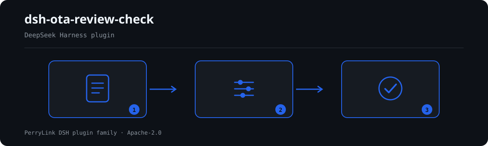

# dsh-ota-review-check — 在线点评回复台账核对

[English](README.md) · [简体中文](README-zh.md) · [Español](README-es.md) · [Português](README-pt.md) · [हिन्दी](README-hi.md)

<!-- topblock:v1 -->
> **这是什么**　在线点评回复台账核对。输出一份「哪一行、哪一栏、差什么」的清单。
> **给谁用**　酒店/门店运营、客服；不用懂命令行。
> **你交什么**　这项核对用到的原始材料（表格、清单或文书）；不改原件。Excel 可先转成 JSON/YAML，对话里也能代转。
> **它不做什么**　不判合规、不认定责任、不替代审核人；只列材料内部能逐条指认的差异。
> **怎么开始**　在 WorkBuddy / 扣子搜「职业文档核对全集」（总包，本检查是其中一项；上架以商城为准）；或命令行：
> `dsh plugin --profile <name> add dsh-ota-review-check`
<!-- /topblock:v1 -->

[](https://dsh.market/)
[](https://dshfind.com/en/plugins/PerryLink/dsh-ota-review-check?ref=badge)

`dsh-ota-review-check` 读取一份在线点评回复台账——门店表头加每条点评一行——核对这份台账自身的齐备与闭环：每条点评是否记录了内容或评分、已回复的点评是否记录了回复日期与回复人、回复是否早于点评、未回复的点评是否落在台账自己写明的回复期限之内、问题类型是否取自本机构自己的分类口径、点评编号是否唯一。

## Install

```sh
dsh plugin --profile <name> add dsh-ota-review-check
dsh --profile <name> --dump-config | grep 'dsh-ota-review-check'
```

## 实际输出长什么样



*工作流概览：文档 → 规则包 → 核对结果。下面的示例使用实际命令面。*


本插件对自己 `OT-001` 测试夹具的**真实输出**，不是示意图。规则库不伪造引文，因此每条发现都会同时写明所引条款，以及该条款原文本次未取得。

## 它回答什么问题

### 示例

下表是示例集：第一行是详细走查，其余行是简短案例。


#### 详细输出

**工具** `ota_review_check`

**输入**

~~~json
{"hotel":"某某门店","period":"2026 年 3 月","platform":"某某平台","rows":[{"序号":"1","渠道":"某某平台","房型":"标准大床房","入住日期":"2026-03-01","总分":"","评分制":"5 分制","点评内容":"","是否回复":"是"}]}
~~~
 
**输出**

~~~json
{
  "id": "dsh-ota-review-check.OT-001.de09b5a6",
  "ruleId": "OT-001",
  "severity": "warn",
  "locator": {
    "row": 1,
    "field": "content"
  },
  "found": "第 1 行 content、score 都为空",
  "expected": "content、score 至少应填写一项"
}
~~~

*来源 `dsh-ota-review-check/tests/fixtures/OT-001/OT-001-unsafe.json`*

| 你会问 | 它怎么答 |
|---|---|
| 某行「点评内容」与「评分」都没有填，会报出什么？ | `OT-001` 会报出该行：每条点评至少要记录 `content` 与 `score` 中的一项。它只核对是否至少填了一项，不判断点评内容是否属实、是否属于恶意评价。 |
| 某行标了「已回复」，但「回复日期」与「回复人」两栏都空着，会报出什么？ | 凡是「是否回复」取值为配置的 `conditionValues`（`是`、`Y`、`yes`、`true`、`已回复`、`√`）之一的行，`OT-002` 报出缺少 `repliedAt`；`OT-005` 要求凡是带「回复人」列的行都填 `replier`，因此标了「未回复」而回复人栏为空的行同样会被报出。两条都只核对字段是否填写，不判断回复是否及时、是否恰当。 |
| 台账的「回复期限」一栏整列空着，检查会自己按 24 小时或 48 小时算吗？ | 不会。本插件不内置任何平台的回复时限：没有 `replyDeadline` 就没有可比较的对象，`OT-003` 会出现在 `skipped` 中，而不是假定任何天数。它只在台账自己写了回复期限时把点评日期与该期限相比；命中只表示台账里的期限与点评日期对不上，不表示已经违反平台规则。 |
| 「回复日期」写成 2026年3月15日，而且早于「入住日期」，会查出什么？ | `OT-004` 比较 `checkIn` 与 `repliedAt`，回复日期早于点评日期即报出，同一天视为不晚于；解析不了的日期会在该行单独报出，不会静默跳过——例如 `2026年3月15日`，能解析的写法只有 `2026-03-15`、`2026/3/15`、`2026.3.15` 及可选的时分。它只比较两个日期，不判断回复是否及时。 |
| 「问题类型」栏填的是我们自己的说法，为什么报告说这条没执行？ | `OT-006` 的 `values` 出厂为空，即「未配置」，因此它在 `skipped` 中如实说明原因，而不硬编码任何分类体系：分类口径（「卫生」「服务态度」「设施设备」「价格」「噪音」「预订与入住」，或本机构自己的取值）由本机构规定。配置之后，它只报出不在册的取值，不判断该点评应归入哪一类——归类是运营人员的判断。 |
| 同一个「点评编号」在台账里出现了两次，会怎么报？ | `OT-007` 会把后一行报为与前一行重复，比较时忽略空白字符。编号唯一是「每条点评只被登记一次」的前提，因此本条为 `warn`；它只核对唯一性，不判断两行中哪一行是抄错的那条。台账没有 `reviewNo` 列时，本条进入 `skipped`，而不是静默通过。 |

## 依据的标准

| 文件 | 文号 | 引用它的规则 |
|---|---|---|
| 《中华人民共和国电子商务法》与平台服务规则 | 现行版本与条号本次未核实 | OT-001 |
| 《中华人民共和国电子商务法》 | 现行版本与条号本次未核实 | OT-002, OT-004, OT-005, OT-007 |
| 各在线旅游平台服务规则（本机构配置） | 无统一标准（本条依据为本机构配置的回复时限） | OT-003 |
| 本机构点评管理办法（本机构配置） | 无统一标准（本条依据为本机构分类口径） | OT-006 |

**边界（中文译文，以英文原文为准）：** 本插件核对一份 **在线点评回复台账** 在台账层面可以要求到的闭环——每条点评是否记录了内容或评分，回复是否带有日期与回复人，回复是否不早于点评，未回复的点评是否落在台账写明的回复期限之内，问题类型是否取自你的取值口径，以及点评编号是否唯一。它**不**判定回复是否恰当、点评是否应当申诉或删除、差评是否恶意，或服务质量是否可以接受。

> ### ⚠️ 法律在此要求什么——以及不要求什么（以英文原文为准）
>
> **《中华人民共和国电子商务法》已取得并逐字阅读**（见 `rules/evidence/clause-verification.md`），而这项核对**推翻了本规则库早先的表述框架**。第三十九条把义务加在**平台经营者**身上，而不是商家身上：
>
> > 电子商务平台经营者应当建立健全信用评价制度，公示信用评价规则，为消费者提供对平台内销售的商品或者提供的服务进行评价的途径。
> > 电子商务平台经营者**不得删除**消费者对其平台内销售的商品或者提供的服务的评价。
>
> **没有任何条款要求商家回复评价。** 因此，本插件核对的是一项来自**各平台自身的服务规则和你所在机构的管理政策**的义务——绝不是来自法律——现在规则库和本 README 都不再把回复描述为法律义务。第十七条（不得虚构评价）和第二十条（按承诺交付）涉及的是其他事项，因此刻意**不予**引用。
>
> **每一条 `excerpt` 仍然写着「本次未取得」，每条规则也仍然保持在 `warn` 或 `info`**——平台服务规则本身并未取得，而该法规范的是平台而非商家，因此把某条规则提升为 `direct`，只会把台账的缺口包装成违法。
>
> **本插件不内置任何平台的回复时限。** `OT-003` 把点评日期与**写在台账自身的 回复期限 列中的**截止日期相比，并在该列为空时把自己记入 `skipped`。一项发现说的是「截止日期与点评日期不一致」，而绝不是「你违反了平台规则」。类别词表同样因此出厂为**空**。此外，本插件**不读取情感**：它只核对低分评价是否记录了整改，而什么算低分由你的配置决定，不是它的判断。

## Compatibility

| 项目 | 状态 |
|---|---|
| Harness | 对等版本范围 `>=0.1.2-rc.1 <0.2.0 \|\| >=0.2.0-0 <0.3.0` —— 已实测同时接受 `0.2.0-rc.2` 与 `0.2.1-rc.2`。**已声明 `engines.dsh`**：0.2.1 起由宿主单独裁决，范围为 `>=0.2.1-0 <0.3.0` |
| Node | `^22.19.0 || >=24.0.0` |
| 平台 | 全平台（纯 ESM；无原生代码、无联网、不调用模型） |
| 工具模式 | `native` / `ptc` 均可；批量校验整个目录时建议 `ptc`，schema 成本只付一次 |

## What it does

规则表、字段说明与行为细节见 [README.md](README.md#what-it-does)（英文主版本）。本插件只列出材料与所引条款之间的字面差异，并对无法执行的检查在 `skipped` 中逐项说明。

## Configuration

全部可调参数都在 `src/config.ts` 的 Schemastery schema 中，只改 `cordis.yml` 即可生效，无需改代码；逐条阈值在 `rules/` 下的规则库文件里。

| 键 | 类型 | 默认值 | 说明 |
|---|---|---|---|
| `rulesFile` | string | `rules/ota-review-check.yaml` | 规则库文件路径，相对插件包根目录 |
| `disabledRules` | string[] | `[]` | 要停用的规则 id 列表；每条都会出现在 `skipped` 中 |
| `onlyRules` | string[] | `[]` | 只执行这些规则 id；留空表示执行全部规则 |
| `skipNotes` | string | `""` | 附加到每条 `skipped` 说明后的备注 |
| `timeoutMs` | number | `120000` | 工具协作式超时预算（毫秒） |

## Material format

支持 JSON 与 YAML。完整字段示例见 [README.md](README.md#material-format)（英文主版本）。字段在读取层是可选的，由检查引擎校验，因此部分导出的材料会产生"缺项"类差异，而不是让程序崩溃。

## Rule sources

规则数据与代码分离，每条规则都带文件名、文号、按原文自身编号体系的条款号、逐字摘录与来源地址。加载期强制：摘录必须是真实引文且不少于八个字符；依据仅为原则性条款（`kind: derived-from-principle`，严重级上限 `warn`）或本机构配置（`kind: institutional-configuration`，上限 `info`）的检查不得标为 `error`。夸大依据的规则库会在加载期失败，而不会产出一份看起来很有底气的报告。

核验中确认的边界与"刻意没有作出的结论"见 [README.md](README.md#rule-sources)（英文主版本）与随包的 `rules/evidence/` 目录。

## Troubleshooting

- **插件装上了但工具不出现**：确认 `main` 指向 `lib/index.mjs` 且 `pnpm run build` 已生成该文件；`main` 写错会让加载器静默跳过该条目。
- **`dsh plugin add` 报版本不兼容**：peer 范围覆盖 `0.1.x` 与 `0.2.x`；若运行时在其之外，可显式豁免：`dsh plugin --profile <name> allow-version <包名@版本> --dsh-version <runtime> --accept-risk`
- **某条规则没有执行**：查看 `skipped` 数组，其中写明了规则 id 与原因。
- **`check` 报 `manifest-peers` 失败**：静态检查器比对的是一份早于 0.2 世代的硬编码 peer 范围；安装期的 peer 校验以运行时为准。这是 `dsh-plugin-dev` 的已知上游问题。
- **时间看起来偏移**：全部计算都是对输入字符串做墙上时钟运算，不做时区换算。

## Development

```sh
pnpm install
pnpm run typecheck
pnpm test
pnpm run build
node ../scripts/sync-shared.mjs dsh-ota-review-check
```

第 4 项把 `../_shared` 的共享件同步进 `src/shared/`；每次改动共享件后都要重跑。

## PerryLink DSH Plugin Family

完整清单（62 个核查器 + 通用插件）见 [按材料选核查器](https://perrylink.github.io/zh/checkers/choose/)；本仓只是其中一个。

## License

[Apache License 2.0](LICENSE) © 2026 dsh-ota-review-check contributors.
