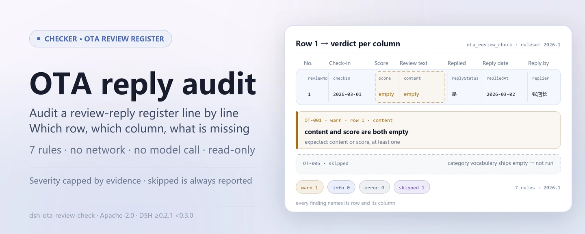
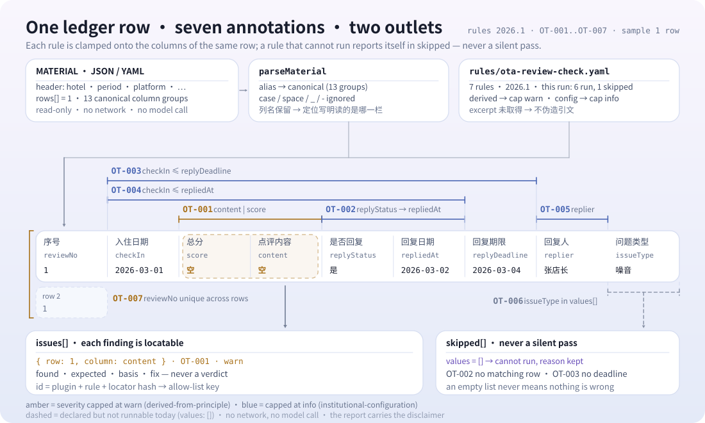

<div align="center">

<picture>
  <source media="(prefers-color-scheme: dark)" srcset="docs/assets/dsh-ota-review-check-hero-en-dark.webp">
  
</picture>

# dsh-ota-review-check

**Check an online review-and-reply register line by line — which row, which column, what is missing.**

A DeepSeek Harness checker for hotel and store operations and support: hand it one review-and-reply register (property header plus one row per review) and get back a list of differences you can point at line by line; it never modifies the original, never goes online, never calls a model, and never issues a compliance verdict.

[Install](#three-step-setup) · [Configuration](#configuration) · [FAQ](#faq) · [简体中文](README.md) · [English](README.en.md)

[](LICENSE)
[](#compatibility)
[](https://www.npmjs.com/package/dsh-ota-review-check)
[](https://github.com/PerryLink/dsh-ota-review-check/actions/workflows/ci.yml)
[](#compatibility)

[](https://github.com/PerryLink/dsh-ota-review-check/stargazers)
[](https://www.npmjs.com/package/dsh-ota-review-check)
[](https://dshfind.com/plugins/PerryLink/dsh-ota-review-check?ref=badge)
[](https://securityscorecards.dev/viewer/?uri=github.com/PerryLink/dsh-ota-review-check)
[](https://dsh.market/)
[](https://gitee.com/perrylink/dsh-ota-review-check)

```sh
dsh plugin --profile <name> add dsh-ota-review-check
```

</div>

<sub>Community plugin, not affiliated with DeepSeek. Canonical repository: <https://github.com/PerryLink/dsh-ota-review-check> (Gitee is a mirror).</sub>

## What it is

`dsh-ota-review-check` reads one online review-and-reply register — the property header plus one row per review — and checks that register's own completeness and closed loop: that each review records its content or a score, that a replied review carries a reply date and a reply author, that the reply does not precede the review, that an unreplied review falls inside the deadline the register itself states, that the problem category comes from your institution's own vocabulary, and that review numbers are unique.

It lists only the differences the material itself can be held to, line by line; every check that could not run is reported in `skipped` with its reason. The rule pack never fabricates citations: each finding names the clause it rests on and says that the clause text was not obtained in this pass.

<picture>
  <source media="(prefers-color-scheme: dark)" srcset="docs/assets/dsh-ota-review-check-flow-v5-dark.svg">
  
</picture>

## Three-step setup

1. **Install** (requires DSH `>=0.2.1-0 <0.3.0` and Node `^22.19.0 || >=24.0.0`):

   ```sh
   dsh plugin --profile <name> add dsh-ota-review-check
   ```

2. **Minimal config** (the defaults work; the rule pack ships with the package and the path is relative to the package root):

   ```yaml
   - insert:
       - id: dsh-ota-review-check
         name: dsh-ota-review-check
         config:
           rulesFile: rules/ota-review-check.yaml
   ```

3. **Verify it mounts**:

   ```sh
   dsh --profile <name> --dump-config | grep 'dsh-ota-review-check'
   ```

The repository ships a reproducible quickstart (run `pnpm install && pnpm run build` first, because the sample loads the plugin from `lib/index.mjs`):

```sh
node samples/quickstart/run.mjs --check
```

Expected: `issueCount: 1` (`warn` 1, `error` 0, `info` 0) and `skippedCount: 1`; the material is `samples/quickstart/input/OT-001-unsafe.json` and the expected result is `samples/quickstart/expected/result.json`.

**Uninstall**: `dsh plugin --profile <name> remove dsh-ota-review-check` (or delete the row from the profile patch).

## Core capabilities

The plugin registers one tool, `ota_review_check`: it reads a review-and-reply register (property header plus one row per review), applies a versioned rule pack (`rules/ota-review-check.yaml`), and returns a report. It checks the register's own completeness and closed loop, and reports every check that could not run in `skipped` with its reason.

### Rule table

| Rule | Check | Severity | Basis kind |
|---|---|---|---|
| `OT-001` | the review records content or a score | warn | principle |
| `OT-002` | a replied review carries a reply date | info | local |
| `OT-003` | the recorded reply deadline does not contradict the review date | info | local |
| `OT-004` | the reply does not precede the review | info | local |
| `OT-005` | a replied review names the replier | info | local |
| `OT-006` | the problem category comes from your vocabulary (off by default) | info | local |
| `OT-007` | review numbers are unique | warn | principle |

### Examples

These are the plugin's real output over its own `OT-001` test fixture, not an illustration.

#### Detailed output

**Tool** `ota_review_check`

**Input**

~~~json
{"hotel":"某某门店","period":"2026 年 3 月","platform":"某某平台","rows":[{"序号":"1","渠道":"某某平台","房型":"标准大床房","入住日期":"2026-03-01","总分":"","评分制":"5 分制","点评内容":"","是否回复":"是"}]}
~~~

**Output**

~~~json
{
  "id": "dsh-ota-review-check.OT-001.de09b5a6",
  "ruleId": "OT-001",
  "severity": "warn",
  "locator": {
    "row": 1,
    "field": "content"
  },
  "found": "第 1 行 content、score 都为空",
  "expected": "content、score 至少应填写一项"
}
~~~

*Observed from `dsh-ota-review-check/tests/fixtures/OT-001/OT-001-unsafe.json`*

| You ask | What it answers |
|---|---|
| A row has neither review content nor a score filled in. What is reported? | `OT-001` reports that row: a review must record at least one of the two fields, `content` or `score`. It checks only that one of them is filled; it does not judge whether the review's content is truthful or whether the review is a malicious one. |
| A row is marked as replied (its reply-status cell holds one of the configured replied values), but the reply-date and replier cells are blank. What is reported? | `OT-002` reports the missing `repliedAt` on any row whose `replyStatus` holds one of the configured conditions, and `OT-005` requires `replier` to be filled on every row that carries the replier column, so a blank cell is reported even on a row marked as not replied. Both check only that the cell is filled: neither says whether the reply was timely or whether it was appropriate. |
| Our register has the reply-deadline column empty throughout. Does the check assume a 24- or 48-hour window? | No. The plugin builds in no platform's reply window: with no `replyDeadline` value there is nothing to compare, and `OT-003` appears in `skipped` instead of assuming any number of days. It runs only against the deadline the register itself writes in its reply-deadline column, and a hit means that deadline and the review date disagree — not that a platform rule was breached. |
| The reply date is written in a local year-month-day form and is earlier than the check-in date. What is caught? | `OT-004` compares `checkIn` with `repliedAt` and reports a reply date earlier than the review date, counting the same day as not later; a date it cannot parse — a Chinese year-month-day form, for instance, since only `2026-03-15`, `2026/3/15` and `2026.3.15` with an optional time parse — is reported on that row rather than passed over in silence. It compares the two dates only and does not judge whether the reply was timely. |
| We filled the issue-type column with our own words. Why does the report say the check did not run? | `OT-006` ships with its `values` list empty, meaning not configured, so it states itself in `skipped` with that reason rather than inventing a category system: the vocabulary (hygiene, service attitude, facilities, price, noise, booking and check-in, or your own) is your institution's. Once you list it, the rule reports any value not on the list and checks nothing further — which category a review belongs in stays the operator's judgement. |
| The same review number appears twice in the register. What is reported? | `OT-007` reports the second row as a duplicate of the first, comparing `reviewNo` while ignoring whitespace. Uniqueness is the premise of each review being registered once, which is why the rule sits at `warn`; it checks uniqueness only and does not say which of the two rows is the copy. With no `reviewNo` column the rule states itself in `skipped` rather than passing in silence. |

## Standards & legal boundary

| Document | Number | Cited by rules |
|---|---|---|
| E-commerce Law of the People's Republic of China and platform service rules | Current version and article numbers not verified in this pass | OT-001 |
| E-commerce Law of the People's Republic of China | Current version and article numbers not verified in this pass | OT-002, OT-004, OT-005, OT-007 |
| Online travel platform service rules (institution configuration) | No unified standard (this row rests on the reply deadline configured by your institution) | OT-003 |
| Your institution's review-management policy (institution configuration) | No unified standard (this row rests on your institution's category vocabulary) | OT-006 |

**Boundary:** this plugin checks an **online review-and-reply register** for the closed loop a register can be held to — that each review records its content or score, that a reply carries a date and a reply author, that the reply does not precede the review, that an unreplied review falls inside the deadline the register states, that the problem category comes from your vocabulary, and that review numbers are unique. It does **not** decide whether a reply was appropriate, whether a review should be appealed or removed, whether a bad review is malicious, or whether service quality is acceptable.

> ### ⚠️ What the law does — and does not — require here
>
> **The E-commerce Law of the People's Republic of China was obtained and read verbatim** (see `rules/evidence/clause-verification.md`), and the check **overturned this pack's earlier framing**. Article 39 puts the duty on the **platform operator**, not the merchant.

Article 39 (verbatim, Chinese original):

```text
电子商务平台经营者应当建立健全信用评价制度，公示信用评价规则，为消费者提供对平台内销售的商品或者提供的服务进行评价的途径。
电子商务平台经营者不得删除消费者对其平台内销售的商品或者提供的服务的评价。
```

> **There is no provision requiring a merchant to reply to a review.** So this plugin checks a duty that comes from **each platform's own service rules and your institution's management policy** — never from the statute — and neither the rule pack nor this README now describes replying as a legal obligation. Articles 17 (no fabricated reviews) and 20 (deliver as promised) concern other things and are deliberately **not** cited.
>
> **Every `excerpt` still says the clause text was not obtained, and every rule remains `warn` or `info`** — the platform service rules themselves were not obtained, and the statute governs the platform rather than the merchant, so raising a rule to `direct` would dress a register gap up as a breach of law.
>
> **The plugin builds in no platform's reply window.** `OT-003` compares the review date against the deadline **written in the register's own reply-deadline column**, and with that column empty it reports itself in `skipped`. A finding says "the deadline and the review date disagree", never "you breached the platform's rules". The category vocabulary ships **empty** for the same reason. And the plugin **does not read sentiment or judge whether a reply was appropriate**; which review needs which remedy stays the operator's call.

## Configuration

All tunables live in the Schemastery schema in `src/config.ts`, so they change from `cordis.yml` without editing code; per-rule thresholds live in the rule pack under `rules/`.

| Key | Type | Default | Description |
|---|---|---|---|
| `rulesFile` | string | `rules/ota-review-check.yaml` | Rule-pack path, relative to the package root |
| `disabledRules` | string[] | `[]` | Rule ids to stop running; each appears in `skipped` |
| `onlyRules` | string[] | `[]` | Run only these rule ids; empty runs every rule |
| `skipNotes` | string | `""` | Note appended to every `skipped` reason |
| `timeoutMs` | number | `120000` | Cooperative tool timeout budget |

Rule-level parameters worth knowing:

- `OT-002` `conditionValues` — the reply-status values that mean "replied" (defaults below).
- `OT-003` reads the register's reply-deadline / `replyDeadline` column. The plugin never derives a deadline from a day count, because windows vary by platform.
- `OT-006` `values` — your problem categories, e.g. hygiene, service attitude, facilities, price, noise, booking and check-in. Empty means no check.

Default replied values for `OT-002`:

```text
是, Y, yes, true, 已回复, √
```

Example override in your profile patch:

```yaml
- insert:
    - id: dsh-ota-review-check
      name: dsh-ota-review-check
      config:
        disabledRules: [OT-007]
        skipNotes: 2026 review policy of this property
        timeoutMs: 60000
```

## Material format

The tool accepts JSON or YAML:

```yaml
hotel: 某某门店
period: 2026 年 3 月
platform: 某某平台
rows:
  - { 序号: '1', 渠道: 某某平台, 房型: 标准大床房, 入住日期: 2026-03-01,
      总分: '4.5', 评分制: 5 分制, 点评内容: 位置方便，前台服务热情，房间隔音一般。,
      是否回复: 是, 回复日期: 2026-03-02, 回复期限: 2026-03-04, 回复人: 张店长,
      问题类型: 噪音, 是否整改: 是 }
```

Column names are matched case-insensitively and ignoring spaces, underscores and hyphens; the register's own column names are kept, so a finding names the column it read. Fields are optional at the reading layer and validated by the check engine, so a partial export produces "missing item" differences instead of crashing.

## Rule sources

Rule data lives in `rules/ota-review-check.yaml`, separate from code: replacing that file switches the rule set without touching TypeScript. The pack's header states the citation gap in full, and each rule's `note` repeats the part that matters for that rule.

The load-time guard requires `excerpt` to be a real quotation of at least eight characters, and forbids a check based only on a principle (`kind: derived-from-principle`, capped at `warn`) or on institutional configuration (`kind: institutional-configuration`, capped at `info`) from being marked `error`. Because that guard cannot tell a quotation from a description, this pack leans on the header, the per-rule notes and a test that asserts every `excerpt` admits the gap; `pnpm run check:citations` then re-checks the excerpts against `rules/evidence/` and the shrink-only `rules/citations-baseline.json`. A pack that overstates its basis fails at load rather than producing a confident-looking report.

## FAQ

<details>
<summary>Is the register uploaded, written to disk, or sent to a model?</summary>

No. The plugin reads only the material you pass to `ota_review_check` through `file` or `material`, parses it locally and applies the rules; `dsh.demo` declares `network: false` and `writes: []`, there is no network request and no model call in the code, and the report is returned only as the tool result.

</details>

<details>
<summary>Does a report with no findings mean the register is compliant?</summary>

No. It lists only the differences the material itself can be held to; it makes no compliance finding, assigns no liability, and does not replace the reviewer. Checks that could not run are listed in `skipped`, and every `excerpt` states that the clause text was not obtained. An empty report means "no difference was reportable in this run", not "nothing is wrong".

</details>

<details>
<summary>Why do `OT-003`, `OT-006` or `OT-007` appear in `skipped`?</summary>

The reason is written on each `skipped` entry: `OT-003` needs a value in the register's `replyDeadline` column and assumes no day count without one; `OT-006` ships its `values` list empty (no category vocabulary configured); `OT-007` needs a `reviewNo` column and does not pass silently without it. Rules disabled through `disabledRules` or excluded by `onlyRules` also land in `skipped`, carrying the `skipNotes` note.

</details>

<details>
<summary>Why are findings only `warn` or `info`, never `error`?</summary>

Severity follows the evidence: `derived-from-principle` is capped at `warn`, `institutional-configuration` at `info`; the platform service rules themselves were not obtained verbatim, and the statute governs the platform rather than the merchant, so promoting any rule to `direct`/`error` would dress a register gap up as a breach of law. A load-time guard rejects a pack that overstates its basis.

</details>

<details>
<summary>Why is a date reported, or why do times look shifted?</summary>

All arithmetic is wall-clock arithmetic over the supplied strings — no timezone conversion. The only parseable forms are `2026-03-15`, `2026/3/15` and `2026.3.15` with an optional time; a date it cannot parse (a Chinese year-month-day form, for example) is reported on that row rather than skipped silently. The same day counts as not later.

</details>

<details>
<summary>A finding looks wrong. How do I judge it?</summary>

- `OT-003` fires but the reply was in time: the register's reply-deadline cell disagrees with the review date — check those two cells first.
- `OT-006` fires on a category you consider fine: the value is not in your configured `values`; widen the list or correct the cell — the plugin does not classify reviews itself.
- `OT-007` fires twice on one review: one review may legitimately be handled twice (a follow-up reply); distinguish the rows rather than reusing the number.

</details>

<details>
<summary>The tool never appears after install, the version is refused, or `check` reports `manifest-peers` as failed. What now?</summary>

Confirm `main` resolves to `lib/index.mjs` and that `pnpm run build` produced it; a wrong `main` makes the loader skip the entry silently. If `dsh plugin add` refuses the package as incompatible, the peer range covers `0.1.x` and `0.2.x`; outside it, grant an explicit exemption: `dsh plugin --profile <name> allow-version dsh-ota-review-check@0.1.0 --dsh-version <runtime> --accept-risk`. `manifest-peers` is a known upstream issue in `dsh-plugin-dev`: the static checker compares against a hard-coded peer range that predates the 0.2 line, while the runtime enforces peer compatibility at install time.

</details>

## Security boundaries

- **Differences only, never a verdict.** The report does not pronounce on compliance, liability or correctness; the wording guard in `src/shared` enforces this and the report always carries the disclaimer.
- **No fabricated citations.** Every rule carries `document` / `number` / `clause` / `excerpt` / `kind` / `source`, and `excerpt` must be a verbatim quotation. When the text is unavailable the pack says so and drops the basis to principle or institutional configuration, capping severity accordingly.
- **An empty result cannot be read as "nothing is wrong".** Every check that could not run is listed in `skipped` with its reason; a rule whose required list is unset reports itself in `skipped` rather than passing silently.
- **Read-only material, no network, no model call.** The plugin reads only the material you hand it; `dsh.demo` declares `network: false` and `writes: []`, and there is no network request or model invocation.
- **Registrations are effects.** Tool registration goes through `ctx.tools.register` and returns a disposer, so unloading or hot-reloading the plugin removes it.
- **No built-in platform window or category system.** Reply windows and problem categories come from your configuration and the register itself; the plugin does not speak for a platform or an institution.

## Known limitations

- **The rule pack currently has seven rules.** The header of `rules/ota-review-check.yaml` lists "does a bad review record a rectification" and "are template placeholders left behind" among the checks, but no rule implements them (`OT-001`…`OT-007` contains neither); those two remain manual review, and this README does not count them as delivered capabilities.
- **No platform reply window is built in.** `OT-003` compares the review date with the deadline only when the register records `replyDeadline`; an empty column lands in `skipped` instead of assuming 24 or 48 hours.
- **The category vocabulary ships empty.** `OT-006` does not run until `values` is configured; the vocabulary (hygiene, service attitude, facilities, price, noise, booking and check-in, or your own) is your institution's.
- **Date formats are limited.** Only `2026-03-15`, `2026/3/15` and `2026.3.15` with an optional time parse; a Chinese year-month-day form is reported on that row. All date arithmetic is wall-clock arithmetic over the supplied strings, with no timezone conversion.
- **Structured fields only, no sentiment reading.** It does not judge whether review content is truthful or malicious, whether a reply was appropriate, or whether service quality is acceptable.
- **Clause text was not obtained.** The platform service rules were not obtained verbatim in this pass, so every `excerpt` says so and every rule stays at `warn` or `info`; `rules/citations-baseline.json` can only shrink, and a new citation must have a source first.
- **A build artifact is required.** The plugin loads from `lib/index.mjs`; a wrong `main` or a skipped `pnpm run build` makes the loader skip the entry silently.
- **`manifest-peers` is a known upstream issue.** `dsh-plugin-dev`'s static checker compares against a hard-coded peer range that predates the 0.2 line; peer compatibility at install time is decided by the runtime.

## Interoperability with other DSH plugins

These are facts checkable in the code and package declarations (this repository does not run runtime interoperability tests against other plugins):

- **One tool only.** The tool id is `ota_review_check`, defined as `TOOL_NAME` in `src/index.ts`; no bare tool name owned by another plugin is registered.
- **No service key.** The plugin exports no service key, so it cannot collide on one.
- **No client slot and no `webServer` prefix.** There is no `client/` directory and `has_client` is false; this is a pure host-side plugin.
- **The bundle patch only `insert`s its own row.** `cordis.patch.yml` never overrides a built-in row's `config`.
- **No global mutation.** The code does not patch prototypes, rewrite `process.env`, or replace the global fetch dispatcher; it makes no network request and calls no model.
- **Registrations are Cordis effects.** Tool registration returns a disposer, so stopping or hot-reloading removes it and leaves no global state behind.

## Compatibility

| Surface | Status |
|---|---|
| Harness | Peer range `>=0.1.2-rc.1 <0.2.0 \|\| >=0.2.0-0 <0.3.0` — verified to accept both `0.2.0-rc.2` and `0.2.1-rc.2`. `engines.dsh` is declared as `>=0.2.1-0 <0.3.0` and is enforced by the host since 0.2.1 |
| Node | `^22.19.0 \|\| >=24.0.0` |
| Platforms | All (plain ESM; no native code, no network, no model call) |
| Tool mode | Works in `native` and `ptc`; for a whole directory use `ptc` |

## Ecosystem & quality

- [Gitee mirror](https://gitee.com/perrylink/dsh-ota-review-check) (sync mirror; GitHub is canonical)
- [dshfind plugin page](https://dshfind.com/plugins/PerryLink/dsh-ota-review-check) (installs and ranking)
- [OpenSSF Scorecard report](https://securityscorecards.dev/viewer/?uri=github.com/PerryLink/dsh-ota-review-check) (driven by [.github/workflows/scorecard.yml](.github/workflows/scorecard.yml))
- [DSH Market](https://dsh.market/) (listed)
- **WorkBuddy / Coze channel**: search for "Professional Document Check Suite" in the marketplace (the full set; this check is one part; availability as listed)
- [Choose a checker by material](https://perrylink.github.io/zh/checkers/choose/) (ecosystem index; this repository is one of them)

## Development

```sh
pnpm install
pnpm run typecheck   # tsc --noEmit
pnpm test            # vitest: the shared table-plugin suite plus paired fixtures
pnpm run build       # tsdown -> lib/index.mjs + lib/index.d.mts
pnpm run verify:self-contained
pnpm run check:lockfile
pnpm run check:citations
pnpm run check:readmes
node ../scripts/sync-shared.mjs dsh-ota-review-check
pnpm pack
```

The plugin is **data-driven**: `src/model.ts` declares the table shape, the shared kit supplies the reader and the check engine, and the rule pack declares every check. `node ../scripts/sync-shared.mjs dsh-ota-review-check` copies the shared kit from `../_shared` into `src/shared/`; re-run it after every shared change.

The README images are generated programmatically by [`scripts/gen-readme-assets.py`](scripts/gen-readme-assets.py) (Python + Pillow) and are safe to re-run:

```sh
python scripts/gen-readme-assets.py
```

Topics: `deepseek-harness`, `dsh`, `dsh-plugin`, `cordis`, `ota`, `review`

## Family & thanks

This project is part of the DeepSeek Harness plugin family from [PerryLink](https://github.com/PerryLink) (all Apache-2.0). If it is useful, **a star helps the next person find it** — nothing is gated behind it.

- [@PerryLink](https://github.com/PerryLink) — creator and maintainer: the `OT-001`…`OT-007` rule pack, the clause-verification record under `rules/evidence/`, the shared check-engine integration, and the five-language docs.

<details>
<summary>Expand all plugins</summary>

| Plugin | Status |
|---|---|
| **[dsh-aqua-input-check](https://github.com/PerryLink/dsh-aqua-input-check)** |  |
| **[dsh-archive-check](https://github.com/PerryLink/dsh-archive-check)** |  |
| **[dsh-auto-review](https://github.com/PerryLink/dsh-auto-review)** |  |
| **[dsh-autotier](https://github.com/PerryLink/dsh-autotier)** | 🧊 FROZEN — see the repo README |
| **[dsh-bid-ca-precheck](https://github.com/PerryLink/dsh-bid-ca-precheck)** |  |
| **[dsh-bid-qual-check](https://github.com/PerryLink/dsh-bid-qual-check)** |  |
| **[dsh-cert-mcp](https://github.com/PerryLink/dsh-cert-mcp)** | 🧊 FROZEN — see the repo README |
| **[dsh-checkpoint-rewind](https://github.com/PerryLink/dsh-checkpoint-rewind)** |  |
| **[dsh-click](https://github.com/PerryLink/dsh-click)** |  |
| **[dsh-composer-history](https://github.com/PerryLink/dsh-composer-history)** |  |
| **[dsh-contract-stance](https://github.com/PerryLink/dsh-contract-stance)** |  |
| **[dsh-customs-doc-check](https://github.com/PerryLink/dsh-customs-doc-check)** |  |
| **[dsh-data-quality](https://github.com/PerryLink/dsh-data-quality)** | 🧊 FROZEN — see the repo README |
| **[dsh-demurrage-ledger](https://github.com/PerryLink/dsh-demurrage-ledger)** |  |
| **[dsh-doublecheck](https://github.com/PerryLink/dsh-doublecheck)** |  |
| **[dsh-drill-script-check](https://github.com/PerryLink/dsh-drill-script-check)** |  |
| **[dsh-eia-guide-check](https://github.com/PerryLink/dsh-eia-guide-check)** |  |
| **[dsh-emergency-plan](https://github.com/PerryLink/dsh-emergency-plan)** |  |
| **[dsh-essay-rubric-check](https://github.com/PerryLink/dsh-essay-rubric-check)** |  |
| **[dsh-evidence-check](https://github.com/PerryLink/dsh-evidence-check)** |  |
| **[dsh-export-ctl-check](https://github.com/PerryLink/dsh-export-ctl-check)** |  |
| **[dsh-fast](https://github.com/PerryLink/dsh-fast)** |  |
| **[dsh-fmea-table-check](https://github.com/PerryLink/dsh-fmea-table-check)** |  |
| **[dsh-forecast-penalty](https://github.com/PerryLink/dsh-forecast-penalty)** |  |
| **[dsh-fund-research](https://github.com/PerryLink/dsh-fund-research)** |  |
| **[dsh-github](https://github.com/PerryLink/dsh-github)** |  |
| **[dsh-gongwen-flow-check](https://github.com/PerryLink/dsh-gongwen-flow-check)** |  |
| **[dsh-gongwen-word-check](https://github.com/PerryLink/dsh-gongwen-word-check)** |  |
| **[dsh-guard-plan-qc](https://github.com/PerryLink/dsh-guard-plan-qc)** |  |
| **[dsh-hazchem-check](https://github.com/PerryLink/dsh-hazchem-check)** |  |
| **[dsh-hazplan-check](https://github.com/PerryLink/dsh-hazplan-check)** |  |
| **[dsh-hidden-risk-map](https://github.com/PerryLink/dsh-hidden-risk-map)** |  |
| **[dsh-hs-classify](https://github.com/PerryLink/dsh-hs-classify)** |  |
| **[dsh-icd-rule-check](https://github.com/PerryLink/dsh-icd-rule-check)** |  |
| **[dsh-industry-research](https://github.com/PerryLink/dsh-industry-research)** |  |
| **[dsh-lawcite-adapter](https://github.com/PerryLink/dsh-lawcite-adapter)** |  |
| **[dsh-laya](https://github.com/PerryLink/dsh-laya)** |  |
| **[dsh-lc-doc-check](https://github.com/PerryLink/dsh-lc-doc-check)** |  |
| **[dsh-learning-gap-check](https://github.com/PerryLink/dsh-learning-gap-check)** |  |
| **[dsh-library](https://github.com/PerryLink/dsh-library)** |  |
| **[dsh-local-ai](https://github.com/PerryLink/dsh-local-ai)** |  |
| **[dsh-lsp-actions](https://github.com/PerryLink/dsh-lsp-actions)** |  |
| **[dsh-mask](https://github.com/PerryLink/dsh-mask)** |  |
| **[dsh-mcp-panel](https://github.com/PerryLink/dsh-mcp-panel)** |  |
| **[dsh-medrec-qc](https://github.com/PerryLink/dsh-medrec-qc)** |  |
| **[dsh-memento](https://github.com/PerryLink/dsh-memento)** | 🧊 FROZEN — see the repo README |
| **[dsh-nsfc-form-check](https://github.com/PerryLink/dsh-nsfc-form-check)** |  |
| **[dsh-nurse-record-check](https://github.com/PerryLink/dsh-nurse-record-check)** |  |
| **[dsh-observe](https://github.com/PerryLink/dsh-observe)** |  |
| **[dsh-origin-rvc-check](https://github.com/PerryLink/dsh-origin-rvc-check)** |  |
| **[dsh-ota-review-check](https://github.com/PerryLink/dsh-ota-review-check)** |  |
| **[dsh-output-styles](https://github.com/PerryLink/dsh-output-styles)** |  |
| **[dsh-paper-doc-adapter](https://github.com/PerryLink/dsh-paper-doc-adapter)** |  |
| **[dsh-permission-rules](https://github.com/PerryLink/dsh-permission-rules)** |  |
| **[dsh-permit-report-check](https://github.com/PerryLink/dsh-permit-report-check)** |  |
| **[dsh-pipeline-check](https://github.com/PerryLink/dsh-pipeline-check)** |  |
| **[dsh-pleading-draft](https://github.com/PerryLink/dsh-pleading-draft)** |  |
| **[dsh-plugin-doctor](https://github.com/PerryLink/dsh-plugin-doctor)** | 🚫 RETIRED (repo archived) |
| **[dsh-plugin-guide](https://github.com/PerryLink/dsh-plugin-guide)** |  |
| **[dsh-plugin-kit](https://github.com/PerryLink/dsh-plugin-kit)** | 🚫 RETIRED (repo archived) |
| **[dsh-plugin-upgrade](https://github.com/PerryLink/dsh-plugin-upgrade)** | 🚫 RETIRED (repo archived) |
| **[dsh-policy-brief-draft](https://github.com/PerryLink/dsh-policy-brief-draft)** |  |
| **[dsh-power-loss-split](https://github.com/PerryLink/dsh-power-loss-split)** |  |
| **[dsh-power-ticket-check](https://github.com/PerryLink/dsh-power-ticket-check)** |  |
| **[dsh-ppap-check](https://github.com/PerryLink/dsh-ppap-check)** |  |
| **[dsh-protest-deadline](https://github.com/PerryLink/dsh-protest-deadline)** |  |
| **[dsh-railway-window](https://github.com/PerryLink/dsh-railway-window)** |  |
| **[dsh-repair-order-qc](https://github.com/PerryLink/dsh-repair-order-qc)** |  |
| **[dsh-research-report](https://github.com/PerryLink/dsh-research-report)** |  |
| **[dsh-review-reply-check](https://github.com/PerryLink/dsh-review-reply-check)** |  |
| **[dsh-rulefile-check](https://github.com/PerryLink/dsh-rulefile-check)** |  |
| **[dsh-safety-brief-check](https://github.com/PerryLink/dsh-safety-brief-check)** |  |
| **[dsh-score](https://github.com/PerryLink/dsh-score)** | 🧊 FROZEN — see the repo README |
| **[dsh-session-sync](https://github.com/PerryLink/dsh-session-sync)** |  |
| **[dsh-site-log-check](https://github.com/PerryLink/dsh-site-log-check)** |  |
| **[dsh-skill-pack-security](https://github.com/PerryLink/dsh-skill-pack-security)** |  |
| **[dsh-soe-decision-check](https://github.com/PerryLink/dsh-soe-decision-check)** |  |
| **[dsh-soilwater-check](https://github.com/PerryLink/dsh-soilwater-check)** |  |
| **[dsh-sop-sync-check](https://github.com/PerryLink/dsh-sop-sync-check)** |  |
| **[dsh-spc-gbt-adapter](https://github.com/PerryLink/dsh-spc-gbt-adapter)** |  |
| **[dsh-talk](https://github.com/PerryLink/dsh-talk)** |  |
| **[dsh-tender-extract](https://github.com/PerryLink/dsh-tender-extract)** |  |
| **[dsh-tender-matrix](https://github.com/PerryLink/dsh-tender-matrix)** |  |
| **[dsh-test-drive](https://github.com/PerryLink/dsh-test-drive)** |  |
| **[dsh-ticktick](https://github.com/PerryLink/dsh-ticktick)** | 🚫 RETIRED (repo archived) |
| **[dsh-translate](https://github.com/PerryLink/dsh-translate)** |  |
| **[dsh-warranty-calc](https://github.com/PerryLink/dsh-warranty-calc)** |  |
| **[dsh-budget](https://github.com/PerryLink/dsh-budget)** | 🧊 FROZEN — see the repo README |
| **[dsh-claude-move](https://github.com/PerryLink/dsh-claude-move)** | 🧊 FROZEN — see the repo README |
| **[dsh-defend](https://github.com/PerryLink/dsh-defend)** | 🧊 FROZEN — see the repo README |
| **[dsh-draw](https://github.com/PerryLink/dsh-draw)** | 🧊 FROZEN — see the repo README |
| **[dsh-reach](https://github.com/PerryLink/dsh-reach)** | 🧊 FROZEN — see the repo README |
| **[dsh-background-agents](https://github.com/PerryLink/dsh-background-agents)** | 🚫 RETIRED (repo archived) |
| **[dsh-session-pin](https://github.com/PerryLink/dsh-session-pin)** | 🚫 RETIRED (repo archived) |
| **[dsh-team-rooms](https://github.com/PerryLink/dsh-team-rooms)** | 🚫 RETIRED (repo archived) |

</details>

## License

[LICENSE](LICENSE) (Apache License 2.0) © 2026 dsh-ota-review-check contributors

<p align="center"><sub>Apache-2.0 · Community plugin, not affiliated with DeepSeek.</sub></p>
