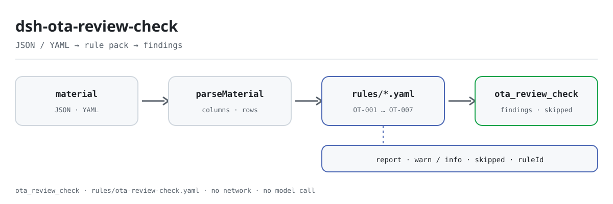

<div align="center">

<picture>
  <source media="(prefers-color-scheme: dark)" srcset="docs/assets/dsh-ota-review-check-flow-dark.svg">
  
</picture>

# dsh-ota-review-check

**Verifique línea por línea el cierre del registro de reseñas y respuestas en línea: qué fila, qué columna, qué falta.**

Comprobador de DeepSeek Harness para operaciones de hotel y tienda y para atención al cliente: entregue un registro de reseñas y respuestas (cabecera del establecimiento más una fila por reseña) y reciba una lista de diferencias señalables línea por línea; no modifica el original, no se conecta a la red, no llama a un modelo y no emite un veredicto de cumplimiento.

[Instalación](#instalación-en-tres-pasos) · [Configuración](#configuración) · [FAQ](#faq) · [简体中文](README.md) · [English](README.en.md) · [Español](README.es.md) · [Português](README.pt.md) · [हिन्दी](README.hi.md)

[](LICENSE)
[](#compatibilidad)
[](https://www.npmjs.com/package/dsh-ota-review-check)
[](https://github.com/PerryLink/dsh-ota-review-check/actions/workflows/ci.yml)
[](#compatibilidad)

[](https://github.com/PerryLink/dsh-ota-review-check/stargazers)
[](https://www.npmjs.com/package/dsh-ota-review-check)
[](https://dshfind.com/plugins/PerryLink/dsh-ota-review-check?ref=badge)
[](https://securityscorecards.dev/viewer/?uri=github.com/PerryLink/dsh-ota-review-check)
[](https://dsh.market/)
[](https://gitee.com/perrylink/dsh-ota-review-check)

```sh
dsh plugin --profile <name> add dsh-ota-review-check
```

</div>

<sub>Plugin de la comunidad, no afiliado a DeepSeek. Repositorio canónico: <https://github.com/PerryLink/dsh-ota-review-check> (Gitee es un espejo).</sub>

## Qué es

`dsh-ota-review-check` lee un registro de reseñas en línea con sus respuestas —la cabecera del establecimiento más una fila por reseña— y comprueba la completitud y el cierre de ese mismo registro: que cada reseña registre su contenido o una puntuación, que una reseña respondida lleve fecha de respuesta y autor de la respuesta, que la respuesta no sea anterior a la reseña, que una reseña sin responder quede dentro del plazo que el propio registro declara, que el tipo de problema proceda del vocabulario de su institución y que los números de reseña sean únicos.

Solo enumera las diferencias que el propio material permite señalar, línea por línea; cada comprobación que no pudo ejecutarse se declara en `skipped` con su motivo. El paquete de reglas no inventa citas: cada hallazgo nombra la cláusula aplicada y advierte que su texto no se obtuvo en esta pasada.

## Instalación en tres pasos

1. **Instalar** (requiere DSH `>=0.2.1-0 <0.3.0` y Node `^22.19.0 || >=24.0.0`):

   ```sh
   dsh plugin --profile <name> add dsh-ota-review-check
   ```

2. **Configuración mínima** (los valores por defecto funcionan; el paquete de reglas viene incluido y la ruta es relativa a la raíz del paquete):

   ```yaml
   - insert:
       - id: dsh-ota-review-check
         name: dsh-ota-review-check
         config:
           rulesFile: rules/ota-review-check.yaml
   ```

3. **Comprobar que se montó**:

   ```sh
   dsh --profile <name> --dump-config | grep 'dsh-ota-review-check'
   ```

El repositorio incluye un quickstart reproducible (ejecute `pnpm install && pnpm run build` antes, porque el ejemplo carga el plugin desde `lib/index.mjs`):

```sh
node samples/quickstart/run.mjs --check
```

Se espera `issueCount: 1` (`warn` 1, `error` 0, `info` 0) y `skippedCount: 1`; el material está en `samples/quickstart/input/OT-001-unsafe.json` y el resultado esperado en `samples/quickstart/expected/result.json`.

**Desinstalar**: `dsh plugin --profile <name> remove dsh-ota-review-check` (o borre la fila del patch del perfil).

## Capacidades clave

El plugin registra una herramienta, `ota_review_check`: lee un registro de reseñas y respuestas (cabecera del establecimiento más una fila por reseña), aplica un paquete de reglas versionado (`rules/ota-review-check.yaml`) y devuelve un informe. Comprueba la completitud y el cierre del propio registro, y declara en `skipped` cada comprobación que no pudo ejecutarse.

### Tabla de reglas

| Regla | Qué comprueba | Nivel | Tipo de base |
|---|---|---|---|
| `OT-001` | la reseña registra contenido o una puntuación | warn | principio |
| `OT-002` | una reseña respondida lleva fecha de respuesta | info | configuración local |
| `OT-003` | el plazo de respuesta registrado no contradice la fecha de la reseña | info | configuración local |
| `OT-004` | la respuesta no es anterior a la reseña | info | configuración local |
| `OT-005` | una reseña respondida nombra al autor de la respuesta | info | configuración local |
| `OT-006` | el tipo de problema procede de su vocabulario (desactivada por defecto) | info | configuración local |
| `OT-007` | los números de reseña son únicos | warn | principio |

### Ejemplos

Esta es la salida real del plugin sobre su propio fixture de prueba `OT-001`, no una ilustración.

#### Salida detallada

**Herramienta** `ota_review_check`

**Entrada**

~~~json
{"hotel":"某某门店","period":"2026 年 3 月","platform":"某某平台","rows":[{"序号":"1","渠道":"某某平台","房型":"标准大床房","入住日期":"2026-03-01","总分":"","评分制":"5 分制","点评内容":"","是否回复":"是"}]}
~~~

**Salida**

~~~json
{
  "id": "dsh-ota-review-check.OT-001.de09b5a6",
  "ruleId": "OT-001",
  "severity": "warn",
  "locator": {
    "row": 1,
    "field": "content"
  },
  "found": "第 1 行 content、score 都为空",
  "expected": "content、score 至少应填写一项"
}
~~~

*Observado en `dsh-ota-review-check/tests/fixtures/OT-001/OT-001-unsafe.json`*

| Usted pregunta | Qué responde |
|---|---|
| Una fila no tiene rellenos ni 点评内容 ni 评分. ¿Qué se informa? | `OT-001` informa de esa fila: cada reseña debe registrar al menos uno de los dos campos, `content` o `score`. Solo comprueba que uno de ellos esté relleno; no juzga si el contenido de la reseña es cierto ni si se trata de una reseña maliciosa. |
| Una fila está marcada 已回复, pero las celdas 回复日期 y 回复人 están vacías. ¿Qué se informa? | `OT-002` informa de la falta de `repliedAt` en toda fila cuyo `replyStatus` tome uno de los valores configurados (`是`, `Y`, `yes`, `true`, `已回复`, `√`), y `OT-005` exige que `replier` esté relleno en cualquier fila que traiga la columna 回复人, de modo que una celda vacía se informa incluso en una fila marcada 未回复. Ambas comprueban solo que la celda esté rellena: ninguna dice si la respuesta fue puntual ni si fue adecuada. |
| En nuestro registro la columna 回复期限 está vacía en todas las filas. ¿La comprobación supone un plazo de 24 o 48 horas? | No. El plugin no incorpora el plazo de ninguna plataforma: sin un valor en `replyDeadline` no hay nada que comparar y `OT-003` aparece en `skipped` en lugar de suponer un número de días. Solo se ejecuta contra el plazo que el propio registro escribe en la columna 回复期限, y una coincidencia significa que ese plazo y la fecha de la reseña no concuerdan, no que se haya infringido una regla de la plataforma. |
| La 回复日期 está escrita como 2026年3月15日 y es anterior a la 入住日期. ¿Qué se detecta? | `OT-004` compara `checkIn` con `repliedAt` e informa de una fecha de respuesta anterior a la fecha de la reseña, considerando el mismo día como no posterior; una fecha que no puede analizar —`2026年3月15日`, por ejemplo, ya que solo se analizan `2026-03-15`, `2026/3/15` y `2026.3.15` con hora opcional— se informa en esa fila en lugar de omitirse en silencio. Solo compara las dos fechas y no juzga si la respuesta fue puntual. |
| Hemos rellenado 问题类型 con nuestras propias palabras. ¿Por qué dice el informe que la comprobación no se ejecutó? | `OT-006` trae su lista `values` vacía, es decir, sin configurar, así que se declara en `skipped` con ese motivo en lugar de inventar un sistema de categorías: el vocabulario (卫生, 服务态度, 设施设备, 价格, 噪音, 预订与入住 o el suyo propio) lo fija su institución. Una vez lo configure, la regla informa de cualquier valor que no esté en la lista y no comprueba nada más: en qué categoría encaja una reseña sigue siendo juicio del operador. |
| El mismo 点评编号 aparece dos veces en el registro. ¿Qué se informa? | `OT-007` informa de la segunda fila como duplicada de la primera, comparando `reviewNo` e ignorando los espacios en blanco. La unicidad es la premisa de que cada reseña se registre una sola vez, por eso la regla está en `warn`; comprueba solo la unicidad y no dice cuál de las dos filas es la copia. Sin columna `reviewNo`, la regla se declara en `skipped` en lugar de pasar en silencio. |

## Normas y límites legales

| Documento | Número | Reglas que lo citan |
|---|---|---|
| Ley de Comercio Electrónico de la República Popular China y reglas de servicio de las plataformas | Versión vigente y números de artículo no verificados en esta pasada | OT-001 |
| Ley de Comercio Electrónico de la República Popular China | Versión vigente y números de artículo no verificados en esta pasada | OT-002, OT-004, OT-005, OT-007 |
| Reglas de servicio de las plataformas de viajes en línea (configuración de la institución) | Sin estándar unificado (esta fila se basa en el plazo de respuesta configurado por su institución) | OT-003 |
| Política de gestión de reseñas de su institución (configuración de la institución) | Sin estándar unificado (esta fila se basa en el vocabulario de categorías de su institución) | OT-006 |

**Límite:** este plugin comprueba un **registro de reseñas y respuestas en línea** frente al cierre que un registro puede exigirse — que cada reseña registre su contenido o una puntuación, que una respuesta lleve fecha y autor, que la respuesta no sea anterior a la reseña, que una reseña sin responder quede dentro del plazo que el registro declara, que el tipo de problema proceda de su vocabulario y que los números de reseña sean únicos. **No** decide si una respuesta fue adecuada, si una reseña debe reclamarse o eliminarse, si una mala reseña es maliciosa o si la calidad del servicio es aceptable.

> ### ⚠️ Qué exige la ley aquí — y qué no
>
> **La Ley de Comercio Electrónico de la República Popular China se obtuvo y se leyó literalmente** (véase `rules/evidence/clause-verification.md`), y la comprobación **revirtió el planteamiento anterior de este paquete**. El artículo 39 pone el deber en el **operador de la plataforma**, no en el comerciante:
>
> ```text
> Artículo 39 (texto literal, original en chino):
> 电子商务平台经营者应当建立健全信用评价制度，公示信用评价规则，为消费者提供对平台内销售的商品或者提供的服务进行评价的途径。
> 电子商务平台经营者不得删除消费者对其平台内销售的商品或者提供的服务的评价。
> ```
>
> **No hay ninguna disposición que obligue al comerciante a responder a una reseña.** Por eso este plugin comprueba un deber que procede de **las reglas de servicio de cada plataforma y de la política de gestión de su institución** — nunca del texto legal — y ni el paquete de reglas ni este README describen ya la respuesta como una obligación legal. Los artículos 17 (no fabricar reseñas) y 20 (entregar lo prometido) tratan de otras materias y deliberadamente **no** se citan.
>
> **Cada `excerpt` sigue diciendo que el texto no se obtuvo, y cada regla permanece en `warn` o `info`** — las reglas de servicio de las plataformas no se obtuvieron, y la ley regula a la plataforma y no al comerciante, de modo que elevar una regla a `direct` vestiría una laguna del registro como un incumplimiento legal.
>
> **El plugin no incorpora el plazo de respuesta de ninguna plataforma.** `OT-003` compara la fecha de la reseña con el plazo **escrito en la propia columna 回复期限 del registro**, y con esa columna vacía se declara en `skipped`. Un hallazgo dice «el plazo y la fecha de la reseña no concuerdan», nunca «ha infringido las reglas de la plataforma». El vocabulario de categorías viene **vacío** por la misma razón. Y el plugin **no lee sentimiento ni juzga si una respuesta fue adecuada**; qué reseña necesita qué remedio sigue siendo decisión del operador.

## Configuración

Todos los parámetros ajustables viven en el esquema Schemastery de `src/config.ts`, por lo que se cambian desde `cordis.yml` sin tocar el código; los umbrales por regla están en el paquete de reglas bajo `rules/`.

| Clave | Tipo | Predeterminado | Descripción |
|---|---|---|---|
| `rulesFile` | string | `rules/ota-review-check.yaml` | Ruta del paquete de reglas, relativa a la raíz del paquete |
| `disabledRules` | string[] | `[]` | Ids de reglas que se dejan de ejecutar; cada una aparece en `skipped` |
| `onlyRules` | string[] | `[]` | Ejecutar solo estas reglas; vacío ejecuta todas |
| `skipNotes` | string | `""` | Nota añadida a cada motivo de `skipped` |
| `timeoutMs` | number | `120000` | Presupuesto de tiempo de espera cooperativo de la herramienta |

Parámetros de regla que conviene conocer:

- `OT-002` `conditionValues` — los valores de la columna 是否回复 que significan «respondida»: `是`, `Y`, `yes`, `true`, `已回复`, `√`.
- `OT-003` lee la columna 回复期限 / `replyDeadline` del registro. El plugin nunca deduce un plazo a partir de un número de días, porque las ventanas varían según la plataforma.
- `OT-006` `values` — sus categorías de problema, por ejemplo 卫生, 服务态度, 设施设备, 价格, 噪音, 预订与入住. Vacío significa que no se comprueba.

Ejemplo de sustitución en el patch del perfil:

```yaml
- insert:
    - id: dsh-ota-review-check
      name: dsh-ota-review-check
      config:
        disabledRules: [OT-007]
        skipNotes: Política de reseñas de 2026 de este establecimiento
        timeoutMs: 60000
```

## Formato del material

La herramienta acepta JSON o YAML:

```yaml
hotel: 某某门店
period: 2026 年 3 月
platform: 某某平台
rows:
  - { 序号: '1', 渠道: 某某平台, 房型: 标准大床房, 入住日期: 2026-03-01,
      总分: '4.5', 评分制: 5 分制, 点评内容: 位置方便，前台服务热情，房间隔音一般。,
      是否回复: 是, 回复日期: 2026-03-02, 回复期限: 2026-03-04, 回复人: 张店长,
      问题类型: 噪音, 是否整改: 是 }
```

Los nombres de columna se comparan sin distinguir mayúsculas y minúsculas y sin tener en cuenta espacios, guiones bajos ni guiones; se conservan los nombres propios del registro, de modo que un hallazgo nombra la columna que leyó. Los campos son opcionales en la capa de lectura y los valida el motor de comprobación, así que una exportación parcial produce diferencias por «falta un elemento» en lugar de un fallo.

## Fuentes de las reglas

Los datos de las reglas viven en `rules/ota-review-check.yaml`, separados del código: sustituir ese archivo cambia el conjunto de reglas sin tocar TypeScript. La cabecera del paquete declara la laguna de citas por completo, y la `note` de cada regla repite la parte que le corresponde.

El cargador impone que `excerpt` sea una cita real de al menos ocho caracteres y prohíbe que una comprobación basada solo en un principio (`kind: derived-from-principle`, tope `warn`) o en configuración institucional (`kind: institutional-configuration`, tope `info`) se marque como `error`. Como esa guarda no distingue una cita de una descripción, este paquete se apoya en la cabecera, en las notas por regla y en una prueba que exige que cada `excerpt` admita la laguna; `pnpm run check:citations` vuelve a contrastar los extractos con `rules/evidence/` y con `rules/citations-baseline.json`, que solo puede encogerse. Un paquete que exagere su base falla al cargar en lugar de producir un informe de apariencia sólida.

## FAQ

<details>
<summary>¿Se sube el registro, se escribe en disco o se envía a un modelo?</summary>

No. El plugin solo lee el material que usted pasa a `ota_review_check` mediante `file` o `material`, lo analiza localmente y aplica las reglas; `dsh.demo` declara `network: false` y `writes: []`, no hay ninguna petición de red ni llamada a un modelo en el código, y el informe se devuelve únicamente como resultado de la herramienta.

</details>

<details>
<summary>¿Un informe sin hallazgos significa que el registro cumple?</summary>

No. Solo enumera las diferencias que el propio material permite señalar; no emite juicios de cumplimiento, no atribuye responsabilidad y no sustituye al revisor. Las comprobaciones que no pudieron ejecutarse figuran en `skipped`, y cada `excerpt` declara que el texto de la cláusula no se obtuvo. Un informe vacío significa «no hubo diferencias reportables en esta ejecución», no «no hay nada malo».

</details>

<details>
<summary>¿Por qué `OT-003`, `OT-006` u `OT-007` aparecen en `skipped`?</summary>

El motivo se escribe en cada entrada de `skipped`: `OT-003` necesita un valor en la columna `replyDeadline` del registro y no supone ningún número de días sin él; `OT-006` trae su lista `values` vacía (sin vocabulario de categorías configurado); `OT-007` necesita una columna `reviewNo` y no pasa en silencio sin ella. Las reglas desactivadas con `disabledRules` o excluidas con `onlyRules` también acaban en `skipped`, con la nota de `skipNotes`.

</details>

<details>
<summary>¿Por qué los hallazgos son solo `warn` o `info`, nunca `error`?</summary>

El nivel sigue a la evidencia: `derived-from-principle` está limitado a `warn` y `institutional-configuration` a `info`; las reglas de servicio de las plataformas no se obtuvieron literalmente, y la ley regula a la plataforma y no al comerciante, de modo que promover cualquier regla a `direct`/`error` vestiría una laguna del registro como un incumplimiento legal. Una guarda de carga rechaza el paquete que exagere su base.

</details>

<details>
<summary>¿Por qué se informa una fecha, o por qué parecen desplazadas las horas?</summary>

Toda la aritmética es de hora local sobre las cadenas entregadas, sin conversión de zona horaria. Las únicas formas analizables son `2026-03-15`, `2026/3/15` y `2026.3.15` con hora opcional; una fecha que no puede analizar (por ejemplo, el formato chino año-mes-día) se informa en esa fila en lugar de omitirse en silencio. El mismo día cuenta como no posterior.

</details>

<details>
<summary>Un hallazgo parece incorrecto. ¿Cómo lo juzgo?</summary>

- `OT-003` se activa pero la respuesta sí fue puntual: la celda 回复期限 del registro no concuerda con la fecha de la reseña; revise primero esas dos celdas.
- `OT-006` se activa en una categoría que usted considera correcta: el valor no está en su `values` configurado; amplíe la lista o corrija la celda — el plugin no clasifica las reseñas por sí mismo.
- `OT-007` se activa dos veces en una misma reseña: una reseña puede gestionarse legítimamente dos veces (una respuesta de seguimiento); distinga las filas en lugar de reutilizar el número.

</details>

<details>
<summary>La herramienta no aparece tras instalar, se rechaza la versión o `check` informa `manifest-peers` como fallo. ¿Qué hago?</summary>

Confirme que `main` resuelve a `lib/index.mjs` y que `pnpm run build` lo generó; un `main` incorrecto hace que el cargador omita la entrada en silencio. Si `dsh plugin add` rechaza el paquete por incompatibilidad, el rango de peers cubre `0.1.x` y `0.2.x`; fuera de él, conceda una exención explícita: `dsh plugin --profile <name> allow-version dsh-ota-review-check@0.1.0 --dsh-version <runtime> --accept-risk`. `manifest-peers` es un problema conocido de `dsh-plugin-dev`: el comprobador estático compara con un rango de peers codificado que es anterior a la línea 0.2, mientras que el runtime aplica la compatibilidad al instalar.

</details>

## Límites de seguridad

- **Solo diferencias, nunca un veredicto.** El informe no se pronuncia sobre cumplimiento, responsabilidad o corrección; la guarda de redacción de `src/shared` lo impone y el informe siempre lleva el descargo de responsabilidad.
- **Sin citas inventadas.** Cada regla declara `document` / `number` / `clause` / `excerpt` / `kind` / `source`, y `excerpt` debe ser una cita literal. Cuando el texto no está disponible, el paquete lo dice y rebaja la base a principio o configuración institucional, limitando el nivel en consecuencia.
- **Un resultado vacío no puede leerse como «no pasa nada».** Cada comprobación que no pudo ejecutarse figura en `skipped` con su motivo; una regla cuya lista requerida no está configurada se declara en `skipped` en lugar de pasar en silencio.
- **Material de solo lectura, sin red y sin modelo.** El plugin solo lee el material que usted le entrega; `dsh.demo` declara `network: false` y `writes: []`, y no hay petición de red ni invocación de modelo.
- **Los registros son efectos.** El registro de la herramienta pasa por `ctx.tools.register` y devuelve un disposer, así que descargar o recargar en caliente el plugin lo retira.
- **Sin ventana de plataforma ni sistema de categorías incorporados.** Las ventanas de respuesta y las categorías de problema proceden de su configuración y del propio registro; el plugin no habla por una plataforma ni por una institución.

## Limitaciones conocidas

- **El paquete de reglas tiene hoy siete reglas.** La cabecera de `rules/ota-review-check.yaml` incluye entre las comprobaciones «¿una mala reseña registra una rectificación?» y «¿quedan marcadores de plantilla?», pero ninguna regla las implementa (`OT-001`…`OT-007` no contiene ninguna de las dos); ambas siguen siendo revisión manual y este README no las cuenta como capacidades entregadas.
- **No se incorpora el plazo de respuesta de ninguna plataforma.** `OT-003` compara la fecha de la reseña con el plazo solo cuando el registro anota `replyDeadline`; una columna vacía acaba en `skipped` en lugar de suponer 24 o 48 horas.
- **El vocabulario de categorías viene vacío.** `OT-006` no se ejecuta hasta configurar `values`; el vocabulario (卫生, 服务态度, 设施设备, 价格, 噪音, 预订与入住, o el suyo) es de su institución.
- **Los formatos de fecha son limitados.** Solo se analizan `2026-03-15`, `2026/3/15` y `2026.3.15` con hora opcional; el formato chino año-mes-día se informa en esa fila. Toda la aritmética de fechas es de hora local sobre las cadenas entregadas, sin conversión de zona horaria.
- **Solo campos estructurados, sin lectura de sentimiento.** No juzga si el contenido de una reseña es cierto o malicioso, si una respuesta fue adecuada o si la calidad del servicio es aceptable.
- **El texto de las cláusulas no se obtuvo.** Las reglas de servicio de las plataformas no se obtuvieron literalmente en esta pasada, así que cada `excerpt` lo dice y cada regla permanece en `warn` o `info`; `rules/citations-baseline.json` solo puede encogerse y una cita nueva debe tener fuente antes de entrar.
- **Se requiere un artefacto compilado.** El plugin carga desde `lib/index.mjs`; un `main` incorrecto o un `pnpm run build` omitido hacen que el cargador omita la entrada en silencio.
- **`manifest-peers` es un problema conocido de origen.** El comprobador estático de `dsh-plugin-dev` compara con un rango de peers codificado anterior a la línea 0.2; la compatibilidad al instalar la decide el runtime.

## Interoperabilidad con otros plugins DSH

Estos son hechos verificables en el código y en las declaraciones del paquete (este repositorio no ejecuta pruebas de interoperabilidad en tiempo de ejecución contra otros plugins):

- **Una sola herramienta.** El id es `ota_review_check`, definido como `TOOL_NAME` en `src/index.ts`; no se registra ningún nombre desnudo propiedad de otro plugin.
- **Sin clave de servicio.** El plugin no exporta ninguna clave de servicio, así que no puede colisionar en una.
- **Sin slot de cliente ni prefijo `webServer`.** No hay directorio `client/` y `has_client` es falso; es un plugin puramente de host.
- **El patch del bundle solo `insert`a su propia fila.** `cordis.patch.yml` nunca sobrescribe el `config` de una fila integrada.
- **Sin mutación global.** El código no parchea prototipos, no reescribe `process.env` ni sustituye el despachador global de fetch; no hace peticiones de red ni llama a un modelo.
- **Los registros son efectos de Cordis.** El registro de la herramienta devuelve un disposer, así que detener o recargar en caliente lo retira sin dejar estado global.

## Compatibilidad

| Superficie | Estado |
|---|---|
| Harness | Rango de peers `>=0.1.2-rc.1 <0.2.0 \|\| >=0.2.0-0 <0.3.0` — verificado para aceptar tanto `0.2.0-rc.2` como `0.2.1-rc.2`. `engines.dsh` se declara como `>=0.2.1-0 <0.3.0` y el host lo aplica desde 0.2.1 |
| Node | `^22.19.0 \|\| >=24.0.0` |
| Plataformas | Todas (ESM puro; sin código nativo, sin red, sin llamada al modelo) |
| Modo de herramienta | Funciona en `native` y `ptc`; para un directorio completo use `ptc` |

## Ecosistema y calidad

- [Espejo en Gitee](https://gitee.com/perrylink/dsh-ota-review-check) (espejo sincronizado; GitHub es el canónico)
- [Página del plugin en dshfind](https://dshfind.com/plugins/PerryLink/dsh-ota-review-check) (instalaciones y clasificación)
- [Informe OpenSSF Scorecard](https://securityscorecards.dev/viewer/?uri=github.com/PerryLink/dsh-ota-review-check) (impulsado por [.github/workflows/scorecard.yml](.github/workflows/scorecard.yml))
- [DSH Market](https://dsh.market/) (publicado)
- **Canal WorkBuddy / Coze**: busque «Professional Document Check Suite» en el mercado de aplicaciones (el conjunto completo; esta comprobación es una parte; disponibilidad según el catálogo)
- [Elegir un comprobador por material](https://perrylink.github.io/zh/checkers/choose/) (índice del ecosistema; este repositorio es uno de ellos)

## Desarrollo

```sh
pnpm install
pnpm run typecheck   # tsc --noEmit
pnpm test            # vitest: suite compartida de plugins de tabla + fixtures emparejados
pnpm run build       # tsdown -> lib/index.mjs + lib/index.d.mts
pnpm run verify:self-contained
pnpm run check:lockfile
pnpm run check:citations
pnpm run check:readmes
node ../scripts/sync-shared.mjs dsh-ota-review-check
pnpm pack
```

El plugin es **dirigido por datos**: `src/model.ts` declara la forma de la tabla, el kit compartido aporta el lector y el motor de comprobación, y el paquete de reglas declara cada comprobación. `node ../scripts/sync-shared.mjs dsh-ota-review-check` copia el kit compartido de `../_shared` a `src/shared/`; vuelva a ejecutarlo tras cada cambio compartido.

Las imágenes del README se generan mediante [`scripts/gen-readme-assets.py`](scripts/gen-readme-assets.py) (Python + Pillow) y pueden volver a ejecutarse sin riesgo:

```sh
python scripts/gen-readme-assets.py
```

Topics: `deepseek-harness`, `dsh`, `dsh-plugin`, `cordis`, `ota`, `review`

## Familia y agradecimientos

Este proyecto forma parte de la familia de plugins de DeepSeek Harness de [PerryLink](https://github.com/PerryLink) (todos Apache-2.0). Si te resulta útil, **una estrella ayuda a que la siguiente persona lo encuentre** — no hay nada bloqueado tras ella.

- [@PerryLink](https://github.com/PerryLink) — creador y mantenedor: el paquete de reglas `OT-001`…`OT-007`, el registro de verificación de cláusulas en `rules/evidence/`, la integración del motor de comprobación compartido y la documentación en cinco idiomas.

<details>
<summary>Expandir todos los plugins</summary>

| Plugin | Estado |
|---|---|
| **[dsh-aqua-input-check](https://github.com/PerryLink/dsh-aqua-input-check)** |  |
| **[dsh-archive-check](https://github.com/PerryLink/dsh-archive-check)** |  |
| **[dsh-auto-review](https://github.com/PerryLink/dsh-auto-review)** |  |
| **[dsh-autotier](https://github.com/PerryLink/dsh-autotier)** | 🧊 CONGELADO — ver el README del repo |
| **[dsh-bid-ca-precheck](https://github.com/PerryLink/dsh-bid-ca-precheck)** |  |
| **[dsh-bid-qual-check](https://github.com/PerryLink/dsh-bid-qual-check)** |  |
| **[dsh-cert-mcp](https://github.com/PerryLink/dsh-cert-mcp)** | 🧊 CONGELADO — ver el README del repo |
| **[dsh-checkpoint-rewind](https://github.com/PerryLink/dsh-checkpoint-rewind)** |  |
| **[dsh-click](https://github.com/PerryLink/dsh-click)** |  |
| **[dsh-composer-history](https://github.com/PerryLink/dsh-composer-history)** |  |
| **[dsh-contract-stance](https://github.com/PerryLink/dsh-contract-stance)** |  |
| **[dsh-customs-doc-check](https://github.com/PerryLink/dsh-customs-doc-check)** |  |
| **[dsh-data-quality](https://github.com/PerryLink/dsh-data-quality)** | 🧊 CONGELADO — ver el README del repo |
| **[dsh-demurrage-ledger](https://github.com/PerryLink/dsh-demurrage-ledger)** |  |
| **[dsh-doublecheck](https://github.com/PerryLink/dsh-doublecheck)** |  |
| **[dsh-drill-script-check](https://github.com/PerryLink/dsh-drill-script-check)** |  |
| **[dsh-eia-guide-check](https://github.com/PerryLink/dsh-eia-guide-check)** |  |
| **[dsh-emergency-plan](https://github.com/PerryLink/dsh-emergency-plan)** |  |
| **[dsh-essay-rubric-check](https://github.com/PerryLink/dsh-essay-rubric-check)** |  |
| **[dsh-evidence-check](https://github.com/PerryLink/dsh-evidence-check)** |  |
| **[dsh-export-ctl-check](https://github.com/PerryLink/dsh-export-ctl-check)** |  |
| **[dsh-fast](https://github.com/PerryLink/dsh-fast)** |  |
| **[dsh-fmea-table-check](https://github.com/PerryLink/dsh-fmea-table-check)** |  |
| **[dsh-forecast-penalty](https://github.com/PerryLink/dsh-forecast-penalty)** |  |
| **[dsh-fund-research](https://github.com/PerryLink/dsh-fund-research)** |  |
| **[dsh-github](https://github.com/PerryLink/dsh-github)** |  |
| **[dsh-gongwen-flow-check](https://github.com/PerryLink/dsh-gongwen-flow-check)** |  |
| **[dsh-gongwen-word-check](https://github.com/PerryLink/dsh-gongwen-word-check)** |  |
| **[dsh-guard-plan-qc](https://github.com/PerryLink/dsh-guard-plan-qc)** |  |
| **[dsh-hazchem-check](https://github.com/PerryLink/dsh-hazchem-check)** |  |
| **[dsh-hazplan-check](https://github.com/PerryLink/dsh-hazplan-check)** |  |
| **[dsh-hidden-risk-map](https://github.com/PerryLink/dsh-hidden-risk-map)** |  |
| **[dsh-hs-classify](https://github.com/PerryLink/dsh-hs-classify)** |  |
| **[dsh-icd-rule-check](https://github.com/PerryLink/dsh-icd-rule-check)** |  |
| **[dsh-industry-research](https://github.com/PerryLink/dsh-industry-research)** |  |
| **[dsh-lawcite-adapter](https://github.com/PerryLink/dsh-lawcite-adapter)** |  |
| **[dsh-laya](https://github.com/PerryLink/dsh-laya)** |  |
| **[dsh-lc-doc-check](https://github.com/PerryLink/dsh-lc-doc-check)** |  |
| **[dsh-learning-gap-check](https://github.com/PerryLink/dsh-learning-gap-check)** |  |
| **[dsh-library](https://github.com/PerryLink/dsh-library)** |  |
| **[dsh-local-ai](https://github.com/PerryLink/dsh-local-ai)** |  |
| **[dsh-lsp-actions](https://github.com/PerryLink/dsh-lsp-actions)** |  |
| **[dsh-mask](https://github.com/PerryLink/dsh-mask)** |  |
| **[dsh-mcp-panel](https://github.com/PerryLink/dsh-mcp-panel)** |  |
| **[dsh-medrec-qc](https://github.com/PerryLink/dsh-medrec-qc)** |  |
| **[dsh-memento](https://github.com/PerryLink/dsh-memento)** | 🧊 CONGELADO — ver el README del repo |
| **[dsh-nsfc-form-check](https://github.com/PerryLink/dsh-nsfc-form-check)** |  |
| **[dsh-nurse-record-check](https://github.com/PerryLink/dsh-nurse-record-check)** |  |
| **[dsh-observe](https://github.com/PerryLink/dsh-observe)** |  |
| **[dsh-origin-rvc-check](https://github.com/PerryLink/dsh-origin-rvc-check)** |  |
| **[dsh-ota-review-check](https://github.com/PerryLink/dsh-ota-review-check)** |  |
| **[dsh-output-styles](https://github.com/PerryLink/dsh-output-styles)** |  |
| **[dsh-paper-doc-adapter](https://github.com/PerryLink/dsh-paper-doc-adapter)** |  |
| **[dsh-permission-rules](https://github.com/PerryLink/dsh-permission-rules)** |  |
| **[dsh-permit-report-check](https://github.com/PerryLink/dsh-permit-report-check)** |  |
| **[dsh-pipeline-check](https://github.com/PerryLink/dsh-pipeline-check)** |  |
| **[dsh-pleading-draft](https://github.com/PerryLink/dsh-pleading-draft)** |  |
| **[dsh-plugin-doctor](https://github.com/PerryLink/dsh-plugin-doctor)** | 🚫 RETIRADO (repo archivado) |
| **[dsh-plugin-guide](https://github.com/PerryLink/dsh-plugin-guide)** |  |
| **[dsh-plugin-kit](https://github.com/PerryLink/dsh-plugin-kit)** | 🚫 RETIRADO (repo archivado) |
| **[dsh-plugin-upgrade](https://github.com/PerryLink/dsh-plugin-upgrade)** | 🚫 RETIRADO (repo archivado) |
| **[dsh-policy-brief-draft](https://github.com/PerryLink/dsh-policy-brief-draft)** |  |
| **[dsh-power-loss-split](https://github.com/PerryLink/dsh-power-loss-split)** |  |
| **[dsh-power-ticket-check](https://github.com/PerryLink/dsh-power-ticket-check)** |  |
| **[dsh-ppap-check](https://github.com/PerryLink/dsh-ppap-check)** |  |
| **[dsh-protest-deadline](https://github.com/PerryLink/dsh-protest-deadline)** |  |
| **[dsh-railway-window](https://github.com/PerryLink/dsh-railway-window)** |  |
| **[dsh-repair-order-qc](https://github.com/PerryLink/dsh-repair-order-qc)** |  |
| **[dsh-research-report](https://github.com/PerryLink/dsh-research-report)** |  |
| **[dsh-review-reply-check](https://github.com/PerryLink/dsh-review-reply-check)** |  |
| **[dsh-rulefile-check](https://github.com/PerryLink/dsh-rulefile-check)** |  |
| **[dsh-safety-brief-check](https://github.com/PerryLink/dsh-safety-brief-check)** |  |
| **[dsh-score](https://github.com/PerryLink/dsh-score)** | 🧊 CONGELADO — ver el README del repo |
| **[dsh-session-sync](https://github.com/PerryLink/dsh-session-sync)** |  |
| **[dsh-site-log-check](https://github.com/PerryLink/dsh-site-log-check)** |  |
| **[dsh-skill-pack-security](https://github.com/PerryLink/dsh-skill-pack-security)** |  |
| **[dsh-soe-decision-check](https://github.com/PerryLink/dsh-soe-decision-check)** |  |
| **[dsh-soilwater-check](https://github.com/PerryLink/dsh-soilwater-check)** |  |
| **[dsh-sop-sync-check](https://github.com/PerryLink/dsh-sop-sync-check)** |  |
| **[dsh-spc-gbt-adapter](https://github.com/PerryLink/dsh-spc-gbt-adapter)** |  |
| **[dsh-talk](https://github.com/PerryLink/dsh-talk)** |  |
| **[dsh-tender-extract](https://github.com/PerryLink/dsh-tender-extract)** |  |
| **[dsh-tender-matrix](https://github.com/PerryLink/dsh-tender-matrix)** |  |
| **[dsh-test-drive](https://github.com/PerryLink/dsh-test-drive)** |  |
| **[dsh-ticktick](https://github.com/PerryLink/dsh-ticktick)** | 🚫 RETIRADO (repo archivado) |
| **[dsh-translate](https://github.com/PerryLink/dsh-translate)** |  |
| **[dsh-warranty-calc](https://github.com/PerryLink/dsh-warranty-calc)** |  |
| **[dsh-budget](https://github.com/PerryLink/dsh-budget)** | 🧊 CONGELADO — ver el README del repo |
| **[dsh-claude-move](https://github.com/PerryLink/dsh-claude-move)** | 🧊 CONGELADO — ver el README del repo |
| **[dsh-defend](https://github.com/PerryLink/dsh-defend)** | 🧊 CONGELADO — ver el README del repo |
| **[dsh-draw](https://github.com/PerryLink/dsh-draw)** | 🧊 CONGELADO — ver el README del repo |
| **[dsh-reach](https://github.com/PerryLink/dsh-reach)** | 🧊 CONGELADO — ver el README del repo |
| **[dsh-background-agents](https://github.com/PerryLink/dsh-background-agents)** | 🚫 RETIRADO (repo archivado) |
| **[dsh-session-pin](https://github.com/PerryLink/dsh-session-pin)** | 🚫 RETIRADO (repo archivado) |
| **[dsh-team-rooms](https://github.com/PerryLink/dsh-team-rooms)** | 🚫 RETIRADO (repo archivado) |

</details>

## Licencia

[LICENSE](LICENSE) (Apache License 2.0) © 2026 dsh-ota-review-check contributors

<p align="center"><sub>Apache-2.0 · Plugin de la comunidad, no afiliado a DeepSeek.</sub></p>
