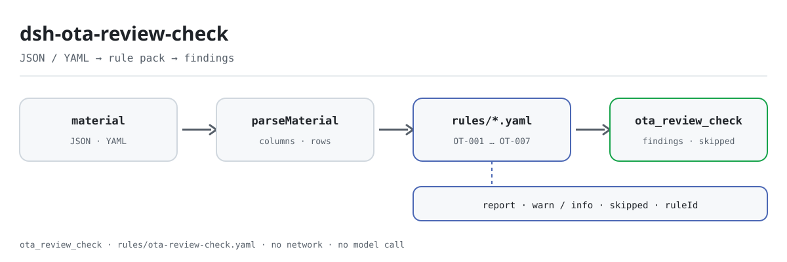

<div align="center">

<picture>
  <source media="(prefers-color-scheme: dark)" srcset="docs/assets/dsh-ota-review-check-flow-dark.svg">
  
</picture>

# dsh-ota-review-check

**ऑनलाइन समीक्षा-उत्तर रजिस्टर के बंद-लूप की पंक्ति-दर-पंक्ति जाँच — कौन-सी पंक्ति, कौन-सा कॉलम, क्या छूटा।**

होटल और स्टोर संचालन तथा सहायता टीम के लिए DeepSeek Harness जाँच प्लगइन: एक समीक्षा-उत्तर रजिस्टर दें (प्रॉपर्टी हेडर और प्रत्येक समीक्षा की एक पंक्ति) और पंक्ति-दर-पंक्ति इंगित करने योग्य अंतरों की सूची पाएँ; यह मूल सामग्री नहीं बदलता, नेटवर्क पर नहीं जाता, मॉडल नहीं बुलाता और अनुपालन पर कोई निर्णय नहीं देता।

[इंस्टॉल](#तीन-चरणों-में-शुरुआत) · [कॉन्फ़िगरेशन](#कॉन्फ़िगरेशन) · [FAQ](#faq) · [简体中文](README.md) · [English](README.en.md) · [Español](README.es.md) · [Português](README.pt.md) · [हिन्दी](README.hi.md)

[](LICENSE)
[](#संगतता)
[](https://www.npmjs.com/package/dsh-ota-review-check)
[](https://github.com/PerryLink/dsh-ota-review-check/actions/workflows/ci.yml)
[](#संगतता)

[](https://github.com/PerryLink/dsh-ota-review-check/stargazers)
[](https://www.npmjs.com/package/dsh-ota-review-check)
[](https://dshfind.com/plugins/PerryLink/dsh-ota-review-check?ref=badge)
[](https://securityscorecards.dev/viewer/?uri=github.com/PerryLink/dsh-ota-review-check)
[](https://dsh.market/)
[](https://gitee.com/perrylink/dsh-ota-review-check)

```sh
dsh plugin --profile <name> add dsh-ota-review-check
```

</div>

<sub>सामुदायिक प्लगइन, DeepSeek से संबद्ध नहीं। मानक रेपो: <https://github.com/PerryLink/dsh-ota-review-check> (Gitee एक मिरर है)।</sub>

## यह क्या है

`dsh-ota-review-check` ऑनलाइन समीक्षा और उत्तर का एक रजिस्टर पढ़ता है — प्रॉपर्टी हेडर और प्रत्येक समीक्षा की एक पंक्ति — और उसी रजिस्टर की पूर्णता तथा बंद-लूप की जाँच करता है: क्या प्रत्येक समीक्षा में उसका विवरण या स्कोर दर्ज है, क्या उत्तर दी गई समीक्षा में उत्तर की तिथि और उत्तर देने वाले का नाम दर्ज है, क्या उत्तर समीक्षा से पहले नहीं है, क्या बिना उत्तर वाली समीक्षा रजिस्टर में लिखी समय-सीमा के भीतर है, क्या समस्या-प्रकार आपकी संस्था की अपनी शब्दावली से लिया गया है, और क्या समीक्षा क्रमांक अद्वितीय हैं।

यह केवल वे अंतर गिनाता है जिन्हें सामग्री स्वयं पंक्ति-दर-पंक्ति इंगित कर सकती है; हर वह जाँच जो नहीं चल सकी, कारण के साथ `skipped` में दर्ज होती है। नियम-पैक उद्धरण नहीं गढ़ता: हर निष्कर्ष लागू खंड का नाम और यह भी बताता है कि उसका मूल पाठ इस बार प्राप्त नहीं हुआ।

## तीन चरणों में शुरुआत

1. **इंस्टॉल** (DSH `>=0.2.1-0 <0.3.0` और Node `^22.19.0 || >=24.0.0` चाहिए):

   ```sh
   dsh plugin --profile <name> add dsh-ota-review-check
   ```

2. **न्यूनतम कॉन्फ़िगरेशन** (डिफ़ॉल्ट काम करते हैं; नियम-पैक पैकेज के साथ आता है और पथ पैकेज रूट के सापेक्ष है):

   ```yaml
   - insert:
       - id: dsh-ota-review-check
         name: dsh-ota-review-check
         config:
           rulesFile: rules/ota-review-check.yaml
   ```

3. **जाँचें कि माउंट हुआ**:

   ```sh
   dsh --profile <name> --dump-config | grep 'dsh-ota-review-check'
   ```

रेपो में दोहराने योग्य quickstart है (पहले `pnpm install && pnpm run build` चलाएँ, क्योंकि नमूना प्लगइन को `lib/index.mjs` से लोड करता है):

```sh
node samples/quickstart/run.mjs --check
```

अपेक्षित: `issueCount: 1` (`warn` 1, `error` 0, `info` 0) और `skippedCount: 1`; सामग्री `samples/quickstart/input/OT-001-unsafe.json` में और अपेक्षित परिणाम `samples/quickstart/expected/result.json` में है।

**अनइंस्टॉल**: `dsh plugin --profile <name> remove dsh-ota-review-check` (या प्रोफ़ाइल patch से पंक्ति हटा दें)।

## मुख्य क्षमताएँ

प्लगइन एक टूल, `ota_review_check`, रजिस्टर करता है: यह समीक्षा-उत्तर रजिस्टर (प्रॉपर्टी हेडर और प्रत्येक समीक्षा की एक पंक्ति) पढ़ता है, संस्करण-बद्ध नियम-पैक (`rules/ota-review-check.yaml`) लागू करता है और रिपोर्ट लौटाता है। यह रजिस्टर की अपनी पूर्णता और बंद-लूप जाँचता है, और हर न चल पाई जाँच को कारण के साथ `skipped` में बताता है।

### नियम तालिका

| नियम | क्या जाँचता है | स्तर | आधार प्रकार |
|---|---|---|---|
| `OT-001` | समीक्षा में विवरण या स्कोर दर्ज है | warn | सिद्धांत |
| `OT-002` | उत्तर दी गई समीक्षा में उत्तर की तिथि है | info | स्थानीय कॉन्फ़िगरेशन |
| `OT-003` | दर्ज उत्तर-समय-सीमा समीक्षा की तिथि से विरोध नहीं करती | info | स्थानीय कॉन्फ़िगरेशन |
| `OT-004` | उत्तर समीक्षा से पहले नहीं है | info | स्थानीय कॉन्फ़िगरेशन |
| `OT-005` | उत्तर दी गई समीक्षा में उत्तर देने वाला दर्ज है | info | स्थानीय कॉन्फ़िगरेशन |
| `OT-006` | समस्या-प्रकार आपकी शब्दावली से है (डिफ़ॉल्ट रूप से बंद) | info | स्थानीय कॉन्फ़िगरेशन |
| `OT-007` | समीक्षा क्रमांक अद्वितीय हैं | warn | सिद्धांत |

### उदाहरण

यह प्लगइन का अपने ही `OT-001` टेस्ट फ़िक्स्चर पर वास्तविक आउटपुट है, कोई चित्रण नहीं।

#### विस्तृत आउटपुट

**उपकरण** `ota_review_check`

**इनपुट**

~~~json
{"hotel":"某某门店","period":"2026 年 3 月","platform":"某某平台","rows":[{"序号":"1","渠道":"某某平台","房型":"标准大床房","入住日期":"2026-03-01","总分":"","评分制":"5 分制","点评内容":"","是否回复":"是"}]}
~~~

**आउटपुट**

~~~json
{
  "id": "dsh-ota-review-check.OT-001.de09b5a6",
  "ruleId": "OT-001",
  "severity": "warn",
  "locator": {
    "row": 1,
    "field": "content"
  },
  "found": "第 1 行 content、score 都为空",
  "expected": "content、score 至少应填写一项"
}
~~~

*स्रोत `dsh-ota-review-check/tests/fixtures/OT-001/OT-001-unsafe.json`*

| आपका सवाल | इसका जवाब |
|---|---|
| किसी पंक्ति में 点评内容 और 评分 दोनों ही नहीं भरे हैं। क्या दर्ज होता है? | `OT-001` उस पंक्ति को दर्ज करता है: प्रत्येक समीक्षा में `content` या `score` में से कम से कम एक दर्ज होना चाहिए। यह केवल देखता है कि इनमें से एक भरा है; समीक्षा की सामग्री सच है या नहीं, या वह दुर्भावनापूर्ण समीक्षा है या नहीं, यह नहीं आँकता। |
| एक पंक्ति में 已回复 अंकित है, पर 回复日期 और 回复人 खाली हैं। क्या दर्ज होता है? | जिस पंक्ति का `replyStatus` कॉन्फ़िगर किए गए मानों (`是`, `Y`, `yes`, `true`, `已回复`, `√`) में से कोई एक लेता है, उसमें `OT-002` `repliedAt` के अभाव को दर्ज करता है, और `OT-005` उन सभी पंक्तियों में `replier` भरा होने की अपेक्षा करता है जिनमें 回复人 कॉलम है — इसलिए 未回复 अंकित पंक्ति में भी खाली 回复人 दर्ज होता है। दोनों केवल यह देखते हैं कि कॉलम भरा है: कोई यह नहीं बताता कि उत्तर समय पर था या उपयुक्त था। |
| हमारे रजिस्टर में 回复期限 कॉलम पूरा खाली है। क्या जाँच 24 या 48 घंटे की समय-सीमा मान लेती है? | नहीं। प्लगइन किसी भी प्लेटफ़ॉर्म की समय-सीमा अपने भीतर नहीं रखता: `replyDeadline` में मान न हो तो तुलना के लिए कुछ ही नहीं है, और `OT-003` किसी भी दिन-संख्या को मान लेने के बजाय `skipped` में दर्ज होता है। यह केवल उसी सीमा से तुलना करता है जो रजिस्टर स्वयं 回复期限 कॉलम में लिखता है, और मेल न खाने का अर्थ यह है कि रजिस्टर की सीमा और समीक्षा की तिथि में अंतर है — प्लेटफ़ॉर्म नियम का उल्लंघन नहीं। |
| 回复日期 2026年3月15日 लिखी है और वह 入住日期 से पहले है। क्या पकड़ में आता है? | `OT-004` `checkIn` की तुलना `repliedAt` से करता है और समीक्षा की तिथि से पहले की उत्तर-तिथि दर्ज करता है; एक ही दिन को बाद का नहीं माना जाता। जो तिथि पढ़ी न जा सके — जैसे `2026年3月15日`, क्योंकि केवल `2026-03-15`, `2026/3/15` और `2026.3.15` (वैकल्पिक समय के साथ) पढ़ी जाती हैं — वह उस पंक्ति में अलग से दर्ज होती है, चुपचाप छोड़ी नहीं जाती। यह केवल दोनों तिथियों की तुलना करता है, उत्तर समय पर था या नहीं यह नहीं आँकता। |
| हमने 问题类型 में अपने ही शब्द भरे हैं। रिपोर्ट क्यों कहती है कि यह जाँच चली ही नहीं? | `OT-006` की `values` सूची खाली यानी अनकॉन्फ़िगर आती है, इसलिए वह कोई वर्गीकरण तंत्र गढ़ने के बजाय उसी कारण के साथ `skipped` में दर्ज होता है: शब्दावली (卫生, 服务态度, 设施设备, 价格, 噪音, 预订与入住 या आपकी संस्था की अपनी) आपकी संस्था तय करती है। सूची कॉन्फ़िगर करने पर यह केवल सूची से बाहर के मान दर्ज करता है और इससे आगे कुछ नहीं देखता — कोई समीक्षा किस श्रेणी में है, यह संचालक का निर्णय है। |
| एक ही 点评编号 रजिस्टर में दो बार आया है। क्या दर्ज होता है? | `OT-007` दूसरी पंक्ति को पहली की दोहराव के रूप में दर्ज करता है और तुलना में रिक्त स्थान छोड़ देता है। क्रमांक की अद्वितीयता ही इस बात की शर्त है कि प्रत्येक समीक्षा एक ही बार दर्ज हो, इसलिए यह नियम `warn` पर है; यह केवल अद्वितीयता देखता है और यह नहीं बताता कि दोनों में से कौन-सी पंक्ति प्रतिलिपि है। `reviewNo` कॉलम न हो तो यह नियम चुपचाप पास होने के बजाय `skipped` में दर्ज होता है। |

## मानक और कानूनी सीमाएँ

| दस्तावेज़ | संख्यांक | इन्हें उद्धृत करने वाले नियम |
|---|---|---|
| जनवादी गणराज्य चीन का ई-कॉमर्स कानून और प्लेटफ़ॉर्म सेवा नियम | इस बार वर्तमान संस्करण और धारा-संख्या सत्यापित नहीं | OT-001 |
| जनवादी गणराज्य चीन का ई-कॉमर्स कानून | इस बार वर्तमान संस्करण और धारा-संख्या सत्यापित नहीं | OT-002, OT-004, OT-005, OT-007 |
| ऑनलाइन ट्रैवल प्लेटफ़ॉर्म के सेवा नियम (संस्था का कॉन्फ़िगरेशन) | कोई एकरूप मानक नहीं (यह पंक्ति आपकी संस्था द्वारा कॉन्फ़िगर उत्तर-समय-सीमा पर आधारित है) | OT-003 |
| आपकी संस्था की समीक्षा-प्रबंधन नीति (संस्था का कॉन्फ़िगरेशन) | कोई एकरूप मानक नहीं (यह पंक्ति आपकी संस्था की श्रेणी-शब्दावली पर आधारित है) | OT-006 |

**सीमा:** यह प्लगइन एक **ऑनलाइन समीक्षा-उत्तर रजिस्टर** की उस बंद-लूप के सापेक्ष जाँच करता है जो रजिस्टर से अपेक्षित हो सकती है — कि हर समीक्षा अपना विवरण या स्कोर दर्ज करे, उत्तर में तिथि और उत्तर देने वाला हो, उत्तर समीक्षा से पहले न हो, बिना उत्तर वाली समीक्षा रजिस्टर की घोषित समय-सीमा के भीतर हो, समस्या-प्रकार आपकी शब्दावली से हो, और समीक्षा क्रमांक अद्वितीय हों। यह **यह निर्णय नहीं देता** कि उत्तर उपयुक्त था या नहीं, किसी समीक्षा पर आपत्ति होनी चाहिए या वह हटाई जानी चाहिए, कोई बुरी समीक्षा दुर्भावनापूर्ण है या नहीं, या सेवा की गुणवत्ता स्वीकार्य है या नहीं।

> ### ⚠️ कानून यहाँ क्या चाहता है — और क्या नहीं
>
> **जनवादी गणराज्य चीन का ई-कॉमर्स कानून प्राप्त किया गया और शब्दशः पढ़ा गया** (देखें `rules/evidence/clause-verification.md`), और इस जाँच ने **इस पैक के पुराने ढाँचे को उलट दिया**। धारा 39 दायित्व **प्लेटफ़ॉर्म संचालक** पर रखती है, व्यापारी पर नहीं:
>
> ```text
> धारा 39 (शब्दशः, मूल चीनी पाठ):
> 电子商务平台经营者应当建立健全信用评价制度，公示信用评价规则，为消费者提供对平台内销售的商品或者提供的服务进行评价的途径。
> 电子商务平台经营者不得删除消费者对其平台内销售的商品或者提供的服务的评价。
> ```
>
> **कोई प्रावधान व्यापारी से समीक्षा का उत्तर देने की अपेक्षा नहीं करता।** इसलिए यह प्लगइन उस दायित्व की जाँच करता है जो **प्रत्येक प्लेटफ़ॉर्म के अपने सेवा नियमों और आपकी संस्था की प्रबंधन नीति** से आता है — कानून से कभी नहीं — और अब न नियम-पैक न यह README उत्तर देने को कानूनी कर्तव्य बताते हैं। धारा 17 (झूठी समीक्षाएँ नहीं) और 20 (वादे के अनुसार डिलीवरी) अन्य विषयों के हैं और जान-बूझकर **उद्धृत नहीं** की जाती हैं।
>
> **हर `excerpt` अब भी कहता है कि पाठ इस बार प्राप्त नहीं हुआ, और हर नियम `warn` या `info` पर ही रहता है** — प्लेटफ़ॉर्म के सेवा नियम स्वयं प्राप्त नहीं हुए, और कानून व्यापारी के बजाय प्लेटफ़ॉर्म को नियंत्रित करता है, इसलिए किसी नियम को `direct` तक बढ़ाना रजिस्टर की कमी को कानून का उल्लंघन बना देगा।
>
> **प्लगइन किसी प्लेटफ़ॉर्म की उत्तर-समय-सीमा अपने भीतर नहीं रखता।** `OT-003` समीक्षा की तिथि की तुलना **रजिस्टर के अपने 回复期限 कॉलम में लिखी** समय-सीमा से करता है, और वह कॉलम खाली होने पर स्वयं को `skipped` में दर्ज करता है। कोई निष्कर्ष कहता है «समय-सीमा और समीक्षा की तिथि में अंतर है», कभी नहीं «आपने प्लेटफ़ॉर्म के नियम तोड़े»। श्रेणी-शब्दावली इसी कारण **खाली** आती है। और प्लगइन **भावना नहीं पढ़ता और यह नहीं आँकता कि उत्तर उपयुक्त था या नहीं**; किस समीक्षा को क्या सुधार चाहिए, यह संचालक का निर्णय है।

## कॉन्फ़िगरेशन

सभी समायोज्य पैरामीटर `src/config.ts` की Schemastery स्कीमा में हैं, इसलिए कोड बदले बिना `cordis.yml` से बदले जा सकते हैं; प्रति-नियम सीमाएँ `rules/` के नियम-पैक में हैं।

| कुंजी | प्रकार | डिफ़ॉल्ट | विवरण |
|---|---|---|---|
| `rulesFile` | string | `rules/ota-review-check.yaml` | नियम-पैक का पथ, पैकेज रूट के सापेक्ष |
| `disabledRules` | string[] | `[]` | बंद करने वाले नियम id; प्रत्येक `skipped` में दिखता है |
| `onlyRules` | string[] | `[]` | केवल ये नियम चलाएँ; खाली होने पर सभी नियम चलते हैं |
| `skipNotes` | string | `""` | हर `skipped` कारण के आगे जोड़ी जाने वाली टिप्पणी |
| `timeoutMs` | number | `120000` | उपकरण का सहकारी समय-सीमा बजट |

नियम-स्तरीय पैरामीटर जो जानने योग्य हैं:

- `OT-002` `conditionValues` — 是否回复 कॉलम के वे मान जिनका अर्थ «उत्तर दिया गया» है: `是`, `Y`, `yes`, `true`, `已回复`, `√`.
- `OT-003` रजिस्टर का 回复期限 / `replyDeadline` कॉलम पढ़ता है। प्लगइन कभी दिन-संख्या से समय-सीमा नहीं निकालता, क्योंकि प्लेटफ़ॉर्म के अनुसार विंडो बदलती हैं।
- `OT-006` `values` — आपकी समस्या-श्रेणियाँ, जैसे 卫生, 服务态度, 设施设备, 价格, 噪音, 预订与入住. खाली का अर्थ है कोई जाँच नहीं।

प्रोफ़ाइल patch में ओवरराइड का उदाहरण:

```yaml
- insert:
    - id: dsh-ota-review-check
      name: dsh-ota-review-check
      config:
        disabledRules: [OT-007]
        skipNotes: इस प्रॉपर्टी की 2026 समीक्षा नीति
        timeoutMs: 60000
```

## सामग्री का प्रारूप

टूल JSON या YAML स्वीकार करता है:

```yaml
hotel: 某某门店
period: 2026 年 3 月
platform: 某某平台
rows:
  - { 序号: '1', 渠道: 某某平台, 房型: 标准大床房, 入住日期: 2026-03-01,
      总分: '4.5', 评分制: 5 分制, 点评内容: 位置方便，前台服务热情，房间隔音一般。,
      是否回复: 是, 回复日期: 2026-03-02, 回复期限: 2026-03-04, 回复人: 张店长,
      问题类型: 噪音, 是否整改: 是 }
```

कॉलम नाम बड़े/छोटे अक्षर, रिक्त स्थान, अंडरस्कोर और हाइफ़न की अनदेखी करके मिलाए जाते हैं; रजिस्टर के अपने कॉलम नाम सुरक्षित रहते हैं, इसलिए निष्कर्ष उसी कॉलम का नाम बताता है जिसे पढ़ा गया। पढ़ने की परत में फ़ील्ड वैकल्पिक हैं और जाँच इंजन उन्हें सत्यापित करता है, इसलिए आंशिक निर्यात पर क्रैश के बजाय «अनुपस्थित» श्रेणी के निष्कर्ष मिलते हैं।

## नियम स्रोत

नियम-डेटा `rules/ota-review-check.yaml` में, कोड से अलग रहता है: उस फ़ाइल को बदलने से TypeScript छुए बिना नियम-समुच्चय बदल जाता है। पैक का हेडर उद्धरण-अंतराल पूरा बताता है, और हर नियम की `note` उससे संबंधित हिस्सा दोहराती है।

लोडर लागू करता है कि `excerpt` कम से कम आठ अक्षरों का वास्तविक उद्धरण हो, और यह कि केवल सिद्धांत (`kind: derived-from-principle`, अधिकतम `warn`) या संस्थागत कॉन्फ़िगरेशन (`kind: institutional-configuration`, अधिकतम `info`) पर आधारित जाँच को कभी `error` न घोषित किया जाए। चूँकि वह रक्षक उद्धरण और विवरण में अंतर नहीं कर सकता, यह पैक हेडर, प्रति-नियम नोट और उस परीक्षण पर टिका है जो माँगता है कि हर `excerpt` इस अंतराल को स्वीकार करे; `pnpm run check:citations` फिर `rules/evidence/` और केवल-छोटे-होने-योग्य `rules/citations-baseline.json` के सापेक्ष उद्धरणों की पुनः जाँच करता है। अपने आधार को बढ़ा-चढ़ाकर बताने वाला पैक लोड पर विफल होता है, ठोस दिखने वाली रिपोर्ट नहीं बनाता।

## FAQ

<details>
<summary>क्या रजिस्टर अपलोड होता है, डिस्क पर लिखा जाता है, या मॉडल को भेजा जाता है?</summary>

नहीं। प्लगइन केवल वही सामग्री पढ़ता है जो आप `file` या `material` के माध्यम से `ota_review_check` को देते हैं, उसे स्थानीय रूप से पढ़ता है और नियम लागू करता है; `dsh.demo` में `network: false` और `writes: []` घोषित हैं, कोड में कोई नेटवर्क अनुरोध या मॉडल कॉल नहीं है, और रिपोर्ट केवल टूल परिणाम के रूप में लौटती है।

</details>

<details>
<summary>बिना किसी निष्कर्ष वाली रिपोर्ट का अर्थ है कि रजिस्टर अनुपालन में है?</summary>

नहीं। यह केवल वे अंतर गिनाता है जिन्हें सामग्री स्वयं इंगित कर सकती है; यह अनुपालन पर निर्णय नहीं देता, दायित्व नहीं ठहराता और समीक्षक का विकल्प नहीं है। जो जाँचें नहीं चल सकीं वे `skipped` में हैं, और हर `excerpt` बताता है कि खंड का पाठ प्राप्त नहीं हुआ। खाली रिपोर्ट का अर्थ है «इस बार कोई बताने योग्य अंतर नहीं मिला», «कुछ भी गलत नहीं» नहीं।

</details>

<details>
<summary>`OT-003`, `OT-006` या `OT-007` `skipped` में क्यों आते हैं?</summary>

कारण हर `skipped` प्रविष्टि में लिखा होता है: `OT-003` को रजिस्टर के `replyDeadline` कॉलम में मान चाहिए और उसके बिना कोई दिन-संख्या नहीं मानता; `OT-006` की `values` सूची खाली आती है (कोई श्रेणी-शब्दावली कॉन्फ़िगर नहीं); `OT-007` को `reviewNo` कॉलम चाहिए और उसके बिना चुपचाप पास नहीं होता। `disabledRules` से बंद या `onlyRules` से बाहर किए गए नियम भी `skipNotes` टिप्पणी के साथ `skipped` में जाते हैं।

</details>

<details>
<summary>निष्कर्ष केवल `warn` या `info` क्यों हैं, `error` कभी नहीं?</summary>

स्तर साक्ष्य के अनुसार है: `derived-from-principle` अधिकतम `warn` और `institutional-configuration` अधिकतम `info`; प्लेटफ़ॉर्म के सेवा नियम शब्दशः प्राप्त नहीं हुए, और कानून व्यापारी के बजाय प्लेटफ़ॉर्म को नियंत्रित करता है, इसलिए किसी नियम को `direct`/`error` तक बढ़ाना रजिस्टर की कमी को कानून का उल्लंघन बना देगा। लोड-समय रक्षक अपने आधार को बढ़ा-चढ़ाकर बताने वाले पैक को अस्वीकार करता है।

</details>

<details>
<summary>कोई तिथि क्यों दर्ज होती है, या समय खिसका हुआ क्यों लगता है?</summary>

सारी गणना दिए गए स्ट्रिंग पर वॉल-क्लॉक है — कोई समय-क्षेत्र रूपांतरण नहीं। केवल `2026-03-15`, `2026/3/15` और `2026.3.15` (वैकल्पिक समय के साथ) पढ़ी जाती हैं; जो तिथि पढ़ी न जा सके (जैसे चीनी वर्ष-माह-दिन रूप) वह उस पंक्ति में दर्ज होती है, चुपचाप छोड़ी नहीं जाती। एक ही दिन को बाद का नहीं माना जाता।

</details>

<details>
<summary>कोई निष्कर्ष गलत लगता है। मैं इसे कैसे आँकूँ?</summary>

- `OT-003` सक्रिय होता है पर उत्तर समय पर ही था: रजिस्टर का 回复期限 कॉलम समीक्षा की तिथि से मेल नहीं खाता — पहले वे दो कॉलम देखें।
- `OT-006` ऐसी श्रेणी पर सक्रिय होता है जिसे आप ठीक मानते हैं: मान आपके कॉन्फ़िगर किए `values` में नहीं है; सूची बढ़ाएँ या कॉलम ठीक करें — प्लगइन स्वयं समीक्षाओं का वर्गीकरण नहीं करता।
- `OT-007` एक ही समीक्षा पर दो बार सक्रिय होता है: एक समीक्षा को वैध रूप से दो बार संभाला जा सकता है (अनुवर्ती उत्तर); नंबर दोहराने के बजाय पंक्तियों को अलग पहचानें।

</details>

<details>
<summary>इंस्टॉल के बाद टूल दिखता नहीं, संस्करण अस्वीकार होता है, या `check` में `manifest-peers` विफल दिखता है। अब क्या?</summary>

जाँचें कि `main` `lib/index.mjs` पर जाता है और `pnpm run build` ने उसे बनाया है; गलत `main` पर लोडर प्रविष्टि चुपचाप छोड़ देता है। यदि `dsh plugin add` पैकेज को असंगत बताकर मना करता है, तो peer रेंज `0.1.x` और `0.2.x` दोनों को कवर करती है; उसके बाहर स्पष्ट छूट दें: `dsh plugin --profile <name> allow-version dsh-ota-review-check@0.1.0 --dsh-version <runtime> --accept-risk`. `manifest-peers` `dsh-plugin-dev` की ज्ञात अपस्ट्रीम समस्या है: स्थिर जाँच 0.2 लाइन से पुरानी हार्डकोडेड peer रेंज से तुलना करती है, जबकि रनटाइम इंस्टॉल के समय peer अनुकूलता लागू करता है।

</details>

## सुरक्षा सीमाएँ

- **केवल अंतर, कभी निर्णय नहीं।** रिपोर्ट अनुपालन, दायित्व या सत्यता पर कुछ नहीं कहती; `src/shared` का शब्द-रक्षक इसे लागू करता है और रिपोर्ट हमेशा अस्वीकरण साथ रखती है।
- **कोई गढ़ा उद्धरण नहीं।** हर नियम `document` / `number` / `clause` / `excerpt` / `kind` / `source` दर्ज करता है, और `excerpt` शब्दशः उद्धरण होना चाहिए। पाठ उपलब्ध न हो तो पैक यह कहता है और आधार को सिद्धांत या संस्थागत कॉन्फ़िगरेशन तक घटाकर स्तर सीमित करता है।
- **खाली परिणाम को «कुछ गलत नहीं» नहीं पढ़ा जा सकता।** हर न चल पाई जाँच कारण के साथ `skipped` में है; जिस नियम की आवश्यक सूची सेट नहीं है वह चुपचाप पास होने के बजाय स्वयं को `skipped` में दर्ज करता है।
- **सामग्री केवल पढ़ी जाती है, नेटवर्क नहीं, मॉडल नहीं।** प्लगइन केवल वही सामग्री पढ़ता है जो आप देते हैं; `dsh.demo` में `network: false` और `writes: []` हैं, और कोई नेटवर्क अनुरोध या मॉडल आह्वान नहीं है।
- **रजिस्ट्रेशन effect हैं।** टूल रजिस्ट्रेशन `ctx.tools.register` से जाता है और disposer लौटाता है, इसलिए प्लगइन अनलोड या हॉट-रीलोड करने पर वह हट जाता है।
- **कोई अंतर्निहित प्लेटफ़ॉर्म विंडो या श्रेणी तंत्र नहीं।** उत्तर-विंडो और समस्या-श्रेणियाँ आपके कॉन्फ़िगरेशन और रजिस्टर से आती हैं; प्लगइन किसी प्लेटफ़ॉर्म या संस्था की ओर से नहीं बोलता।

## ज्ञात सीमाएँ

- **नियम-पैक में अभी सात नियम हैं।** `rules/ota-review-check.yaml` का हेडर «क्या बुरी समीक्षा में सुधार दर्ज है» और «क्या टेम्पलेट प्लेसहोल्डर बचे हैं» को जाँचों में गिनाता है, पर कोई नियम उन्हें लागू नहीं करता (`OT-001`…`OT-007` में दोनों में से कोई नहीं); दोनों मैन्युअल समीक्षा ही रहते हैं और यह README उन्हें दिए गए सामर्थ्य के रूप में नहीं गिनता।
- **किसी प्लेटफ़ॉर्म की उत्तर-समय-सीमा अंतर्निहित नहीं।** `OT-003` समीक्षा की तिथि की तुलना समय-सीमा से केवल तब करता है जब रजिस्टर में `replyDeadline` दर्ज हो; खाली कॉलम 24 या 48 घंटे मानने के बजाय `skipped` में जाता है।
- **श्रेणी-शब्दावली खाली आती है।** `OT-006` तब तक नहीं चलता जब तक `values` कॉन्फ़िगर न हो; शब्दावली (卫生, 服务态度, 设施设备, 价格, 噪音, 预订与入住, या आपकी अपनी) आपकी संस्था की है।
- **तिथि प्रारूप सीमित हैं।** केवल `2026-03-15`, `2026/3/15` और `2026.3.15` वैकल्पिक समय के साथ पढ़ी जाती हैं; चीनी वर्ष-माह-दिन रूप उस पंक्ति में दर्ज होता है। सारी तिथि-गणना दिए गए स्ट्रिंग पर वॉल-क्लॉक है, बिना समय-क्षेत्र रूपांतरण।
- **केवल संरचित फ़ील्ड, भावना-पठन नहीं।** यह नहीं आँकता कि समीक्षा की सामग्री सच या दुर्भावनापूर्ण है, उत्तर उपयुक्त था या नहीं, या सेवा की गुणवत्ता स्वीकार्य है या नहीं।
- **खंडों का पाठ प्राप्त नहीं हुआ।** प्लेटफ़ॉर्म के सेवा नियम इस बार शब्दशः प्राप्त नहीं हुए, इसलिए हर `excerpt` यह कहता है और हर नियम `warn` या `info` पर रहता है; `rules/citations-baseline.json` केवल छोटा हो सकता है और नया उद्धरण पहले स्रोत पाना होगा।
- **बिल्ड आर्टिफ़ैक्ट आवश्यक है।** प्लगइन `lib/index.mjs` से लोड होता है; गलत `main` या छोड़ा गया `pnpm run build` लोडर को प्रविष्टि चुपचाप छोड़ने पर मजबूर करता है।
- **`manifest-peers` ज्ञात अपस्ट्रीम समस्या है।** `dsh-plugin-dev` की स्थिर जाँच 0.2 लाइन से पुरानी हार्डकोडेड peer रेंज से तुलना करती है; इंस्टॉल के समय peer अनुकूलता रनटाइम तय करता है।

## अन्य DSH प्लगइनों के साथ इंटरऑपरेबिलिटी

ये कोड और पैकेज घोषणाओं में जाँचे जा सकने वाले तथ्य हैं (यह रेपो अन्य प्लगइनों के साथ रनटाइम इंटरऑपरेबिलिटी परीक्षण नहीं चलाता):

- **केवल एक टूल।** टूल id `ota_review_check` है, जो `src/index.ts` में `TOOL_NAME` के रूप में परिभाषित है; किसी अन्य प्लगइन का नंगा टूल नाम पंजीकृत नहीं होता।
- **कोई service key नहीं।** प्लगइन कोई service key निर्यात नहीं करता, इसलिए उस पर टकराव संभव नहीं।
- **कोई client slot नहीं और कोई `webServer` उपसर्ग नहीं।** `client/` निर्देशिका नहीं है और `has_client` गलत है; यह पूर्णतः होस्ट-साइड प्लगइन है।
- **bundle patch केवल अपनी पंक्ति `insert` करता है।** `cordis.patch.yml` किसी अंतर्निहित पंक्ति का `config` कभी नहीं बदलता।
- **कोई ग्लोबल परिवर्तन नहीं।** कोड प्रोटोटाइप नहीं बदलता, `process.env` नहीं लिखता, ग्लोबल fetch dispatcher नहीं बदलता; कोई नेटवर्क अनुरोध नहीं करता और मॉडल नहीं बुलाता।
- **रजिस्ट्रेशन Cordis effect हैं।** टूल रजिस्ट्रेशन disposer लौटाता है, इसलिए रोकना या हॉट-रीलोड हटा देता है और कोई ग्लोबल स्थिति नहीं छोड़ता।

## संगतता

| सतह | स्थिति |
|---|---|
| Harness | peer रेंज `>=0.1.2-rc.1 <0.2.0 \|\| >=0.2.0-0 <0.3.0` — `0.2.0-rc.2` और `0.2.1-rc.2` दोनों को स्वीकार करने के लिए सत्यापित। `engines.dsh` `>=0.2.1-0 <0.3.0` के रूप में घोषित है और 0.2.1 से होस्ट इसे लागू करता है |
| Node | `^22.19.0 \|\| >=24.0.0` |
| प्लेटफ़ॉर्म | सभी (शुद्ध ESM; कोई नेटिव कोड नहीं, कोई नेटवर्क नहीं, कोई मॉडल कॉल नहीं) |
| टूल मोड | `native` और `ptc` में काम करता है; पूरे फ़ोल्डर के लिए `ptc` चुनें |

## इकोसिस्टम और गुणवत्ता

- [Gitee मिरर](https://gitee.com/perrylink/dsh-ota-review-check) (समन्वित मिरर; GitHub मानक है)
- [dshfind प्लगइन पृष्ठ](https://dshfind.com/plugins/PerryLink/dsh-ota-review-check) (इंस्टॉल और रैंकिंग)
- [OpenSSF Scorecard रिपोर्ट](https://securityscorecards.dev/viewer/?uri=github.com/PerryLink/dsh-ota-review-check) ([.github/workflows/scorecard.yml](.github/workflows/scorecard.yml) द्वारा संचालित)
- [DSH Market](https://dsh.market/) (सूचीबद्ध)
- **WorkBuddy / Coze चैनल**: ऐप मार्केट में «Professional Document Check Suite» खोजें (पूरा सेट; यह जाँच उसका एक हिस्सा है; उपलब्धता सूची के अनुसार)
- [सामग्री के अनुसार जाँच चुनें](https://perrylink.github.io/zh/checkers/choose/) (इकोसिस्टम सूचकांक; यह रेपो उनमें से एक है)

## डेवलपमेंट

```sh
pnpm install
pnpm run typecheck   # tsc --noEmit
pnpm test            # vitest: साझा टेबल-प्लगइन सूट + युग्मित फ़िक्स्चर
pnpm run build       # tsdown -> lib/index.mjs + lib/index.d.mts
pnpm run verify:self-contained
pnpm run check:lockfile
pnpm run check:citations
pnpm run check:readmes
node ../scripts/sync-shared.mjs dsh-ota-review-check
pnpm pack
```

प्लगइन **डेटा-चालित** है: `src/model.ts` तालिका का आकार घोषित करता है, साझा किट पढ़ने वाला और जाँच इंजन देता है, और नियम-पैक हर जाँच घोषित करता है। `node ../scripts/sync-shared.mjs dsh-ota-review-check` साझा किट को `../_shared` से `src/shared/` में कॉपी करता है; हर साझा बदलाव के बाद इसे दोबारा चलाएँ।

README की छवियाँ [`scripts/gen-readme-assets.py`](scripts/gen-readme-assets.py) (Python + Pillow) से कार्यक्रमपूर्वक बनती हैं और सुरक्षित रूप से दोबारा चलाई जा सकती हैं:

```sh
python scripts/gen-readme-assets.py
```

Topics: `deepseek-harness`, `dsh`, `dsh-plugin`, `cordis`, `ota`, `review`

## परिवार और आभार

यह प्रोजेक्ट [PerryLink](https://github.com/PerryLink) के DeepSeek Harness प्लगइन परिवार का हिस्सा है (सभी Apache-2.0)। अगर यह उपयोगी लगे, तो **एक स्टार अगले व्यक्ति को इसे खोजने में मदद करता है** — इसके पीछे कुछ भी लॉक नहीं है।

- [@PerryLink](https://github.com/PerryLink) — निर्माता और रखरखावकर्ता: `OT-001`…`OT-007` नियम-पैक, `rules/evidence/` में खंड-सत्यापन रिकॉर्ड, साझा जाँच-इंजन का एकीकरण, और पाँच-भाषा दस्तावेज़।

<details>
<summary>सभी प्लगइन खोलें</summary>

| प्लगइन | स्थिति |
|---|---|
| **[dsh-aqua-input-check](https://github.com/PerryLink/dsh-aqua-input-check)** |  |
| **[dsh-archive-check](https://github.com/PerryLink/dsh-archive-check)** |  |
| **[dsh-auto-review](https://github.com/PerryLink/dsh-auto-review)** |  |
| **[dsh-autotier](https://github.com/PerryLink/dsh-autotier)** | 🧊 फ़्रोज़न — रेपो README देखें |
| **[dsh-bid-ca-precheck](https://github.com/PerryLink/dsh-bid-ca-precheck)** |  |
| **[dsh-bid-qual-check](https://github.com/PerryLink/dsh-bid-qual-check)** |  |
| **[dsh-cert-mcp](https://github.com/PerryLink/dsh-cert-mcp)** | 🧊 फ़्रोज़न — रेपो README देखें |
| **[dsh-checkpoint-rewind](https://github.com/PerryLink/dsh-checkpoint-rewind)** |  |
| **[dsh-click](https://github.com/PerryLink/dsh-click)** |  |
| **[dsh-composer-history](https://github.com/PerryLink/dsh-composer-history)** |  |
| **[dsh-contract-stance](https://github.com/PerryLink/dsh-contract-stance)** |  |
| **[dsh-customs-doc-check](https://github.com/PerryLink/dsh-customs-doc-check)** |  |
| **[dsh-data-quality](https://github.com/PerryLink/dsh-data-quality)** | 🧊 फ़्रोज़न — रेपो README देखें |
| **[dsh-demurrage-ledger](https://github.com/PerryLink/dsh-demurrage-ledger)** |  |
| **[dsh-doublecheck](https://github.com/PerryLink/dsh-doublecheck)** |  |
| **[dsh-drill-script-check](https://github.com/PerryLink/dsh-drill-script-check)** |  |
| **[dsh-eia-guide-check](https://github.com/PerryLink/dsh-eia-guide-check)** |  |
| **[dsh-emergency-plan](https://github.com/PerryLink/dsh-emergency-plan)** |  |
| **[dsh-essay-rubric-check](https://github.com/PerryLink/dsh-essay-rubric-check)** |  |
| **[dsh-evidence-check](https://github.com/PerryLink/dsh-evidence-check)** |  |
| **[dsh-export-ctl-check](https://github.com/PerryLink/dsh-export-ctl-check)** |  |
| **[dsh-fast](https://github.com/PerryLink/dsh-fast)** |  |
| **[dsh-fmea-table-check](https://github.com/PerryLink/dsh-fmea-table-check)** |  |
| **[dsh-forecast-penalty](https://github.com/PerryLink/dsh-forecast-penalty)** |  |
| **[dsh-fund-research](https://github.com/PerryLink/dsh-fund-research)** |  |
| **[dsh-github](https://github.com/PerryLink/dsh-github)** |  |
| **[dsh-gongwen-flow-check](https://github.com/PerryLink/dsh-gongwen-flow-check)** |  |
| **[dsh-gongwen-word-check](https://github.com/PerryLink/dsh-gongwen-word-check)** |  |
| **[dsh-guard-plan-qc](https://github.com/PerryLink/dsh-guard-plan-qc)** |  |
| **[dsh-hazchem-check](https://github.com/PerryLink/dsh-hazchem-check)** |  |
| **[dsh-hazplan-check](https://github.com/PerryLink/dsh-hazplan-check)** |  |
| **[dsh-hidden-risk-map](https://github.com/PerryLink/dsh-hidden-risk-map)** |  |
| **[dsh-hs-classify](https://github.com/PerryLink/dsh-hs-classify)** |  |
| **[dsh-icd-rule-check](https://github.com/PerryLink/dsh-icd-rule-check)** |  |
| **[dsh-industry-research](https://github.com/PerryLink/dsh-industry-research)** |  |
| **[dsh-lawcite-adapter](https://github.com/PerryLink/dsh-lawcite-adapter)** |  |
| **[dsh-laya](https://github.com/PerryLink/dsh-laya)** |  |
| **[dsh-lc-doc-check](https://github.com/PerryLink/dsh-lc-doc-check)** |  |
| **[dsh-learning-gap-check](https://github.com/PerryLink/dsh-learning-gap-check)** |  |
| **[dsh-library](https://github.com/PerryLink/dsh-library)** |  |
| **[dsh-local-ai](https://github.com/PerryLink/dsh-local-ai)** |  |
| **[dsh-lsp-actions](https://github.com/PerryLink/dsh-lsp-actions)** |  |
| **[dsh-mask](https://github.com/PerryLink/dsh-mask)** |  |
| **[dsh-mcp-panel](https://github.com/PerryLink/dsh-mcp-panel)** |  |
| **[dsh-medrec-qc](https://github.com/PerryLink/dsh-medrec-qc)** |  |
| **[dsh-memento](https://github.com/PerryLink/dsh-memento)** | 🧊 फ़्रोज़न — रेपो README देखें |
| **[dsh-nsfc-form-check](https://github.com/PerryLink/dsh-nsfc-form-check)** |  |
| **[dsh-nurse-record-check](https://github.com/PerryLink/dsh-nurse-record-check)** |  |
| **[dsh-observe](https://github.com/PerryLink/dsh-observe)** |  |
| **[dsh-origin-rvc-check](https://github.com/PerryLink/dsh-origin-rvc-check)** |  |
| **[dsh-ota-review-check](https://github.com/PerryLink/dsh-ota-review-check)** |  |
| **[dsh-output-styles](https://github.com/PerryLink/dsh-output-styles)** |  |
| **[dsh-paper-doc-adapter](https://github.com/PerryLink/dsh-paper-doc-adapter)** |  |
| **[dsh-permission-rules](https://github.com/PerryLink/dsh-permission-rules)** |  |
| **[dsh-permit-report-check](https://github.com/PerryLink/dsh-permit-report-check)** |  |
| **[dsh-pipeline-check](https://github.com/PerryLink/dsh-pipeline-check)** |  |
| **[dsh-pleading-draft](https://github.com/PerryLink/dsh-pleading-draft)** |  |
| **[dsh-plugin-doctor](https://github.com/PerryLink/dsh-plugin-doctor)** | 🚫 रिटायर्ड (रेपो संग्रहीत) |
| **[dsh-plugin-guide](https://github.com/PerryLink/dsh-plugin-guide)** |  |
| **[dsh-plugin-kit](https://github.com/PerryLink/dsh-plugin-kit)** | 🚫 रिटायर्ड (रेपो संग्रहीत) |
| **[dsh-plugin-upgrade](https://github.com/PerryLink/dsh-plugin-upgrade)** | 🚫 रिटायर्ड (रेपो संग्रहीत) |
| **[dsh-policy-brief-draft](https://github.com/PerryLink/dsh-policy-brief-draft)** |  |
| **[dsh-power-loss-split](https://github.com/PerryLink/dsh-power-loss-split)** |  |
| **[dsh-power-ticket-check](https://github.com/PerryLink/dsh-power-ticket-check)** |  |
| **[dsh-ppap-check](https://github.com/PerryLink/dsh-ppap-check)** |  |
| **[dsh-protest-deadline](https://github.com/PerryLink/dsh-protest-deadline)** |  |
| **[dsh-railway-window](https://github.com/PerryLink/dsh-railway-window)** |  |
| **[dsh-repair-order-qc](https://github.com/PerryLink/dsh-repair-order-qc)** |  |
| **[dsh-research-report](https://github.com/PerryLink/dsh-research-report)** |  |
| **[dsh-review-reply-check](https://github.com/PerryLink/dsh-review-reply-check)** |  |
| **[dsh-rulefile-check](https://github.com/PerryLink/dsh-rulefile-check)** |  |
| **[dsh-safety-brief-check](https://github.com/PerryLink/dsh-safety-brief-check)** |  |
| **[dsh-score](https://github.com/PerryLink/dsh-score)** | 🧊 फ़्रोज़न — रेपो README देखें |
| **[dsh-session-sync](https://github.com/PerryLink/dsh-session-sync)** |  |
| **[dsh-site-log-check](https://github.com/PerryLink/dsh-site-log-check)** |  |
| **[dsh-skill-pack-security](https://github.com/PerryLink/dsh-skill-pack-security)** |  |
| **[dsh-soe-decision-check](https://github.com/PerryLink/dsh-soe-decision-check)** |  |
| **[dsh-soilwater-check](https://github.com/PerryLink/dsh-soilwater-check)** |  |
| **[dsh-sop-sync-check](https://github.com/PerryLink/dsh-sop-sync-check)** |  |
| **[dsh-spc-gbt-adapter](https://github.com/PerryLink/dsh-spc-gbt-adapter)** |  |
| **[dsh-talk](https://github.com/PerryLink/dsh-talk)** |  |
| **[dsh-tender-extract](https://github.com/PerryLink/dsh-tender-extract)** |  |
| **[dsh-tender-matrix](https://github.com/PerryLink/dsh-tender-matrix)** |  |
| **[dsh-test-drive](https://github.com/PerryLink/dsh-test-drive)** |  |
| **[dsh-ticktick](https://github.com/PerryLink/dsh-ticktick)** | 🚫 रिटायर्ड (रेपो संग्रहीत) |
| **[dsh-translate](https://github.com/PerryLink/dsh-translate)** |  |
| **[dsh-warranty-calc](https://github.com/PerryLink/dsh-warranty-calc)** |  |
| **[dsh-budget](https://github.com/PerryLink/dsh-budget)** | 🧊 फ़्रोज़न — रेपो README देखें |
| **[dsh-claude-move](https://github.com/PerryLink/dsh-claude-move)** | 🧊 फ़्रोज़न — रेपो README देखें |
| **[dsh-defend](https://github.com/PerryLink/dsh-defend)** | 🧊 फ़्रोज़न — रेपो README देखें |
| **[dsh-draw](https://github.com/PerryLink/dsh-draw)** | 🧊 फ़्रोज़न — रेपो README देखें |
| **[dsh-reach](https://github.com/PerryLink/dsh-reach)** | 🧊 फ़्रोज़न — रेपो README देखें |
| **[dsh-background-agents](https://github.com/PerryLink/dsh-background-agents)** | 🚫 रिटायर्ड (रेपो संग्रहीत) |
| **[dsh-session-pin](https://github.com/PerryLink/dsh-session-pin)** | 🚫 रिटायर्ड (रेपो संग्रहीत) |
| **[dsh-team-rooms](https://github.com/PerryLink/dsh-team-rooms)** | 🚫 रिटायर्ड (रेपो संग्रहीत) |

</details>

## लाइसेंस

[LICENSE](LICENSE) (Apache License 2.0) © 2026 dsh-ota-review-check contributors

<p align="center"><sub>Apache-2.0 · सामुदायिक प्लगइन, DeepSeek से असंबद्ध।</sub></p>
