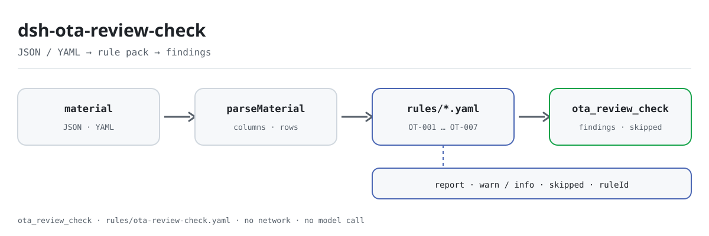

<div align="center">

<picture>
  <source media="(prefers-color-scheme: dark)" srcset="docs/assets/dsh-ota-review-check-flow-dark.svg">
  
</picture>

# dsh-ota-review-check

**逐行核对在线点评回复台账的闭环——哪一行、哪一栏、差什么。**

面向酒店与门店运营、客服的 DeepSeek Harness 核查插件：交一份点评回复台账（门店表头 + 每条点评一行），拿回一份可逐条指认的差异清单；不改原件、不联网、不调用模型，也不下合规结论。

[安装](#三步上手) · [配置](#配置) · [FAQ](#faq) · [简体中文](README.md) · [English](README.en.md) · [Español](README.es.md) · [Português](README.pt.md) · [हिन्दी](README.hi.md)

[](LICENSE)
[](#兼容性)
[](https://www.npmjs.com/package/dsh-ota-review-check)
[](https://github.com/PerryLink/dsh-ota-review-check/actions/workflows/ci.yml)
[](#兼容性)

[](https://github.com/PerryLink/dsh-ota-review-check/stargazers)
[](https://www.npmjs.com/package/dsh-ota-review-check)
[](https://dshfind.com/plugins/PerryLink/dsh-ota-review-check?ref=badge)
[](https://securityscorecards.dev/viewer/?uri=github.com/PerryLink/dsh-ota-review-check)
[](https://dsh.market/)
[](https://gitee.com/perrylink/dsh-ota-review-check)

```sh
dsh plugin --profile <name> add dsh-ota-review-check
```

</div>

<sub>社区插件，与 DeepSeek 官方无关。唯一仓库：<https://github.com/PerryLink/dsh-ota-review-check>（Gitee 为镜像）。</sub>

## 它是什么

`dsh-ota-review-check` 读取一份在线点评回复台账——门店表头加每条点评一行——核对这份台账自身的齐备与闭环：每条点评是否记录了内容或评分、已回复的点评是否记录了回复日期与回复人、回复是否早于点评、未回复的点评是否落在台账自己写明的回复期限之内、问题类型是否取自本机构自己的分类口径、点评编号是否唯一。

它只列出材料内部能逐条指认的差异；无法执行的检查会逐项写进 `skipped` 并说明原因。规则库不伪造引文：每条发现都会写明所引条款，以及该条款原文本次未取得。

## 三步上手

1. **安装**（需要 DSH `>=0.2.1-0 <0.3.0`、Node `^22.19.0 || >=24.0.0`）：

   ```sh
   dsh plugin --profile <name> add dsh-ota-review-check
   ```

2. **最小配置**（默认即可用；规则库随包自带，路径相对插件包根目录）：

   ```yaml
   - insert:
       - id: dsh-ota-review-check
         name: dsh-ota-review-check
         config:
           rulesFile: rules/ota-review-check.yaml
   ```

3. **验证已生效**：

   ```sh
   dsh --profile <name> --dump-config | grep 'dsh-ota-review-check'
   ```

仓库自带可复现样例（先 `pnpm install && pnpm run build`，因为样例从 `lib/index.mjs` 加载插件）：

```sh
node samples/quickstart/run.mjs --check
```

期望 `issueCount: 1`（`warn` 1、`error` 0、`info` 0）、`skippedCount: 1`；样例材料在 `samples/quickstart/input/OT-001-unsafe.json`，期望结果在 `samples/quickstart/expected/result.json`。

**卸载**：`dsh plugin --profile <name> remove dsh-ota-review-check`（或从 profile patch 里删掉该行）。

## 核心能力

插件注册一个工具 `ota_review_check`：读取一份点评回复台账（门店表头加每条点评一行），套用带版本的规则库 `rules/ota-review-check.yaml`，返回一份报告。它只核对台账自身的齐备与闭环，并对无法执行的检查在 `skipped` 中逐项说明。

### 规则表

| 规则 | 核对什么 | 级别 | 依据类型 |
|---|---|---|---|
| `OT-001` | 每条点评记录了内容或评分 | warn | 原则推论 |
| `OT-002` | 已回复的点评带回复日期 | info | 本机构配置 |
| `OT-003` | 台账记录的回复期限与点评日期不矛盾 | info | 本机构配置 |
| `OT-004` | 回复不早于点评 | info | 本机构配置 |
| `OT-005` | 已回复的点评记录了回复人 | info | 本机构配置 |
| `OT-006` | 问题类型取自你的分类口径（默认关闭） | info | 本机构配置 |
| `OT-007` | 点评编号唯一 | warn | 原则推论 |

### 示例

以下为插件对自身 `OT-001` 测试夹具的真实输出，不是示意图。

#### 详细输出

**工具** `ota_review_check`

**输入**

~~~json
{"hotel":"某某门店","period":"2026 年 3 月","platform":"某某平台","rows":[{"序号":"1","渠道":"某某平台","房型":"标准大床房","入住日期":"2026-03-01","总分":"","评分制":"5 分制","点评内容":"","是否回复":"是"}]}
~~~

**输出**

~~~json
{
  "id": "dsh-ota-review-check.OT-001.de09b5a6",
  "ruleId": "OT-001",
  "severity": "warn",
  "locator": {
    "row": 1,
    "field": "content"
  },
  "found": "第 1 行 content、score 都为空",
  "expected": "content、score 至少应填写一项"
}
~~~

*来源 `dsh-ota-review-check/tests/fixtures/OT-001/OT-001-unsafe.json`*

| 你会问 | 它怎么答 |
|---|---|
| 某行「点评内容」与「评分」都没有填，会报出什么？ | `OT-001` 会报出该行：每条点评至少要记录 `content` 与 `score` 中的一项。它只核对是否至少填了一项，不判断点评内容是否属实、是否属于恶意评价。 |
| 某行标了「已回复」，但「回复日期」与「回复人」两栏都空着，会报出什么？ | 凡是「是否回复」取值为配置的 `conditionValues`（`是`、`Y`、`yes`、`true`、`已回复`、`√`）之一的行，`OT-002` 报出缺少 `repliedAt`；`OT-005` 要求凡是带「回复人」列的行都填 `replier`，因此标了「未回复」而回复人栏为空的行同样会被报出。两条都只核对字段是否填写，不判断回复是否及时、是否恰当。 |
| 台账的「回复期限」一栏整列空着，检查会自己按 24 小时或 48 小时算吗？ | 不会。本插件不内置任何平台的回复时限：没有 `replyDeadline` 就没有可比较的对象，`OT-003` 会出现在 `skipped` 中，而不是假定任何天数。它只在台账自己写了回复期限时把点评日期与该期限相比；命中只表示台账里的期限与点评日期对不上，不表示已经违反平台规则。 |
| 「回复日期」写成 2026年3月15日，而且早于「入住日期」，会查出什么？ | `OT-004` 比较 `checkIn` 与 `repliedAt`，回复日期早于点评日期即报出，同一天视为不晚于；解析不了的日期会在该行单独报出，不会静默跳过——例如 `2026年3月15日`，能解析的写法只有 `2026-03-15`、`2026/3/15`、`2026.3.15` 及可选的时分。它只比较两个日期，不判断回复是否及时。 |
| 「问题类型」栏填的是我们自己的说法，为什么报告说这条没执行？ | `OT-006` 的 `values` 出厂为空，即「未配置」，因此它在 `skipped` 中如实说明原因，而不硬编码任何分类体系：分类口径（「卫生」「服务态度」「设施设备」「价格」「噪音」「预订与入住」，或本机构自己的取值）由本机构规定。配置之后，它只报出不在册的取值，不判断该点评应归入哪一类——归类是运营人员的判断。 |
| 同一个「点评编号」在台账里出现了两次，会怎么报？ | `OT-007` 会把后一行报为与前一行重复，比较时忽略空白字符。编号唯一是「每条点评只被登记一次」的前提，因此本条为 `warn`；它只核对唯一性，不判断两行中哪一行是抄错的那条。台账没有 `reviewNo` 列时，本条进入 `skipped`，而不是静默通过。 |

## 依据的标准与法律边界

| 文件 | 文号 | 引用它的规则 |
|---|---|---|
| 《中华人民共和国电子商务法》与平台服务规则 | 现行版本与条号本次未核实 | OT-001 |
| 《中华人民共和国电子商务法》 | 现行版本与条号本次未核实 | OT-002, OT-004, OT-005, OT-007 |
| 各在线旅游平台服务规则（本机构配置） | 无统一标准（本条依据为本机构配置的回复时限） | OT-003 |
| 本机构点评管理办法（本机构配置） | 无统一标准（本条依据为本机构分类口径） | OT-006 |

**边界：** 本插件核对一份**在线点评回复台账**在台账层面可以要求到的闭环——每条点评是否记录了内容或评分，回复是否带有日期与回复人，回复是否不早于点评，未回复的点评是否落在台账写明的回复期限之内，问题类型是否取自你的取值口径，以及点评编号是否唯一。它**不**判定回复是否恰当、点评是否应当申诉或删除、差评是否恶意，或服务质量是否可以接受。

> ### ⚠️ 法律在此要求什么——以及不要求什么
>
> **《中华人民共和国电子商务法》已取得并逐字阅读**（见 `rules/evidence/clause-verification.md`），而这项核对**推翻了本规则库早先的表述框架**。第三十九条把义务加在**平台经营者**身上，而不是商家身上：
>
> > 电子商务平台经营者应当建立健全信用评价制度，公示信用评价规则，为消费者提供对平台内销售的商品或者提供的服务进行评价的途径。
> > 电子商务平台经营者**不得删除**消费者对其平台内销售的商品或者提供的服务的评价。
>
> **没有任何条款要求商家回复评价。** 因此，本插件核对的是一项来自**各平台自身的服务规则和你所在机构的管理政策**的义务——绝不是来自法律——现在规则库和本 README 都不再把回复描述为法律义务。第十七条（不得虚构评价）和第二十条（按承诺交付）涉及的是其他事项，因此刻意**不予**引用。
>
> **每一条 `excerpt` 仍然写着「本次未取得」，每条规则也仍然保持在 `warn` 或 `info`**——平台服务规则本身并未取得，而该法规范的是平台而非商家，因此把某条规则提升为 `direct`，只会把台账的缺口包装成违法。
>
> **本插件不内置任何平台的回复时限。** `OT-003` 把点评日期与**写在台账自身的「回复期限」列中的**截止日期相比，并在该列为空时把自己记入 `skipped`。一项发现说的是「截止日期与点评日期不一致」，而绝不是「你违反了平台规则」。类别词表同样因此出厂为**空**。此外，本插件**不读取情感**：它不判断点评内容是否属实、回复是否恰当；哪些点评需要整改，由运营人员判断。

## 配置

全部可调参数都在 `src/config.ts` 的 Schemastery schema 中，只改 `cordis.yml` 即可生效，无需改代码；逐条阈值在 `rules/` 下的规则库文件里。

| 键 | 类型 | 默认值 | 说明 |
|---|---|---|---|
| `rulesFile` | string | `rules/ota-review-check.yaml` | 规则库文件路径，相对插件包根目录 |
| `disabledRules` | string[] | `[]` | 要停用的规则 id 列表；每条都会出现在 `skipped` 中 |
| `onlyRules` | string[] | `[]` | 只执行这些规则 id；留空表示执行全部规则 |
| `skipNotes` | string | `""` | 附加到每条 `skipped` 说明后的备注 |
| `timeoutMs` | number | `120000` | 工具协作式超时预算（毫秒） |

规则级参数值得注意的几项：

- `OT-002` `conditionValues` —— 「是否回复」列中表示「已回复」的取值，默认 `[是, Y, yes, true, 已回复, √]`。
- `OT-003` 读取台账的「回复期限」/`replyDeadline` 列。插件绝不按天数推导期限，因为各平台的回复窗口不同。
- `OT-006` `values` —— 你的问题分类，例如 `[卫生, 服务态度, 设施设备, 价格, 噪音, 预订与入住]`。留空表示不检查。

profile patch 覆盖示例：

```yaml
- insert:
    - id: dsh-ota-review-check
      name: dsh-ota-review-check
      config:
        disabledRules: [OT-007]
        skipNotes: 本机构 2026 年点评管理办法
        timeoutMs: 60000
```

## 材料格式

工具接受 JSON 或 YAML：

```yaml
hotel: 某某门店
period: 2026 年 3 月
platform: 某某平台
rows:
  - { 序号: '1', 渠道: 某某平台, 房型: 标准大床房, 入住日期: 2026-03-01,
      总分: '4.5', 评分制: 5 分制, 点评内容: 位置方便，前台服务热情，房间隔音一般。,
      是否回复: 是, 回复日期: 2026-03-02, 回复期限: 2026-03-04, 回复人: 张店长,
      问题类型: 噪音, 是否整改: 是 }
```

列名匹配忽略大小写、空格、下划线与连字符；台账自己的列名会被保留，因此一条发现会写明它读的是哪一列。字段在读取层是可选的，由检查引擎校验，因此部分导出的材料会产生「缺项」类差异，而不是让程序崩溃。

## 规则库与引用纪律

规则数据与代码分离，位于 `rules/ota-review-check.yaml`；替换该文件即可切换规则集版本，无需改动 TypeScript。规则库头部完整写明引用缺口，每条规则的 `note` 重复其中与本条相关的部分。

加载期强制：`excerpt` 必须是真实引文且不少于八个字符；依据仅为原则性条款（`kind: derived-from-principle`，严重级上限 `warn`）或本机构配置（`kind: institutional-configuration`，上限 `info`）的检查不得标为 `error`。由于这条守卫分不清「引文」与「描述」，本规则库改由头部说明、逐条 `note` 以及一条断言每个 `excerpt` 都承认该缺口的测试来兜底；`pnpm run check:citations` 再对照 `rules/evidence/` 与只增不减的 `rules/citations-baseline.json` 复核引用。夸大依据的规则库会在加载期失败，而不会产出一份看起来很有底气的报告。

## FAQ

<details>
<summary>台账会被上传、写盘或发给模型吗？</summary>

不会。插件只读取你通过 `file` 或 `material` 交给 `ota_review_check` 的那份材料，在本地解析并套用规则；`dsh.demo` 声明 `network: false`、`writes: []`，代码中没有网络请求、没有模型调用，报告只作为工具结果返回。

</details>

<details>
<summary>报告没有发现，是否等于台账合规、没有风险？</summary>

不等于。它只列出材料内部能逐条指认的差异，不作合规判断、不认定责任，也不替代审核人。无法执行的检查会进入 `skipped`；每一条 `excerpt` 都注明所引条文本次未取得。空结果表示「本次没有可报的差异」，不表示「没有问题」。

</details>

<details>
<summary>为什么 `OT-003`、`OT-006`、`OT-007` 会出现在 `skipped` 里？</summary>

各自的原因都写在 `skipped` 条目中：`OT-003` 需要台账 `replyDeadline` 列有值，没有就不假定任何天数；`OT-006` 的 `values` 出厂为空（未配置分类口径）；`OT-007` 需要 `reviewNo` 列，没有该列时不会静默通过。被 `disabledRules` 停用或被 `onlyRules` 排除的规则同样进入 `skipped`，并带上 `skipNotes` 备注。

</details>

<details>
<summary>为什么发现只有 `warn` / `info`，没有 `error`？</summary>

级别跟着依据走：`derived-from-principle` 封顶 `warn`，`institutional-configuration` 封顶 `info`；平台服务规则本身未取得逐字条文，该法规范的是平台而非商家，因此把任何一条提升为 `direct`/`error` 都会把台账缺口包装成违法。加载期守卫会拒绝夸大依据的规则库。

</details>

<details>
<summary>日期为什么会被报错，或者看起来有时区偏移？</summary>

全部计算都是对输入字符串做墙上时钟运算，不做时区换算。可解析的写法只有 `2026-03-15`、`2026/3/15`、`2026.3.15` 及可选的时分；解析不了的日期（例如 `2026年3月15日`）会在该行单独报出，而不是静默跳过。同一天视为「不晚于」。

</details>

<details>
<summary>某条发现看起来不对，怎么判断？</summary>

- `OT-003` 命中，但回复确实在时限内：台账「回复期限」与点评日期对不上，先核对这两栏的填写。
- `OT-006` 在你认为没问题的分类上报出：该值不在你配置的 `values` 中；扩充列表或改正单元格，插件不自行归类。
- `OT-007` 对同一条点评报了两次：同一点评可能被处理两次（追加回复），应区分两行，而不是复用编号。

</details>

<details>
<summary>装上后工具不出现、版本不兼容，或 `check` 报 `manifest-peers` 失败怎么办？</summary>

确认 `main` 指向 `lib/index.mjs` 且 `pnpm run build` 已生成该文件；`main` 写错会让加载器静默跳过该条目。`dsh plugin add` 报版本不兼容时，peer 范围覆盖 `0.1.x` 与 `0.2.x`，运行时在其之外可显式豁免：`dsh plugin --profile <name> allow-version dsh-ota-review-check@0.1.0 --dsh-version <runtime> --accept-risk`。`manifest-peers` 是 `dsh-plugin-dev` 的已知上游问题：静态检查器比对的是一份早于 0.2 世代的硬编码 peer 范围，安装期的 peer 校验以运行时为准。

</details>

## 安全边界

- **只列差异，不作定性结论。** 报告不会判定合规、责任或对错；`src/shared` 的措辞守卫（wording guard）强制这一点，报告始终携带免责声明。
- **引用不伪造。** 每条规则必须写全 `document` / `number` / `clause` / `excerpt` / `kind` / `source`；`excerpt` 必须是逐字摘录。取不到原文时如实写明，并把依据降为原则推论或本机构配置，级别随之封顶。
- **空结果不能被读成「没有问题」。** 凡未能执行的检查都写进 `skipped` 并带原因；规则所需的列表未配置时，规则把自己记入 `skipped`，而不是静默通过。
- **只读材料、不联网、不调用模型。** 插件只读取你交来的那份材料，`dsh.demo` 声明 `network: false` 与 `writes: []`；没有网络请求，也没有模型调用。
- **注册即 effect。** 工具注册通过 `ctx.tools.register` 返回 disposer；插件卸载或热重载时注册随之撤销。
- **不内置平台时限与分类体系。** 回复窗口与问题分类都来自你的配置与台账本身，插件不替平台或本机构作规定。

## 已知限制

- **规则库当前只有 7 条规则。** `rules/ota-review-check.yaml` 头部注释把「差评是否记录整改」「是否残留模板占位符」列为核对范围，但当前规则库没有对应规则（`OT-001`…`OT-007` 不含这两项）；这两项只能人工核对，本 README 不把它们算作已交付能力。
- **不内置任何平台的回复时限。** `OT-003` 只在台账写了 `replyDeadline` 时比较点评日期与期限；该列为空时进入 `skipped`，不会假定 24 或 48 小时。
- **分类词表出厂为空。** `OT-006` 的 `values` 未配置时不会执行；分类口径（例如「卫生」「服务态度」「设施设备」「价格」「噪音」「预订与入住」，或你自己的取值）由本机构规定。
- **日期格式有限。** 只解析 `2026-03-15`、`2026/3/15`、`2026.3.15` 及可选的时分；中文年月日等写法会在该行报出。所有日期运算都是墙上时钟运算，不做时区换算。
- **只核对结构化字段，不读情感。** 它不判断点评内容是否属实、是否属于恶意评价，也不判定回复是否恰当或服务质量是否合格。
- **条款原文未取得。** 各平台服务规则本次没有拿到逐字条文，因此每条 `excerpt` 都写明这一点，所有规则保持在 `warn` 或 `info`；`rules/citations-baseline.json` 只能缩小，新增引用必须先有出处。
- **需要构建产物。** 插件从 `lib/index.mjs` 加载；`main` 配置错误或未运行 `pnpm run build` 时，加载器会静默跳过该条目。
- **`manifest-peers` 是已知上游问题。** `dsh-plugin-dev` 的静态检查器比对的是一份早于 0.2 世代的硬编码 peer 范围；安装期 peer 兼容性以运行时为准。

## 与其他 DSH 插件的互操作性

以下为代码与包声明层面可核对的事实（本仓未对其他插件做运行时联测）：

- **只注册一个工具。** 工具 id 为 `ota_review_check`，由 `src/index.ts` 的 `TOOL_NAME` 定义，不占用其他裸名工具。
- **不提供 service key。** 插件不导出任何服务键，因此不存在服务键冲突。
- **不注册客户端 slot，也不注册 `webServer` 前缀。** 本仓无 `client/` 目录，`has_client` 为假；插件是纯 host 形态。
- **bundle patch 只 `insert` 自己那一行。** `cordis.patch.yml` 不覆写任何内置行的 `config`。
- **不改全局对象。** 代码不修改原型、不改写 `process.env`、不替换全局 fetch dispatcher；也不发起网络请求或调用模型。
- **注册是 Cordis effect。** 工具注册返回 disposer，停止或热重载即撤销，不会残留全局状态。

## 兼容性

| 项目 | 状态 |
|---|---|
| Harness | 对等版本范围 `>=0.1.2-rc.1 <0.2.0 \|\| >=0.2.0-0 <0.3.0` —— 已实测同时接受 `0.2.0-rc.2` 与 `0.2.1-rc.2`。**已声明 `engines.dsh`**：0.2.1 起由宿主单独裁决，范围为 `>=0.2.1-0 <0.3.0` |
| Node | `^22.19.0 || >=24.0.0` |
| 平台 | 全平台（纯 ESM；无原生代码、无联网、不调用模型） |
| 工具模式 | `native` / `ptc` 均可；批量核对整个目录时建议 `ptc`，schema 成本只付一次 |

## 生态与质量

- [Gitee 镜像](https://gitee.com/perrylink/dsh-ota-review-check)（同步镜像，以 GitHub 为准）
- [dshfind 插件页](https://dshfind.com/plugins/PerryLink/dsh-ota-review-check)（安装量与排名）
- [OpenSSF Scorecard 报告](https://securityscorecards.dev/viewer/?uri=github.com/PerryLink/dsh-ota-review-check)（由 [.github/workflows/scorecard.yml](.github/workflows/scorecard.yml) 驱动）
- [DSH Market](https://dsh.market/)（已上架）
- **WorkBuddy / 扣子（Coze）渠道**：在应用市场搜索「职业文档核对全集」（总包；本检查是其中一项，上架以商城为准）。
- [按材料选核查器](https://perrylink.github.io/zh/checkers/choose/)（生态索引；本仓只是其中一个）

## 开发

```sh
pnpm install
pnpm run typecheck   # tsc --noEmit
pnpm test            # vitest：共享表格插件套件 + 成对夹具
pnpm run build       # tsdown -> lib/index.mjs + lib/index.d.mts
pnpm run verify:self-contained
pnpm run check:lockfile
pnpm run check:citations
pnpm run check:readmes
node ../scripts/sync-shared.mjs dsh-ota-review-check
pnpm pack
```

插件是**数据驱动**的：`src/model.ts` 声明表格形状，共享件提供读取器与核对引擎，规则库声明每一条检查。`node ../scripts/sync-shared.mjs dsh-ota-review-check` 把 `../_shared` 的共享件同步进 `src/shared/`；每次改动共享件后都要重跑。

配图由 [`scripts/gen-readme-assets.py`](scripts/gen-readme-assets.py) 程序化生成（Python + Pillow），可重复执行：

```sh
python scripts/gen-readme-assets.py
```

Topics：`deepseek-harness`, `dsh`, `dsh-plugin`, `cordis`, `ota`, `review`

## 家族与致谢

本项目是 [PerryLink](https://github.com/PerryLink) 维护的 DeepSeek Harness 插件家族成员（全部 Apache-2.0）。如果这个插件帮到了你，**给个 star**——它不解锁任何功能，但会让下一个人更容易找到它。

- [@PerryLink](https://github.com/PerryLink) —— 创建者与维护者：`OT-001`…`OT-007` 规则库、`rules/evidence/` 条文核查记录、共享核对引擎的接入与五语文档。

<details>
<summary>展开全部插件</summary>

| 插件 | 状态 |
|---|---|
| **[dsh-aqua-input-check](https://github.com/PerryLink/dsh-aqua-input-check)** |  |
| **[dsh-archive-check](https://github.com/PerryLink/dsh-archive-check)** |  |
| **[dsh-auto-review](https://github.com/PerryLink/dsh-auto-review)** |  |
| **[dsh-autotier](https://github.com/PerryLink/dsh-autotier)** | 🧊 已冻结 — 见仓库 README |
| **[dsh-bid-ca-precheck](https://github.com/PerryLink/dsh-bid-ca-precheck)** |  |
| **[dsh-bid-qual-check](https://github.com/PerryLink/dsh-bid-qual-check)** |  |
| **[dsh-cert-mcp](https://github.com/PerryLink/dsh-cert-mcp)** | 🧊 已冻结 — 见仓库 README |
| **[dsh-checkpoint-rewind](https://github.com/PerryLink/dsh-checkpoint-rewind)** |  |
| **[dsh-click](https://github.com/PerryLink/dsh-click)** |  |
| **[dsh-composer-history](https://github.com/PerryLink/dsh-composer-history)** |  |
| **[dsh-contract-stance](https://github.com/PerryLink/dsh-contract-stance)** |  |
| **[dsh-customs-doc-check](https://github.com/PerryLink/dsh-customs-doc-check)** |  |
| **[dsh-data-quality](https://github.com/PerryLink/dsh-data-quality)** | 🧊 已冻结 — 见仓库 README |
| **[dsh-demurrage-ledger](https://github.com/PerryLink/dsh-demurrage-ledger)** |  |
| **[dsh-doublecheck](https://github.com/PerryLink/dsh-doublecheck)** |  |
| **[dsh-drill-script-check](https://github.com/PerryLink/dsh-drill-script-check)** |  |
| **[dsh-eia-guide-check](https://github.com/PerryLink/dsh-eia-guide-check)** |  |
| **[dsh-emergency-plan](https://github.com/PerryLink/dsh-emergency-plan)** |  |
| **[dsh-essay-rubric-check](https://github.com/PerryLink/dsh-essay-rubric-check)** |  |
| **[dsh-evidence-check](https://github.com/PerryLink/dsh-evidence-check)** |  |
| **[dsh-export-ctl-check](https://github.com/PerryLink/dsh-export-ctl-check)** |  |
| **[dsh-fast](https://github.com/PerryLink/dsh-fast)** |  |
| **[dsh-fmea-table-check](https://github.com/PerryLink/dsh-fmea-table-check)** |  |
| **[dsh-forecast-penalty](https://github.com/PerryLink/dsh-forecast-penalty)** |  |
| **[dsh-fund-research](https://github.com/PerryLink/dsh-fund-research)** |  |
| **[dsh-github](https://github.com/PerryLink/dsh-github)** |  |
| **[dsh-gongwen-flow-check](https://github.com/PerryLink/dsh-gongwen-flow-check)** |  |
| **[dsh-gongwen-word-check](https://github.com/PerryLink/dsh-gongwen-word-check)** |  |
| **[dsh-guard-plan-qc](https://github.com/PerryLink/dsh-guard-plan-qc)** |  |
| **[dsh-hazchem-check](https://github.com/PerryLink/dsh-hazchem-check)** |  |
| **[dsh-hazplan-check](https://github.com/PerryLink/dsh-hazplan-check)** |  |
| **[dsh-hidden-risk-map](https://github.com/PerryLink/dsh-hidden-risk-map)** |  |
| **[dsh-hs-classify](https://github.com/PerryLink/dsh-hs-classify)** |  |
| **[dsh-icd-rule-check](https://github.com/PerryLink/dsh-icd-rule-check)** |  |
| **[dsh-industry-research](https://github.com/PerryLink/dsh-industry-research)** |  |
| **[dsh-lawcite-adapter](https://github.com/PerryLink/dsh-lawcite-adapter)** |  |
| **[dsh-laya](https://github.com/PerryLink/dsh-laya)** |  |
| **[dsh-lc-doc-check](https://github.com/PerryLink/dsh-lc-doc-check)** |  |
| **[dsh-learning-gap-check](https://github.com/PerryLink/dsh-learning-gap-check)** |  |
| **[dsh-library](https://github.com/PerryLink/dsh-library)** |  |
| **[dsh-local-ai](https://github.com/PerryLink/dsh-local-ai)** |  |
| **[dsh-lsp-actions](https://github.com/PerryLink/dsh-lsp-actions)** |  |
| **[dsh-mask](https://github.com/PerryLink/dsh-mask)** |  |
| **[dsh-mcp-panel](https://github.com/PerryLink/dsh-mcp-panel)** |  |
| **[dsh-medrec-qc](https://github.com/PerryLink/dsh-medrec-qc)** |  |
| **[dsh-memento](https://github.com/PerryLink/dsh-memento)** | 🧊 已冻结 — 见仓库 README |
| **[dsh-nsfc-form-check](https://github.com/PerryLink/dsh-nsfc-form-check)** |  |
| **[dsh-nurse-record-check](https://github.com/PerryLink/dsh-nurse-record-check)** |  |
| **[dsh-observe](https://github.com/PerryLink/dsh-observe)** |  |
| **[dsh-origin-rvc-check](https://github.com/PerryLink/dsh-origin-rvc-check)** |  |
| **[dsh-ota-review-check](https://github.com/PerryLink/dsh-ota-review-check)** |  |
| **[dsh-output-styles](https://github.com/PerryLink/dsh-output-styles)** |  |
| **[dsh-paper-doc-adapter](https://github.com/PerryLink/dsh-paper-doc-adapter)** |  |
| **[dsh-permission-rules](https://github.com/PerryLink/dsh-permission-rules)** |  |
| **[dsh-permit-report-check](https://github.com/PerryLink/dsh-permit-report-check)** |  |
| **[dsh-pipeline-check](https://github.com/PerryLink/dsh-pipeline-check)** |  |
| **[dsh-pleading-draft](https://github.com/PerryLink/dsh-pleading-draft)** |  |
| **[dsh-plugin-doctor](https://github.com/PerryLink/dsh-plugin-doctor)** | 🚫 已退役（仓库已归档） |
| **[dsh-plugin-guide](https://github.com/PerryLink/dsh-plugin-guide)** |  |
| **[dsh-plugin-kit](https://github.com/PerryLink/dsh-plugin-kit)** | 🚫 已退役（仓库已归档） |
| **[dsh-plugin-upgrade](https://github.com/PerryLink/dsh-plugin-upgrade)** | 🚫 已退役（仓库已归档） |
| **[dsh-policy-brief-draft](https://github.com/PerryLink/dsh-policy-brief-draft)** |  |
| **[dsh-power-loss-split](https://github.com/PerryLink/dsh-power-loss-split)** |  |
| **[dsh-power-ticket-check](https://github.com/PerryLink/dsh-power-ticket-check)** |  |
| **[dsh-ppap-check](https://github.com/PerryLink/dsh-ppap-check)** |  |
| **[dsh-protest-deadline](https://github.com/PerryLink/dsh-protest-deadline)** |  |
| **[dsh-railway-window](https://github.com/PerryLink/dsh-railway-window)** |  |
| **[dsh-repair-order-qc](https://github.com/PerryLink/dsh-repair-order-qc)** |  |
| **[dsh-research-report](https://github.com/PerryLink/dsh-research-report)** |  |
| **[dsh-review-reply-check](https://github.com/PerryLink/dsh-review-reply-check)** |  |
| **[dsh-rulefile-check](https://github.com/PerryLink/dsh-rulefile-check)** |  |
| **[dsh-safety-brief-check](https://github.com/PerryLink/dsh-safety-brief-check)** |  |
| **[dsh-score](https://github.com/PerryLink/dsh-score)** | 🧊 已冻结 — 见仓库 README |
| **[dsh-session-sync](https://github.com/PerryLink/dsh-session-sync)** |  |
| **[dsh-site-log-check](https://github.com/PerryLink/dsh-site-log-check)** |  |
| **[dsh-skill-pack-security](https://github.com/PerryLink/dsh-skill-pack-security)** |  |
| **[dsh-soe-decision-check](https://github.com/PerryLink/dsh-soe-decision-check)** |  |
| **[dsh-soilwater-check](https://github.com/PerryLink/dsh-soilwater-check)** |  |
| **[dsh-sop-sync-check](https://github.com/PerryLink/dsh-sop-sync-check)** |  |
| **[dsh-spc-gbt-adapter](https://github.com/PerryLink/dsh-spc-gbt-adapter)** |  |
| **[dsh-talk](https://github.com/PerryLink/dsh-talk)** |  |
| **[dsh-tender-extract](https://github.com/PerryLink/dsh-tender-extract)** |  |
| **[dsh-tender-matrix](https://github.com/PerryLink/dsh-tender-matrix)** |  |
| **[dsh-test-drive](https://github.com/PerryLink/dsh-test-drive)** |  |
| **[dsh-ticktick](https://github.com/PerryLink/dsh-ticktick)** | 🚫 已退役（仓库已归档） |
| **[dsh-translate](https://github.com/PerryLink/dsh-translate)** |  |
| **[dsh-warranty-calc](https://github.com/PerryLink/dsh-warranty-calc)** |  |
| **[dsh-budget](https://github.com/PerryLink/dsh-budget)** | 🧊 已冻结 — 见仓库 README |
| **[dsh-claude-move](https://github.com/PerryLink/dsh-claude-move)** | 🧊 已冻结 — 见仓库 README |
| **[dsh-defend](https://github.com/PerryLink/dsh-defend)** | 🧊 已冻结 — 见仓库 README |
| **[dsh-draw](https://github.com/PerryLink/dsh-draw)** | 🧊 已冻结 — 见仓库 README |
| **[dsh-reach](https://github.com/PerryLink/dsh-reach)** | 🧊 已冻结 — 见仓库 README |
| **[dsh-background-agents](https://github.com/PerryLink/dsh-background-agents)** | 🚫 已退役（仓库已归档） |
| **[dsh-session-pin](https://github.com/PerryLink/dsh-session-pin)** | 🚫 已退役（仓库已归档） |
| **[dsh-team-rooms](https://github.com/PerryLink/dsh-team-rooms)** | 🚫 已退役（仓库已归档） |

</details>

## License

[LICENSE](LICENSE)（Apache License 2.0）© 2026 dsh-ota-review-check contributors

<p align="center"><sub>Apache-2.0 · 社区插件，与 DeepSeek 无关。</sub></p>
