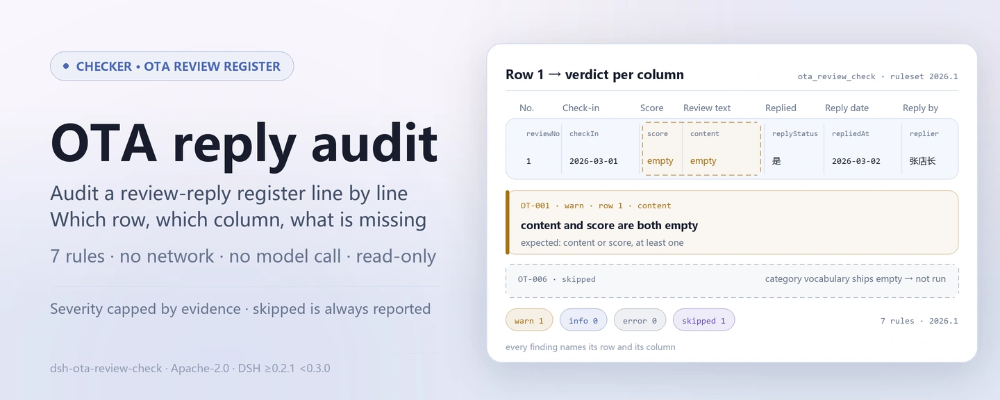

<div align="center">

<picture>
  <source media="(prefers-color-scheme: dark)" srcset="docs/assets/dsh-ota-review-check-hero-en-dark.webp">
  
</picture>

# dsh-ota-review-check

**Verifique linha a linha o fecho do registo de avaliações e respostas em linha — que linha, que coluna, o que falta.**

Verificador do DeepSeek Harness para operações de hotel e loja e para apoio ao cliente: entregue um registo de avaliações e respostas (cabeçalho do estabelecimento mais uma linha por avaliação) e receba uma lista de diferenças apontáveis linha a linha; não altera o original, não vai à rede, não chama um modelo e não emite um veredicto de conformidade.

[Instalar](#instalação-em-três-passos) · [Configuração](#configuração) · [FAQ](#faq) · [简体中文](README.md) · [English](README.en.md) · [Español](README.es.md) · [Português](README.pt.md) · [हिन्दी](README.hi.md)

[](LICENSE)
[](#compatibilidade)
[](https://www.npmjs.com/package/dsh-ota-review-check)
[](https://github.com/PerryLink/dsh-ota-review-check/actions/workflows/ci.yml)
[](#compatibilidade)

[](https://github.com/PerryLink/dsh-ota-review-check/stargazers)
[](https://www.npmjs.com/package/dsh-ota-review-check)
[](https://dshfind.com/plugins/PerryLink/dsh-ota-review-check?ref=badge)
[](https://securityscorecards.dev/viewer/?uri=github.com/PerryLink/dsh-ota-review-check)
[](https://dsh.market/)
[](https://gitee.com/perrylink/dsh-ota-review-check)

```sh
dsh plugin --profile <name> add dsh-ota-review-check
```

</div>

<sub>Plugin da comunidade, sem afiliação com a DeepSeek. Repositório canónico: <https://github.com/PerryLink/dsh-ota-review-check> (o Gitee é um espelho).</sub>

## O que é

`dsh-ota-review-check` lê um registo de avaliações em linha com as respetivas respostas —o cabeçalho do estabelecimento mais uma linha por avaliação— e verifica a completude e o fecho desse próprio registo: se cada avaliação regista o seu conteúdo ou uma pontuação, se uma avaliação respondida traz data de resposta e autor da resposta, se a resposta não é anterior à avaliação, se uma avaliação sem resposta cai dentro do prazo que o próprio registo declara, se o tipo de problema vem do vocabulário da sua instituição e se os números de avaliação são únicos.

Enumera apenas as diferenças que o próprio material permite apontar, linha a linha; cada verificação que não pôde correr declara-se em `skipped` com o motivo. O pacote de regras não inventa citações: cada achado nomeia a cláusula aplicada e avisa que o seu texto não foi obtido nesta passagem.

<picture>
  <source media="(prefers-color-scheme: dark)" srcset="docs/assets/dsh-ota-review-check-flow-v5-dark.svg">
  
</picture>

## Instalação em três passos

1. **Instalar** (requer DSH `>=0.2.1-0 <0.3.0` e Node `^22.19.0 || >=24.0.0`):

   ```sh
   dsh plugin --profile <name> add dsh-ota-review-check
   ```

2. **Configuração mínima** (os valores por omissão funcionam; o pacote de regras vem incluído e o caminho é relativo à raiz do pacote):

   ```yaml
   - insert:
       - id: dsh-ota-review-check
         name: dsh-ota-review-check
         config:
           rulesFile: rules/ota-review-check.yaml
   ```

3. **Confirmar que montou**:

   ```sh
   dsh --profile <name> --dump-config | grep 'dsh-ota-review-check'
   ```

O repositório inclui um quickstart reproduzível (execute `pnpm install && pnpm run build` primeiro, porque o exemplo carrega o plugin a partir de `lib/index.mjs`):

```sh
node samples/quickstart/run.mjs --check
```

Espera-se `issueCount: 1` (`warn` 1, `error` 0, `info` 0) e `skippedCount: 1`; o material está em `samples/quickstart/input/OT-001-unsafe.json` e o resultado esperado em `samples/quickstart/expected/result.json`.

**Desinstalar**: `dsh plugin --profile <name> remove dsh-ota-review-check` (ou apague a linha do patch do perfil).

## Capacidades principais

O plugin regista uma ferramenta, `ota_review_check`: lê um registo de avaliações e respostas (cabeçalho do estabelecimento mais uma linha por avaliação), aplica um pacote de regras versionado (`rules/ota-review-check.yaml`) e devolve um relatório. Verifica a completude e o fecho do próprio registo e declara em `skipped` cada verificação que não pôde correr.

### Tabela de regras

| Regra | O que verifica | Nível | Tipo de base |
|---|---|---|---|
| `OT-001` | a avaliação regista conteúdo ou uma pontuação | warn | princípio |
| `OT-002` | uma avaliação respondida traz data de resposta | info | configuração local |
| `OT-003` | o prazo de resposta registado não contradiz a data da avaliação | info | configuração local |
| `OT-004` | a resposta não é anterior à avaliação | info | configuração local |
| `OT-005` | uma avaliação respondida nomeia o autor da resposta | info | configuração local |
| `OT-006` | o tipo de problema vem do seu vocabulário (desativada por omissão) | info | configuração local |
| `OT-007` | os números de avaliação são únicos | warn | princípio |

### Exemplos

Esta é a saída real do plugin sobre o seu próprio fixture de teste `OT-001`, não uma ilustração.

#### Saída detalhada

**Ferramenta** `ota_review_check`

**Entrada**

~~~json
{"hotel":"某某门店","period":"2026 年 3 月","platform":"某某平台","rows":[{"序号":"1","渠道":"某某平台","房型":"标准大床房","入住日期":"2026-03-01","总分":"","评分制":"5 分制","点评内容":"","是否回复":"是"}]}
~~~

**Saída**

~~~json
{
  "id": "dsh-ota-review-check.OT-001.de09b5a6",
  "ruleId": "OT-001",
  "severity": "warn",
  "locator": {
    "row": 1,
    "field": "content"
  },
  "found": "第 1 行 content、score 都为空",
  "expected": "content、score 至少应填写一项"
}
~~~

*Observado em `dsh-ota-review-check/tests/fixtures/OT-001/OT-001-unsafe.json`*

| Você pergunta | O que ele responde |
|---|---|
| Uma linha não tem preenchidos nem 点评内容 nem 评分. O que é reportado? | `OT-001` reporta essa linha: cada avaliação tem de registar pelo menos um dos dois campos, `content` ou `score`. Verifica apenas que um deles está preenchido; não julga se o conteúdo da avaliação é verdadeiro nem se se trata de uma avaliação maliciosa. |
| Uma linha está marcada 已回复, mas as células 回复日期 e 回复人 estão vazias. O que é reportado? | `OT-002` reporta a falta de `repliedAt` em qualquer linha cujo `replyStatus` tenha um dos valores configurados (`是`, `Y`, `yes`, `true`, `已回复`, `√`), e `OT-005` exige que `replier` esteja preenchido em qualquer linha que traga a coluna 回复人, pelo que uma célula vazia é reportada mesmo numa linha marcada 未回复. Ambas verificam apenas que a célula está preenchida: nenhuma diz se a resposta foi atempada ou adequada. |
| No nosso registo a coluna 回复期限 está vazia em todas as linhas. A verificação assume um prazo de 24 ou 48 horas? | Não. O plugin não incorpora o prazo de nenhuma plataforma: sem um valor em `replyDeadline` não há nada a comparar e `OT-003` aparece em `skipped` em vez de presumir um número de dias. Só corre contra o prazo que o próprio registo escreve na coluna 回复期限, e uma ocorrência significa que esse prazo e a data da avaliação não concordam, não que uma regra da plataforma tenha sido violada. |
| A 回复日期 está escrita como 2026年3月15日 e é anterior à 入住日期. O que é detetado? | `OT-004` compara `checkIn` com `repliedAt` e reporta uma data de resposta anterior à data da avaliação, considerando o mesmo dia como não posterior; uma data que não consegue analisar —`2026年3月15日`, por exemplo, pois só são analisadas `2026-03-15`, `2026/3/15` e `2026.3.15` com hora opcional— é reportada nessa linha em vez de ser omitida em silêncio. Compara apenas as duas datas e não julga se a resposta foi atempada. |
| Preenchemos 问题类型 com palavras nossas. Porque diz o relatório que a verificação não correu? | `OT-006` traz a lista `values` vazia, ou seja, por configurar, pelo que se declara em `skipped` com esse motivo em vez de inventar um sistema de categorias: o vocabulário (卫生, 服务态度, 设施设备, 价格, 噪音, 预订与入住 ou o da sua instituição) é definido pela instituição. Depois de o configurar, a regra reporta qualquer valor fora da lista e não verifica mais nada: em que categoria se enquadra uma avaliação continua a ser um juízo do operador. |
| O mesmo 点评编号 aparece duas vezes no registo. O que é reportado? | `OT-007` reporta a segunda linha como duplicada da primeira, comparando `reviewNo` e ignorando espaços em branco. A unicidade é a premissa de que cada avaliação seja registada uma só vez, por isso a regra está em `warn`; verifica apenas a unicidade e não diz qual das duas linhas é a cópia. Sem coluna `reviewNo`, a regra declara-se em `skipped` em vez de passar em silêncio. |

## Normas e limites legais

| Documento | Número | Regras que o citam |
|---|---|---|
| Lei do Comércio Eletrónico da República Popular da China e regras de serviço das plataformas | Versão em vigor e números de artigo não verificados nesta passagem | OT-001 |
| Lei do Comércio Eletrónico da República Popular da China | Versão em vigor e números de artigo não verificados nesta passagem | OT-002, OT-004, OT-005, OT-007 |
| Regras de serviço das plataformas de viagens em linha (configuração da instituição) | Sem norma unificada (esta linha baseia-se no prazo de resposta configurado pela sua instituição) | OT-003 |
| Política de gestão de avaliações da sua instituição (configuração da instituição) | Sem norma unificada (esta linha baseia-se no vocabulário de categorias da sua instituição) | OT-006 |

**Limite:** este plugin verifica um **registo de avaliações e respostas em linha** face ao fecho que um registo pode exigir — que cada avaliação registe o seu conteúdo ou uma pontuação, que uma resposta traga data e autor, que a resposta não seja anterior à avaliação, que uma avaliação sem resposta caia dentro do prazo que o registo declara, que o tipo de problema venha do seu vocabulário e que os números de avaliação sejam únicos. **Não** decide se uma resposta foi adequada, se uma avaliação deve ser contestada ou removida, se uma má avaliação é maliciosa ou se a qualidade do serviço é aceitável.

> ### ⚠️ O que a lei exige aqui — e o que não exige
>
> **A Lei do Comércio Eletrónico da República Popular da China foi obtida e lida literalmente** (ver `rules/evidence/clause-verification.md`), e a verificação **reverteu o enquadramento anterior deste pacote**. O artigo 39 coloca o dever no **operador da plataforma**, não no comerciante:
>
> ```text
> Artigo 39 (texto literal, original em chinês):
> 电子商务平台经营者应当建立健全信用评价制度，公示信用评价规则，为消费者提供对平台内销售的商品或者提供的服务进行评价的途径。
> 电子商务平台经营者不得删除消费者对其平台内销售的商品或者提供的服务的评价。
> ```
>
> **Não existe qualquer disposição que obrigue o comerciante a responder a uma avaliação.** Por isso este plugin verifica um dever que vem das **regras de serviço de cada plataforma e da política de gestão da sua instituição** — nunca do texto legal — e nem o pacote de regras nem este README descrevem agora a resposta como uma obrigação legal. Os artigos 17 (não fabricar avaliações) e 20 (entregar o prometido) tratam de outras matérias e deliberadamente **não** são citados.
>
> **Cada `excerpt` continua a dizer que o texto não foi obtido, e cada regra permanece em `warn` ou `info`** — as regras de serviço das plataformas não foram obtidas, e a lei regula a plataforma e não o comerciante, pelo que elevar uma regra a `direct` vestiria uma lacuna do registo como incumprimento legal.
>
> **O plugin não incorpora o prazo de resposta de nenhuma plataforma.** `OT-003` compara a data da avaliação com o prazo **escrito na própria coluna 回复期限 do registo**, e com essa coluna vazia declara-se em `skipped`. Um achado diz «o prazo e a data da avaliação não concordam», nunca «violou as regras da plataforma». O vocabulário de categorias vem **vazio** pela mesma razão. E o plugin **não lê sentimento nem julga se uma resposta foi adequada**; que avaliação precisa de que remédio continua a ser decisão do operador.

## Configuração

Todos os parâmetros ajustáveis ficam no esquema Schemastery de `src/config.ts`, portanto mudam pelo `cordis.yml` sem editar código; os limites por regra ficam no pacote de regras sob `rules/`.

| Chave | Tipo | Padrão | Descrição |
|---|---|---|---|
| `rulesFile` | string | `rules/ota-review-check.yaml` | Caminho do pacote de regras, relativo à raiz do pacote |
| `disabledRules` | string[] | `[]` | Ids de regras a desativar; cada uma aparece em `skipped` |
| `onlyRules` | string[] | `[]` | Executar apenas estas regras; vazio executa todas |
| `skipNotes` | string | `""` | Nota acrescentada a cada motivo de `skipped` |
| `timeoutMs` | number | `120000` | Orçamento de tempo limite cooperativo da ferramenta |

Parâmetros de regra que vale a pena conhecer:

- `OT-002` `conditionValues` — os valores da coluna 是否回复 que significam «respondida»: `是`, `Y`, `yes`, `true`, `已回复`, `√`.
- `OT-003` lê a coluna 回复期限 / `replyDeadline` do registo. O plugin nunca deduz um prazo a partir de um número de dias, porque as janelas variam por plataforma.
- `OT-006` `values` — as suas categorias de problema, por exemplo 卫生, 服务态度, 设施设备, 价格, 噪音, 预订与入住. Vazio significa que não se verifica.

Exemplo de substituição no patch do perfil:

```yaml
- insert:
    - id: dsh-ota-review-check
      name: dsh-ota-review-check
      config:
        disabledRules: [OT-007]
        skipNotes: Política de avaliações de 2026 deste estabelecimento
        timeoutMs: 60000
```

## Formato do material

A ferramenta aceita JSON ou YAML:

```yaml
hotel: 某某门店
period: 2026 年 3 月
platform: 某某平台
rows:
  - { 序号: '1', 渠道: 某某平台, 房型: 标准大床房, 入住日期: 2026-03-01,
      总分: '4.5', 评分制: 5 分制, 点评内容: 位置方便，前台服务热情，房间隔音一般。,
      是否回复: 是, 回复日期: 2026-03-02, 回复期限: 2026-03-04, 回复人: 张店长,
      问题类型: 噪音, 是否整改: 是 }
```

Os nomes de coluna são comparados sem distinguir maiúsculas de minúsculas e ignorando espaços, underscores e hífenes; os nomes próprios do registo são mantidos, pelo que um achado nomeia a coluna que leu. Os campos são opcionais na camada de leitura e validados pelo motor de verificação, pelo que uma exportação parcial produz diferenças por «falta um elemento» em vez de falhar.

## Fontes das regras

Os dados das regras ficam em `rules/ota-review-check.yaml`, separados do código: substituir esse ficheiro muda o conjunto de regras sem tocar em TypeScript. O cabeçalho do pacote declara a lacuna de citações por completo, e a `note` de cada regra repete a parte que lhe diz respeito.

O carregador impõe que `excerpt` seja uma citação real de pelo menos oito caracteres e proíbe que uma verificação baseada apenas num princípio (`kind: derived-from-principle`, teto `warn`) ou em configuração institucional (`kind: institutional-configuration`, teto `info`) seja marcada como `error`. Como essa guarda não distingue uma citação de uma descrição, este pacote apoia-se no cabeçalho, nas notas por regra e num teste que exige que cada `excerpt` admita a lacuna; o `pnpm run check:citations` volta a contrastar os excertos com `rules/evidence/` e com `rules/citations-baseline.json`, que só pode encolher. Um pacote que exagere a sua base falha ao carregar em vez de produzir um relatório de aparência sólida.

## FAQ

<details>
<summary>O registo é enviado, escrito em disco ou enviado a um modelo?</summary>

Não. O plugin lê apenas o material que você entrega a `ota_review_check` através de `file` ou `material`, analisa-o localmente e aplica as regras; o `dsh.demo` declara `network: false` e `writes: []`, não há qualquer pedido de rede nem chamada a modelo no código, e o relatório é devolvido apenas como resultado da ferramenta.

</details>

<details>
<summary>Um relatório sem achados significa que o registo está conforme?</summary>

Não. Enumera apenas as diferenças que o próprio material permite apontar; não emite juízos de conformidade, não atribui responsabilidade e não substitui o revisor. As verificações que não puderam correr figuram em `skipped`, e cada `excerpt` declara que o texto da cláusula não foi obtido. Um relatório vazio significa «não houve diferenças reportáveis nesta execução», não «não há nada de errado».

</details>

<details>
<summary>Porque aparecem `OT-003`, `OT-006` ou `OT-007` em `skipped`?</summary>

O motivo é escrito em cada entrada de `skipped`: `OT-003` precisa de um valor na coluna `replyDeadline` do registo e não presume qualquer número de dias sem ele; `OT-006` traz a lista `values` vazia (sem vocabulário de categorias configurado); `OT-007` precisa de uma coluna `reviewNo` e não passa em silêncio sem ela. As regras desativadas com `disabledRules` ou excluídas por `onlyRules` também acabam em `skipped`, com a nota de `skipNotes`.

</details>

<details>
<summary>Porque os achados são apenas `warn` ou `info`, nunca `error`?</summary>

O nível segue a evidência: `derived-from-principle` está limitado a `warn` e `institutional-configuration` a `info`; as regras de serviço das plataformas não foram obtidas literalmente, e a lei regula a plataforma e não o comerciante, pelo que promover qualquer regra a `direct`/`error` vestiria uma lacuna do registo como incumprimento legal. Uma guarda de carregamento rejeita o pacote que exagere a sua base.

</details>

<details>
<summary>Porque é reportada uma data, ou porque parecem deslocadas as horas?</summary>

Toda a aritmética é de hora local sobre as cadeias fornecidas, sem conversão de fuso horário. As únicas formas analisáveis são `2026-03-15`, `2026/3/15` e `2026.3.15` com hora opcional; uma data que não consegue analisar (por exemplo, o formato chinês ano-mês-dia) é reportada nessa linha em vez de ser omitida em silêncio. O mesmo dia conta como não posterior.

</details>

<details>
<summary>Um achado parece errado. Como o julgo?</summary>

- `OT-003` dispara mas a resposta foi mesmo atempada: a célula 回复期限 do registo não concorda com a data da avaliação; verifique primeiro essas duas células.
- `OT-006` dispara numa categoria que considera correta: o valor não está no seu `values` configurado; amplie a lista ou corrija a célula — o plugin não classifica avaliações por si.
- `OT-007` dispara duas vezes na mesma avaliação: uma avaliação pode ser tratada legitimamente duas vezes (uma resposta de seguimento); distinga as linhas em vez de reutilizar o número.

</details>

<details>
<summary>A ferramenta não aparece após instalar, a versão é recusada ou o `check` reporta `manifest-peers` como falha. O que faço?</summary>

Confirme que `main` resolve para `lib/index.mjs` e que `pnpm run build` o gerou; um `main` errado faz o carregador omitir a entrada em silêncio. Se o `dsh plugin add` recusar o pacote por incompatibilidade, a faixa de peers cobre `0.1.x` e `0.2.x`; fora dela, conceda isenção explícita: `dsh plugin --profile <name> allow-version dsh-ota-review-check@0.1.0 --dsh-version <runtime> --accept-risk`. O `manifest-peers` é um problema conhecido do `dsh-plugin-dev`: o verificador estático compara com uma faixa de peers codificada anterior à linha 0.2, enquanto o runtime aplica a compatibilidade na instalação.

</details>

## Limites de segurança

- **Apenas diferenças, nunca um veredicto.** O relatório não se pronuncia sobre conformidade, responsabilidade ou correção; a guarda de redação em `src/shared` impõe isso e o relatório leva sempre o aviso legal.
- **Sem citações inventadas.** Cada regra declara `document` / `number` / `clause` / `excerpt` / `kind` / `source`, e `excerpt` tem de ser uma citação literal. Quando o texto não está disponível, o pacote diz isso e baixa a base para princípio ou configuração institucional, limitando o nível em conformidade.
- **Um resultado vazio não pode ser lido como «não há problema».** Cada verificação que não pôde correr figura em `skipped` com o motivo; uma regra cuja lista necessária não está configurada declara-se em `skipped` em vez de passar em silêncio.
- **Material só de leitura, sem rede e sem modelo.** O plugin lê apenas o material que lhe é entregue; o `dsh.demo` declara `network: false` e `writes: []`, e não há pedido de rede nem invocação de modelo.
- **Os registos são efeitos.** O registo da ferramenta passa por `ctx.tools.register` e devolve um disposer, pelo que descarregar ou recarregar a quente o plugin o remove.
- **Sem janela de plataforma nem sistema de categorias incorporados.** As janelas de resposta e as categorias de problema vêm da sua configuração e do próprio registo; o plugin não fala por uma plataforma nem por uma instituição.

## Limitações conhecidas

- **O pacote de regras tem hoje sete regras.** O cabeçalho de `rules/ota-review-check.yaml` inclui entre as verificações «uma má avaliação registra uma retificação?» e «restam marcadores de modelo?», mas nenhuma regra as implementa (`OT-001`…`OT-007` não contém nenhuma das duas); ambas continuam a ser revisão manual e este README não as conta como capacidades entregues.
- **Não se incorpora o prazo de resposta de nenhuma plataforma.** `OT-003` compara a data da avaliação com o prazo apenas quando o registo anota `replyDeadline`; uma coluna vazia acaba em `skipped` em vez de presumir 24 ou 48 horas.
- **O vocabulário de categorias vem vazio.** `OT-006` não corre até `values` ser configurado; o vocabulário (卫生, 服务态度, 设施设备, 价格, 噪音, 预订与入住, ou o seu) é da sua instituição.
- **Os formatos de data são limitados.** Só são analisados `2026-03-15`, `2026/3/15` e `2026.3.15` com hora opcional; o formato chinês ano-mês-dia é reportado nessa linha. Toda a aritmética de datas é de hora local sobre as cadeias fornecidas, sem conversão de fuso horário.
- **Apenas campos estruturados, sem leitura de sentimento.** Não julga se o conteúdo de uma avaliação é verdadeiro ou malicioso, se uma resposta foi adequada ou se a qualidade do serviço é aceitável.
- **O texto das cláusulas não foi obtido.** As regras de serviço das plataformas não foram obtidas literalmente nesta passagem, pelo que cada `excerpt` o diz e cada regra permanece em `warn` ou `info`; `rules/citations-baseline.json` só pode encolher e uma nova citação tem de ter fonte antes de entrar.
- **É necessário um artefacto compilado.** O plugin carrega de `lib/index.mjs`; um `main` errado ou um `pnpm run build` omitido fazem o carregador omitir a entrada em silêncio.
- **`manifest-peers` é um problema conhecido de origem.** O verificador estático do `dsh-plugin-dev` compara com uma faixa de peers codificada anterior à linha 0.2; a compatibilidade na instalação é decidida pelo runtime.

## Interoperabilidade com outros plugins DSH

Estes são factos verificáveis no código e nas declarações do pacote (este repositório não executa testes de interoperabilidade em tempo de execução contra outros plugins):

- **Uma só ferramenta.** O id é `ota_review_check`, definido como `TOOL_NAME` em `src/index.ts`; não é registado nenhum nome nu pertencente a outro plugin.
- **Sem chave de serviço.** O plugin não exporta qualquer chave de serviço, pelo que não pode colidir numa.
- **Sem slot de cliente nem prefixo `webServer`.** Não existe diretório `client/` e `has_client` é falso; é um plugin puramente de host.
- **O patch do bundle apenas `insert`a a sua própria linha.** O `cordis.patch.yml` nunca sobrepõe o `config` de uma linha integrada.
- **Sem mutação global.** O código não corrige protótipos, não reescreve `process.env` nem substitui o despachante global de fetch; não faz pedidos de rede nem chama um modelo.
- **Os registos são efeitos do Cordis.** O registo da ferramenta devolve um disposer, pelo que parar ou recarregar a quente o remove sem deixar estado global.

## Compatibilidade

| Superfície | Estado |
|---|---|
| Harness | Faixa de peers `>=0.1.2-rc.1 <0.2.0 \|\| >=0.2.0-0 <0.3.0` — verificada para aceitar tanto `0.2.0-rc.2` quanto `0.2.1-rc.2`. `engines.dsh` é declarado como `>=0.2.1-0 <0.3.0` e o host o aplica desde 0.2.1 |
| Node | `^22.19.0 \|\| >=24.0.0` |
| Plataformas | Todas (ESM puro; sem código nativo, sem rede, sem chamada ao modelo) |
| Modo de ferramenta | Funciona em `native` e `ptc`; para um diretório inteiro use `ptc` |

## Ecossistema e qualidade

- [Espelho no Gitee](https://gitee.com/perrylink/dsh-ota-review-check) (espelho sincronizado; o GitHub é o canónico)
- [Página do plugin no dshfind](https://dshfind.com/plugins/PerryLink/dsh-ota-review-check) (instalações e classificação)
- [Relatório OpenSSF Scorecard](https://securityscorecards.dev/viewer/?uri=github.com/PerryLink/dsh-ota-review-check) (impulsionado por [.github/workflows/scorecard.yml](.github/workflows/scorecard.yml))
- [DSH Market](https://dsh.market/) (publicado)
- **Canal WorkBuddy / Coze**: procure «Professional Document Check Suite» na loja de aplicações (o conjunto completo; esta verificação é uma parte; disponibilidade conforme o catálogo)
- [Escolher um verificador por material](https://perrylink.github.io/zh/checkers/choose/) (índice do ecossistema; este repositório é um deles)

## Desenvolvimento

```sh
pnpm install
pnpm run typecheck   # tsc --noEmit
pnpm test            # vitest: suíte partilhada de plugins de tabela + fixtures emparelhados
pnpm run build       # tsdown -> lib/index.mjs + lib/index.d.mts
pnpm run verify:self-contained
pnpm run check:lockfile
pnpm run check:citations
pnpm run check:readmes
node ../scripts/sync-shared.mjs dsh-ota-review-check
pnpm pack
```

O plugin é **orientado por dados**: `src/model.ts` declara a forma da tabela, o kit partilhado fornece o leitor e o motor de verificação, e o pacote de regras declara cada verificação. `node ../scripts/sync-shared.mjs dsh-ota-review-check` copia o kit partilhado de `../_shared` para `src/shared/`; execute-o de novo após cada alteração partilhada.

As imagens do README são geradas por [`scripts/gen-readme-assets.py`](scripts/gen-readme-assets.py) (Python + Pillow) e podem ser executadas de novo sem risco:

```sh
python scripts/gen-readme-assets.py
```

Topics: `deepseek-harness`, `dsh`, `dsh-plugin`, `cordis`, `ota`, `review`

## Família e agradecimentos

Este projeto faz parte da família de plugins do DeepSeek Harness da [PerryLink](https://github.com/PerryLink) (todos Apache-2.0). Se for útil, **uma estrela ajuda a próxima pessoa a encontrá-lo** — nada está bloqueado por trás dela.

- [@PerryLink](https://github.com/PerryLink) — criador e mantenedor: o pacote de regras `OT-001`…`OT-007`, o registo de verificação de cláusulas em `rules/evidence/`, a integração do motor de verificação partilhado e a documentação em cinco idiomas.

<details>
<summary>Expandir todos os plugins</summary>

| Plugin | Estado |
|---|---|
| **[dsh-aqua-input-check](https://github.com/PerryLink/dsh-aqua-input-check)** |  |
| **[dsh-archive-check](https://github.com/PerryLink/dsh-archive-check)** |  |
| **[dsh-auto-review](https://github.com/PerryLink/dsh-auto-review)** |  |
| **[dsh-autotier](https://github.com/PerryLink/dsh-autotier)** | 🧊 CONGELADO — ver o README do repo |
| **[dsh-bid-ca-precheck](https://github.com/PerryLink/dsh-bid-ca-precheck)** |  |
| **[dsh-bid-qual-check](https://github.com/PerryLink/dsh-bid-qual-check)** |  |
| **[dsh-cert-mcp](https://github.com/PerryLink/dsh-cert-mcp)** | 🧊 CONGELADO — ver o README do repo |
| **[dsh-checkpoint-rewind](https://github.com/PerryLink/dsh-checkpoint-rewind)** |  |
| **[dsh-click](https://github.com/PerryLink/dsh-click)** |  |
| **[dsh-composer-history](https://github.com/PerryLink/dsh-composer-history)** |  |
| **[dsh-contract-stance](https://github.com/PerryLink/dsh-contract-stance)** |  |
| **[dsh-customs-doc-check](https://github.com/PerryLink/dsh-customs-doc-check)** |  |
| **[dsh-data-quality](https://github.com/PerryLink/dsh-data-quality)** | 🧊 CONGELADO — ver o README do repo |
| **[dsh-demurrage-ledger](https://github.com/PerryLink/dsh-demurrage-ledger)** |  |
| **[dsh-doublecheck](https://github.com/PerryLink/dsh-doublecheck)** |  |
| **[dsh-drill-script-check](https://github.com/PerryLink/dsh-drill-script-check)** |  |
| **[dsh-eia-guide-check](https://github.com/PerryLink/dsh-eia-guide-check)** |  |
| **[dsh-emergency-plan](https://github.com/PerryLink/dsh-emergency-plan)** |  |
| **[dsh-essay-rubric-check](https://github.com/PerryLink/dsh-essay-rubric-check)** |  |
| **[dsh-evidence-check](https://github.com/PerryLink/dsh-evidence-check)** |  |
| **[dsh-export-ctl-check](https://github.com/PerryLink/dsh-export-ctl-check)** |  |
| **[dsh-fast](https://github.com/PerryLink/dsh-fast)** |  |
| **[dsh-fmea-table-check](https://github.com/PerryLink/dsh-fmea-table-check)** |  |
| **[dsh-forecast-penalty](https://github.com/PerryLink/dsh-forecast-penalty)** |  |
| **[dsh-fund-research](https://github.com/PerryLink/dsh-fund-research)** |  |
| **[dsh-github](https://github.com/PerryLink/dsh-github)** |  |
| **[dsh-gongwen-flow-check](https://github.com/PerryLink/dsh-gongwen-flow-check)** |  |
| **[dsh-gongwen-word-check](https://github.com/PerryLink/dsh-gongwen-word-check)** |  |
| **[dsh-guard-plan-qc](https://github.com/PerryLink/dsh-guard-plan-qc)** |  |
| **[dsh-hazchem-check](https://github.com/PerryLink/dsh-hazchem-check)** |  |
| **[dsh-hazplan-check](https://github.com/PerryLink/dsh-hazplan-check)** |  |
| **[dsh-hidden-risk-map](https://github.com/PerryLink/dsh-hidden-risk-map)** |  |
| **[dsh-hs-classify](https://github.com/PerryLink/dsh-hs-classify)** |  |
| **[dsh-icd-rule-check](https://github.com/PerryLink/dsh-icd-rule-check)** |  |
| **[dsh-industry-research](https://github.com/PerryLink/dsh-industry-research)** |  |
| **[dsh-lawcite-adapter](https://github.com/PerryLink/dsh-lawcite-adapter)** |  |
| **[dsh-laya](https://github.com/PerryLink/dsh-laya)** |  |
| **[dsh-lc-doc-check](https://github.com/PerryLink/dsh-lc-doc-check)** |  |
| **[dsh-learning-gap-check](https://github.com/PerryLink/dsh-learning-gap-check)** |  |
| **[dsh-library](https://github.com/PerryLink/dsh-library)** |  |
| **[dsh-local-ai](https://github.com/PerryLink/dsh-local-ai)** |  |
| **[dsh-lsp-actions](https://github.com/PerryLink/dsh-lsp-actions)** |  |
| **[dsh-mask](https://github.com/PerryLink/dsh-mask)** |  |
| **[dsh-mcp-panel](https://github.com/PerryLink/dsh-mcp-panel)** |  |
| **[dsh-medrec-qc](https://github.com/PerryLink/dsh-medrec-qc)** |  |
| **[dsh-memento](https://github.com/PerryLink/dsh-memento)** | 🧊 CONGELADO — ver o README do repo |
| **[dsh-nsfc-form-check](https://github.com/PerryLink/dsh-nsfc-form-check)** |  |
| **[dsh-nurse-record-check](https://github.com/PerryLink/dsh-nurse-record-check)** |  |
| **[dsh-observe](https://github.com/PerryLink/dsh-observe)** |  |
| **[dsh-origin-rvc-check](https://github.com/PerryLink/dsh-origin-rvc-check)** |  |
| **[dsh-ota-review-check](https://github.com/PerryLink/dsh-ota-review-check)** |  |
| **[dsh-output-styles](https://github.com/PerryLink/dsh-output-styles)** |  |
| **[dsh-paper-doc-adapter](https://github.com/PerryLink/dsh-paper-doc-adapter)** |  |
| **[dsh-permission-rules](https://github.com/PerryLink/dsh-permission-rules)** |  |
| **[dsh-permit-report-check](https://github.com/PerryLink/dsh-permit-report-check)** |  |
| **[dsh-pipeline-check](https://github.com/PerryLink/dsh-pipeline-check)** |  |
| **[dsh-pleading-draft](https://github.com/PerryLink/dsh-pleading-draft)** |  |
| **[dsh-plugin-doctor](https://github.com/PerryLink/dsh-plugin-doctor)** | 🚫 APOSENTADO (repo arquivado) |
| **[dsh-plugin-guide](https://github.com/PerryLink/dsh-plugin-guide)** |  |
| **[dsh-plugin-kit](https://github.com/PerryLink/dsh-plugin-kit)** | 🚫 APOSENTADO (repo arquivado) |
| **[dsh-plugin-upgrade](https://github.com/PerryLink/dsh-plugin-upgrade)** | 🚫 APOSENTADO (repo arquivado) |
| **[dsh-policy-brief-draft](https://github.com/PerryLink/dsh-policy-brief-draft)** |  |
| **[dsh-power-loss-split](https://github.com/PerryLink/dsh-power-loss-split)** |  |
| **[dsh-power-ticket-check](https://github.com/PerryLink/dsh-power-ticket-check)** |  |
| **[dsh-ppap-check](https://github.com/PerryLink/dsh-ppap-check)** |  |
| **[dsh-protest-deadline](https://github.com/PerryLink/dsh-protest-deadline)** |  |
| **[dsh-railway-window](https://github.com/PerryLink/dsh-railway-window)** |  |
| **[dsh-repair-order-qc](https://github.com/PerryLink/dsh-repair-order-qc)** |  |
| **[dsh-research-report](https://github.com/PerryLink/dsh-research-report)** |  |
| **[dsh-review-reply-check](https://github.com/PerryLink/dsh-review-reply-check)** |  |
| **[dsh-rulefile-check](https://github.com/PerryLink/dsh-rulefile-check)** |  |
| **[dsh-safety-brief-check](https://github.com/PerryLink/dsh-safety-brief-check)** |  |
| **[dsh-score](https://github.com/PerryLink/dsh-score)** | 🧊 CONGELADO — ver o README do repo |
| **[dsh-session-sync](https://github.com/PerryLink/dsh-session-sync)** |  |
| **[dsh-site-log-check](https://github.com/PerryLink/dsh-site-log-check)** |  |
| **[dsh-skill-pack-security](https://github.com/PerryLink/dsh-skill-pack-security)** |  |
| **[dsh-soe-decision-check](https://github.com/PerryLink/dsh-soe-decision-check)** |  |
| **[dsh-soilwater-check](https://github.com/PerryLink/dsh-soilwater-check)** |  |
| **[dsh-sop-sync-check](https://github.com/PerryLink/dsh-sop-sync-check)** |  |
| **[dsh-spc-gbt-adapter](https://github.com/PerryLink/dsh-spc-gbt-adapter)** |  |
| **[dsh-talk](https://github.com/PerryLink/dsh-talk)** |  |
| **[dsh-tender-extract](https://github.com/PerryLink/dsh-tender-extract)** |  |
| **[dsh-tender-matrix](https://github.com/PerryLink/dsh-tender-matrix)** |  |
| **[dsh-test-drive](https://github.com/PerryLink/dsh-test-drive)** |  |
| **[dsh-ticktick](https://github.com/PerryLink/dsh-ticktick)** | 🚫 APOSENTADO (repo arquivado) |
| **[dsh-translate](https://github.com/PerryLink/dsh-translate)** |  |
| **[dsh-warranty-calc](https://github.com/PerryLink/dsh-warranty-calc)** |  |
| **[dsh-budget](https://github.com/PerryLink/dsh-budget)** | 🧊 CONGELADO — ver o README do repo |
| **[dsh-claude-move](https://github.com/PerryLink/dsh-claude-move)** | 🧊 CONGELADO — ver o README do repo |
| **[dsh-defend](https://github.com/PerryLink/dsh-defend)** | 🧊 CONGELADO — ver o README do repo |
| **[dsh-draw](https://github.com/PerryLink/dsh-draw)** | 🧊 CONGELADO — ver o README do repo |
| **[dsh-reach](https://github.com/PerryLink/dsh-reach)** | 🧊 CONGELADO — ver o README do repo |
| **[dsh-background-agents](https://github.com/PerryLink/dsh-background-agents)** | 🚫 APOSENTADO (repo arquivado) |
| **[dsh-session-pin](https://github.com/PerryLink/dsh-session-pin)** | 🚫 APOSENTADO (repo arquivado) |
| **[dsh-team-rooms](https://github.com/PerryLink/dsh-team-rooms)** | 🚫 APOSENTADO (repo arquivado) |

</details>

## Licença

[LICENSE](LICENSE) (Apache License 2.0) © 2026 dsh-ota-review-check contributors

<p align="center"><sub>Apache-2.0 · Plugin da comunidade, sem afiliação com a DeepSeek.</sub></p>
